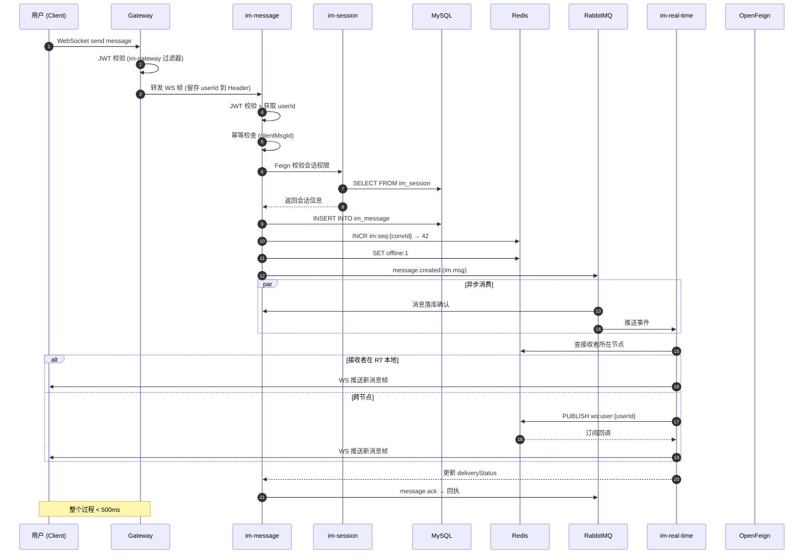

# 03 后端微服务架构设计

> **定位**：定义 12 个微服务的领域边界、DDD 四层结构、通信矩阵、服务治理与详细包结构。
> **更新时间**：2026-10-30

---

## 一、微服务拆分清单

| 服务名 | 端口 | 数据库 | 领域 | 聚合根 |
|--------|------|--------|------|--------|
| im-message | 8081 | im_msg | IM 核心-消息 | Message, Conversation |
| im-session | 8082 | im_sess | IM 核心-会话 | Session, SessionMember |
| im-group | 8083 | im_grp | IM 核心-群组 | Group, GroupMember |
| im-real-time | 8084 | 无状态 | 实时推送 | Connection, Presence |
| collab-task | 8085 | im_collab | 协同-审批/待办 | Approval, TodoItem |
| collab-calendar | 8086 | im_calendar | 协同-日历 | ScheduleEvent |
| collab-doc | 8087 | im_doc | 协同-文档 | Document, DocumentVersion |
| file-storage | 8088 | im_file | 文件存储 | FileAsset, ChunkUpload |
| platform-user | 8089 | im_user | 平台-用户/通讯录 | User, Department, Friend |
| admin-system | 8090 | im_admin | 管理后台 | AuditLog, SysConfig |
| platform-ai | 8091 | - | AI 助手 | - |
| platform-search | 8092 | - | 全局搜索 | - |

### 1.2 platform-ai (8091) 微服务骨架占位

> **对应审查报告**: 27-辅助功能审查 §问题 3 (P0)
> **审查结论**: platform-ai 是零实现的服务——仅有文档契约，无 Java 代码、无 Spring Boot 启动类、无 Nacos 注册配置。
> **当前开发阶段策略**: 本架构文档仅完成骨架占位设计，**留待后端开发阶段落地为完整 Java 模块**。
> **Gateway 路由**: doc 06 §十五已配置 `platform-ai → http://localhost:8091`
> **Nacos Data ID**: `im-ai.yaml`（**尚未创建**，标记为待实现）

#### 1.2.1 预期包结构（占位）

```text
ruoyi-im-ai/                               ← 待新建模块骨架目录（当前不存在）
├── pom.xml                                ← 父 pom: ruoyi-im-parent, 引入 spring-cloud-starter-openfeign + okhttp
└── src/main/java/com/ruoyi/im/ai/
    ├── AiApplication.java                 ← @SpringBootApplication + @EnableFeignClients
    ├── interfaces/
    │   └── rest/
    │       └── AiController.java          ← 4 个端点 (POST /im/ai/chat, POST /im/ai/chat/stream, GET /im/ai/models, GET /im/ai/status)
    ├── application/
    │   ├── AiChatService.java             ← 编排层：路由到对应 LlmProvider 适配器
    │   ├── SseResponseBuilder.java        ← SSE 帧编码 (data: / event: error)
    │   └── dto/{AiChatRequest, AiStreamChunk, AiModelDTO, AiStatusDTO}.java
    ├── domain/
    │   └── adapter/
    │       └── LlmProvider.java           ← 接口: chat()/stream(onChunk)/listModels()/isAvailable()
    └── infrastructure/
        ├── adapter/
        │   ├── OpenAiLlmAdapter.java      ← OpenAI 兼容 (DeepSeek/Qwen/OpenAI)
        │   └── LocalLlmAdapter.java       ← 内网自托管模型 (Ollama/VLLM 协议)
        └── config/
            └── AiProperties.java           ← @ConfigurationProperties("im.ai")
```

#### 1.2.2 适配器接口设计（占位）

```java
// domain/adapter/LlmProvider.java (接口)
public interface LlmProvider {
    String providerName();
    List<AiModelDTO> listModels();
    AiResponse chat(AiChatRequest request);
    void stream(AiChatRequest request, Consumer<AiStreamChunk> onChunk);
    boolean isAvailable();
}
```

#### 1.2.3 Nacos 配置骨架（im-ai.yaml，待创建）

```yaml
# Nacos Data ID: im-ai.yaml (待创建)
server:
  port: 8091

spring:
  application:
    name: platform-ai

im:
  ai:
    provider: ${AI_PROVIDER:deepseek}         # deepseek / openai / local
    api-key: ${AI_API_KEY:}
    base-url: ${AI_BASE_URL:https://api.deepseek.com}
    status-poll-interval: 30000              # doc 06 §十六 前端轮询 /im/ai/status 间隔 (ms)
    models:
      - id: deepseek-chat
        name: DeepSeek Chat
        maxTokens: 8192
      - id: gpt-4
        name: GPT-4
        maxTokens: 8192
```

#### 1.2.4 实现状态跟踪表

| 检查项 | 状态 | 说明 |
|--------|------|------|
| doc 03 微服务清单含 platform-ai (8091) | ✅ | §一 服务拆分清单 |
| doc 06 REST API 端点 (4 个) | ✅ | §十三 platform-ai API |
| doc 05 SSE 事件帧协议 | ✅ | §一 + §二 WebSocket 帧协议 |
| doc 06 §十六 SSE 协议细化 | ✅ (本轮补齐) | 错误/重试/超时定义 |
| doc 16 Gateway 路由 | ✅ | /im/ai/** → 8091 |
| ruoyi-im-ai Java 模块实现 | ❌ | **留待后端开发阶段** |
| Nacos Data ID: im-ai.yaml | ❌ | **留待后端开发阶段** |
| DDD 四层完整代码骨架 | ❌ | **留待后端开发阶段** |
| LlmProvider + 适配器实现 | ❌ | **留待后端开发阶段** |
| SSE 流式 Controller 实现 | ❌ | **留待后端开发阶段** |

### 1.3 Calendar RRULE 解析器（collab-calendar 8086 核心组件）

**库选型**: `org.dmfs/rfc5545-datetime` + 自研 `RruleRecurrenceIterator`（轻量迭代器，不引入 Google Calendar API 重依赖）

**算法**: RRULE → 时间序列迭代器

- 解析阶段: 验证 FREQ/BYDAY/INTERVAL/UNTIL/COUNT 合法性
- 迭代阶段: 按天展开月视图所需日期区间 ±1 个月（避免全量展开到 UNTIL）
- 异常处理: COUNT=0 / INTERVAL=0 / UNTIL 早于 DTSTART → 抛 `InvalidRruleException`

**缓存**: `im:calendar:rrule:{eventId}` 序列化后的最近 3 个月展开序列，TTL 1h

**性能**: 月视图展开（30 天）< 5ms；年视图展开（365 天）< 20ms

**cron 扫描**: 每日 00:05 全量重新生成重复事件的未来 30 天实例到 `im_calendar_event_instance` 表

### 1.3 Mermaid 时序图: 用户发送消息的服务调用链



## 二、DDD 分层结构 (每个微服务内部)

```text
com.ruoyi.im.{service}/
│
├── interfaces/                          ← 接口层 (输入适配)
│   ├── rest/
│   │   ├── MessageController.java       ← REST 端点
│   │   ├── SessionController.java
│   │   └── ...
│   ├── ws/
│   │   └── ChatWsEndpoint.java          ← WebSocket 端点
│   └── assembler/
│       ├── MessageAssembler.java        ← Entity → DTO 转换
│       └── SessionAssembler.java
│
├── application/                         ← 应用层 (编排 + 事务)
│   ├── MessageApplicationService.java   ← 发送消息编排
│   ├── SessionApplicationService.java   ← 会话管理编排
│   ├── dto/
│   │   ├── SendMessageCommand.java      ← 入参 Command
│   │   ├── MessageDTO.java              ← 出参 DTO
│   │   └── SessionDTO.java
│   └── event/
│       └── MessageSentEventListener.java ← 领域事件订阅
│
├── domain/                              ← 领域层 (核心业务规则)
│   ├── model/
│   │   ├── Message.java                 ← 聚合根
│   │   ├── MessageStatus.java           ← 值对象 (枚举)
│   │   └── MessageType.java             ← 值对象 (枚举)
│   ├── service/
│   │   └── MessageDomainService.java    ← 消息创建/撤回领域服务
│   └── event/
│       └── MessageSentEvent.java        ← 领域事件
│
└── infrastructure/                      ← 基础设施层 (技术实现)
    ├── repository/
    │   ├── MessageRepository.java       ← 接口
    │   └── MessageRepositoryImpl.java   ← MyBatis Plus 实现
    ├── adapter/
    │   └── XxxExternalAdapter.java     ← 外部适配器
    ├── messaging/
    │   └── RabbitMqEventPublisher.java ← 事件发布实现
    └── config/
        └── ServiceConfig.java           ← 本地配置
```

---

## 三、核心领域模型设计

### 3.1 im-message 服务

**Message 聚合根：**

```java
package com.ruoyi.im.message.domain.model;

@Data
@TableName("im_message")
public class Message {
    private Long id;                    // 雪花 ID
    private Long conversationId;        // 所属会话 ID
    private Long senderId;              // 发送者
    private MessageType type;           // 消息类型 (enum)
    private String content;             // 消息体 (TEXT存文本，其他存JSON)
    private MessageStatus status;       // 状态 (PENDING/SENDING/SENT/DELIVERED/FAILED/RECALLED)
    private Long serverSeq;             // 服务端序号 (会话内递增)
    private Long clientSeq;             // 客户端序号 (幂等去重)
    private LocalDateTime createTime;
    private LocalDateTime updateTime;
    private Integer delFlag;

    // 领域行为
    public boolean canRecall(Long byUserId, Duration within) {
        return this.senderId.equals(byUserId)
            && this.status == MessageStatus.SENT
            && Duration.between(this.createTime, LocalDateTime.now()).compareTo(within) <= 0;
    }

    public Message recall() {
        if (!canRecall(this.senderId, Duration.ofMinutes(5))) {
            throw new BusinessException(ImErrorCode.MESSAGE_RECALL_TIMEOUT);
        }
        this.status = MessageStatus.RECALLED;
        this.content = "[消息已撤回]";
        return this;
    }
}
```

**MessageDomainService：**

```java
package com.ruoyi.im.message.domain.service;

@Service
@RequiredArgsConstructor
public class MessageDomainService {
    private final MessageRepository messageRepo;
    private final ApplicationEventPublisher eventPublisher;

    /**
     * 创建消息（领域逻辑：分配 serverSeq，发布领域事件）
     */
    public Message createMessage(SendMessageCommand cmd) {
        Long serverSeq = messageRepo.nextServerSeq(cmd.getConversationId());

        Message message = Message.builder()
            .conversationId(cmd.getConversationId())
            .senderId(cmd.getSenderId())
            .type(cmd.getType())
            .content(cmd.getContent())
            .status(MessageStatus.SENT)
            .serverSeq(serverSeq)
            .clientSeq(cmd.getClientSeq())
            .createTime(LocalDateTime.now())
            .build();

        messageRepo.save(message);

        // 发布领域事件（非直接调用 WS）
        eventPublisher.publishEvent(new MessageSentEvent(this, message));
        return message;
    }

    public void recallMessage(Long msgId, Long byUserId) {
        Message msg = messageRepo.findById(msgId);
        msg.recall(byUserId);  // 领域行为
        messageRepo.save(msg);
        eventPublisher.publishEvent(new MessageRecalledEvent(this, msg));
    }
}
```

**MessageApplicationService (编排层)：**

```java
package com.ruoyi.im.message.application;

@Service
@RequiredArgsConstructor
public class MessageApplicationService {
    private final MessageDomainService domainService;
    private final ConversationRepository conversationRepo;
    private final MessageAssembler assembler;

    @Transactional
    public MessageDTO sendMessage(SendMessageCommand cmd) {
        // 1. 领域服务创建消息并持久化
        Message msg = domainService.createMessage(cmd);

        // 2. 更新会话最后消息
        conversationRepo.updateLastMessage(msg.getConversationId(), msg.getId(), msg.getServerSeq());

        // 3. 转换为 DTO 返回
        return assembler.toDTO(msg);
    }

    @Transactional
    public void recallMessage(Long msgId, Long userId) {
        domainService.recallMessage(msgId, userId);
        // 领域事件自动触发 WS 推送（由 Listener 处理）
    }
}
```

**REST Controller：**

```java
package com.ruoyi.im.message.interfaces.rest;

@RestController
@RequestMapping("/im/message")
@RequiredArgsConstructor
@Tag(name = "消息管理")
public class MessageController {

    private final MessageApplicationService applicationService;

    @PostMapping("/send")
    public Result<MessageDTO> sendMessage(@Valid @RequestBody SendMessageRequest request,
                                          @CurrentUser Long userId) {
        SendMessageCommand cmd = SendMessageCommand.fromRequest(request, userId);
        MessageDTO dto = applicationService.sendMessage(cmd);
        return Result.success(dto);
    }

    @PostMapping("/{msgId}/recall")
    public Result<Void> recallMessage(@PathVariable Long msgId,
                                      @CurrentUser Long userId) {
        applicationService.recallMessage(msgId, userId);
        return Result.success();
    }

    @GetMapping("/history")
    public Result<List<MessageDTO>> history(@RequestParam Long convId,
                                             @RequestParam Long beforeSeq,
                                             @RequestParam(defaultValue = "50") Integer limit) {
        return Result.success(applicationService.loadHistory(convId, beforeSeq, limit));
    }
}
```

---

## 四、服务间通信矩阵

| 调用方 → 被调方 | 协议 | 场景 |
|----------------|------|------|
| API Gateway → 全部微服务 | HTTP | 用户请求路由 |
| im-real-time → platform-user | gRPC | 校验用户在线状态 |
| im-message → im-session | OpenFeign | 发送消息后更新会话 lastMsg |
| im-message → Redis Pub/Sub | 发布 | 跨节点广播消息 |
| im-real-time → RabbitMQ | 消费 | 订阅 MessageSentEvent 触发推送 |
| collab-doc → file-storage | OpenFeign | 文档获取文件元数据 |
| admin-system → platform-user | OpenFeign | 管理后台查询用户列表 |

### 4.1 OpenFeign 示例

```java
@FeignClient(name = "im-session", contextId = "sessionClient")
public interface SessionClient {
    @GetMapping("/im/session/{convId}")
    Result<SessionDTO> getSession(@PathVariable Long convId);

    @PutMapping("/im/session/{convId}/last-msg")
    Result<Void> updateLastMsg(@PathVariable Long convId,
                                @RequestParam Long msgId,
                                @RequestParam Long serverSeq);
}
```

---

## 五、Nacos 服务治理

### 5.1 服务注册

```yaml
# 每个微服务的 application.yml
spring:
  application:
    name: im-message    # 服务名
  cloud:
    nacos:
      discovery:
        server-addr: ${NACOS_HOST:localhost}:8848
        namespace: im-prod
        group: IM_GROUP
```

### 5.2 配置中心

```yaml
# Nacos Data ID: im-message.yaml
server:
  port: 8081

spring:
  datasource:
    url: jdbc:mysql://${MYSQL_HOST:localhost}:3306/im_msg?useUnicode=true&characterEncoding=utf8
    username: ${MYSQL_USER:im}
    password: ${MYSQL_PASSWORD:}
    driver-class-name: com.mysql.cj.jdbc.Driver
    type: com.alibaba.druid.pool.DruidDataSource
    druid:
      initial-size: 5
      max-active: 20

mybatis-plus:
  configuration:
    map-underscore-to-camel-case: true
  global-config:
    db-config:
      id-type: ASSIGN_ID      # 雪花 ID      logic-delete-field: delFlag
      logic-delete-value: 1
      logic-not-delete-value: 0

# 自定义业务配置
im:
  security:
    jwt:
      secret: ${JWT_SECRET:}
      expiration: 7200000    # 2h
      refresh-expiration: 604800000  # 7d
  message:
    recall-within-minutes: 5
    max-content-length: 5000
  websocket:
    heartbeat-interval: 30000
    max-connections-per-node: 50000
```

---

## 六、WebSocket im-real-time 服务设计

### 6.1 独立部署的必要性

im-real-time 是无状态多实例服务，独立于业务服务部署：

- 长连接资源消耗大，与短请求 HTTP 服务线程模型不同
- 可独立扩缩容（连接数增长时只加 im-real-time 实例）
- 业务重启不影响 WebSocket 连接

### 6.2 核心组件

```java
// 连接管理器
@Component
public class ConnectionManager {
    // 本地连接表: userId -> ConcurrentHashMap<connectionId, WebSocketSession>
    private final ConcurrentHashMap<Long, ConcurrentHashMap<String, WebSocketSession>> localConnections
        = new ConcurrentHashMap<>();

    public void register(Long userId, String connId, WebSocketSession session) {
        localConnections.computeIfAbsent(userId, k -> new ConcurrentHashMap<>()).put(connId, session);
        // Redis 记录在线状态
        redisTemplate.opsForValue().set(
            "im:online:" + userId,
            InetAddress.getLocalHost().getHostAddress(),
            Duration.ofSeconds(120)
        );
    }

    public void unregister(Long userId, String connId) {
        var conns = localConnections.get(userId);
        if (conns != null) {
            conns.remove(connId);
            if (conns.isEmpty()) {
                localConnections.remove(userId);
                redisTemplate.delete("im:online:" + userId);
            }
        }
    }

    public void sendToUser(Long userId, WsFrame frame) {
        // 1. 本地直推
        var conns = localConnections.get(userId);
        if (conns != null && !conns.isEmpty()) {
            conns.values().forEach(s -> sendToSession(s, frame));
            return;
        }

        // 2. 跨节点：通过 Redis Pub/Sub
        String targetServer = redisTemplate.opsForValue().get("im:online:" + userId);
        if (targetServer != null) {
            redisTemplate.convertAndSend("ws:user:" + userId, JSON.toJSONString(frame));
        }
    }
}

// WS 端点（不注入业务 Service）
@Component
@ServerEndpoint(value = "/ws", configurator = WsTokenConfigurator.class)
public class ChatWsEndpoint {
    @Autowired private ConnectionManager connectionManager;
    @Autowired private ApplicationEventPublisher eventPublisher;

    @OnOpen
    public void onOpen(WebSocketSession session, @RequestParam String token) {
        Long userId = JwtUtils.parse(token);
        connectionManager.register(userId, session.getId(), session);
        eventPublisher.publishEvent(new UserConnectedEvent(userId));
    }

    @OnClose
    public void onClose(WebSocketSession session) {
        Long userId = (Long) session.getAttributes().get("userId");
        connectionManager.unregister(userId, session.getId());
        eventPublisher.publishEvent(new UserDisconnectedEvent(userId));
    }

    @OnMessage
    public void onMessage(WebSocketSession session, String payload) {
        WsFrame frame = JSON.parseObject(payload, WsFrame.class);
        switch (frame.getType()) {
            case "CHAT"     -> handleChatMessage(session, frame);
            case "TYPING"   -> handleTyping(frame);
            case "READ"     -> handleReadReceipt(frame);
            case "PING"     -> session.sendPong();
            case "CALL"     -> handleCallSignal(frame);
        }
    }
}
```

---

## 七、统一 API 响应

```java
// common/Result.java
@Data
public class Result<T> {
    private Integer code;
    private String msg;
    private T data;
    private Long timestamp;

    public static <T> Result<T> success(T data) {
        Result<T> r = new Result<>();
        r.code = 200;
        r.msg = "success";
        r.data = data;
        r.timestamp = System.currentTimeMillis();
        return r;
    }

    public static <T> Result<T> error(ImErrorCode errorCode) {
        Result<T> r = new Result<>();
        r.code = errorCode.getCode();
        r.msg = errorCode.getMsg();
        r.timestamp = System.currentTimeMillis();
        return r;
    }
}

// 全局异常处理
@RestControllerAdvice
@Slf4j
public class GlobalExceptionHandler {

    @ExceptionHandler(BusinessException.class)
    public Result<Void> handleBusiness(BusinessException e) {
        return Result.error(e.getErrorCode());
    }

    @ExceptionHandler(MethodArgumentNotValidException.class)
    public Result<Void> handleValidation(MethodArgumentNotValidException e) {
        String msg = e.getBindingResult().getFieldErrors().stream()
            .map(FieldError::getDefaultMessage).collect(Collectors.joining("; "));
        return Result.error(ImErrorCode.PARAM_ERROR.getCode(), msg);
    }

    @ExceptionHandler(Exception.class)
    public Result<Void> handleException(Exception e) {
        log.error("System error", e);
        return Result.error(ImErrorCode.SYSTEM_ERROR);
    }
}
```

---

## 八、变更记录

| 日期 | 变更 |
|------|
| 2026-10-30 | 定义 12 个微服务拆分 + DDD 四层结构 + 通信矩阵 + WS 独立服务设计 |
| 2026-05-07 | §1.2 新增 platform-ai (8091) 微服务骨架占位设计：包结构预览、LlmProvider 接口、Nacos 配置骨架、实现状态跟踪表（对齐 27-审查 §问题 3 P0） |
