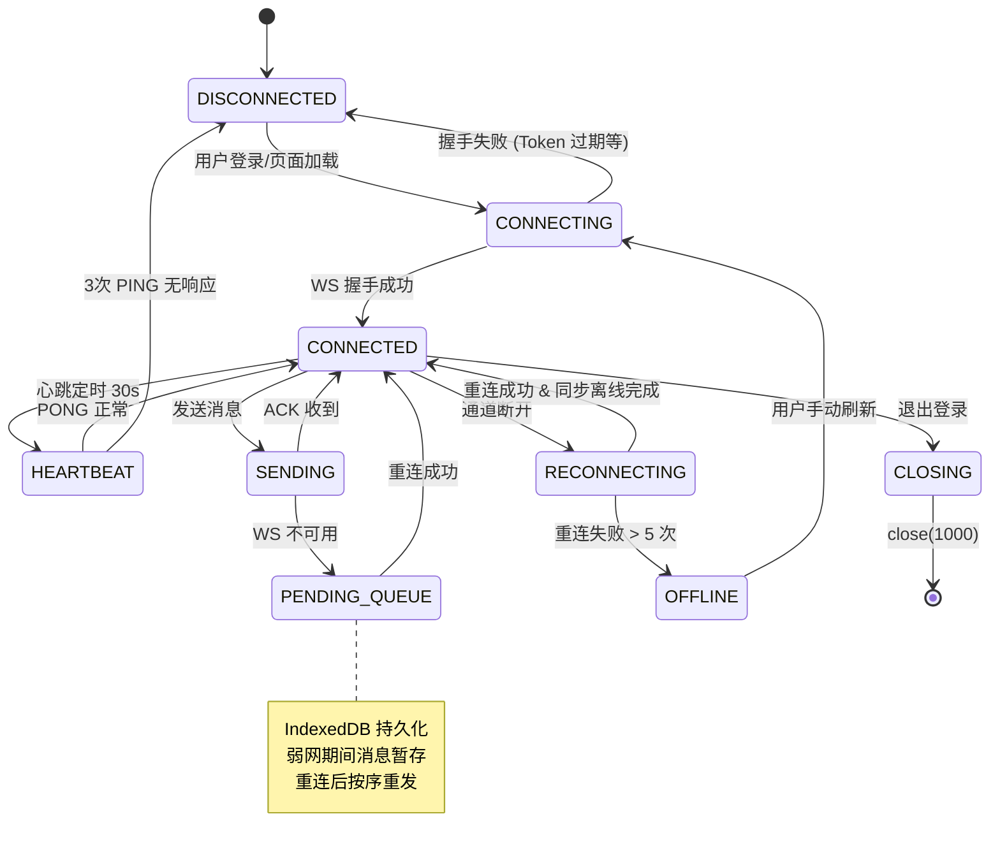
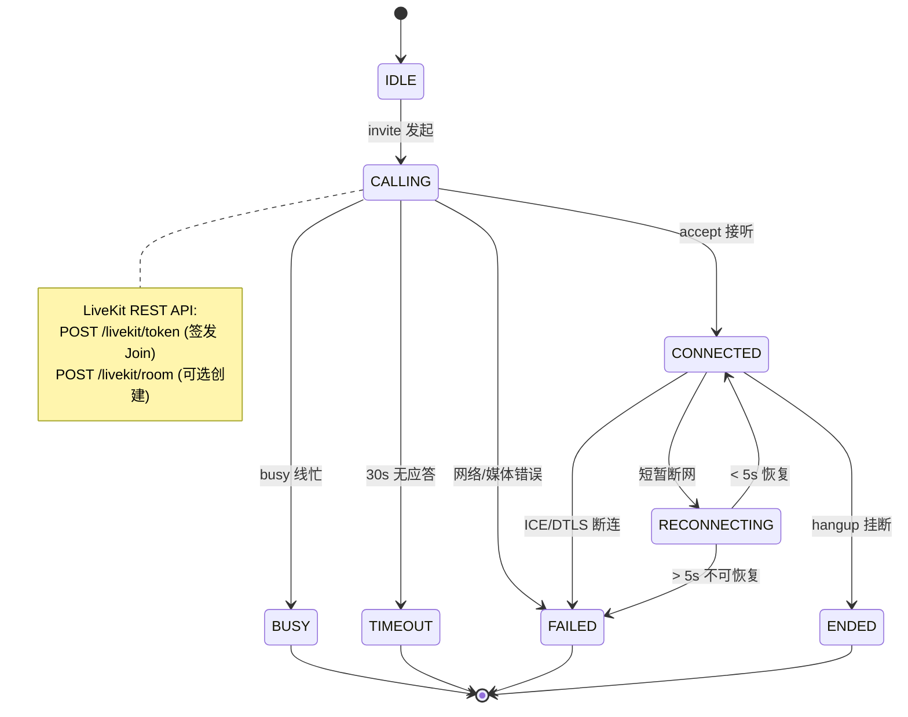

# 05 WebSocket 实时协议设计

> **定位**：定义完整的 WS 通信协议：帧结构、消息类型、事件、通话信令、心跳重连、可靠性机制、服务网格集成。
> **更新时间**：2026-10-30

---

## 一、连接架构

### 1.1 端点与网关

```text
客户端 (Browser / Electron)
    │
    │  WSS wss://{host}:443/im/ws?token={jwt}
    ▼
Nginx (WSS Gateway, ip_hash 粘性会话)
    │
    │  ws://im-real-time:8084/internal
    ▼
im-real-time 服务 (×3 实例)
    │
    ├── 本地推送 (userId → Session 命中)
    └── 跨节点 (Redis Pub/Sub → 目标实例 → 推送)
```

### 1.2 Nginx WSS 配置

```nginx
upstream im_real_time {
    ip_hash;                          # 粘性会话
    server 127.0.0.1:8084 weight=1;
    server 127.0.0.1:8084 weight=1;
    server 127.0.0.1:8084 weight=1;
}

server {
    listen 8443 ssl;
    server_name im.internal.com;

    ssl_certificate /etc/nginx/ssl/fullchain.pem;
    ssl_certificate_key /etc/nginx/ssl/privkey.pem;
    ssl_protocols TLSv1.2 TLSv1.3;

    # WS 路由：/im/ws → 后端 /ws (strip /im 前缀)
    location /im/ws {
        rewrite ^/im/ws/?(.*)$ /$1 break;
        proxy_pass http://im_real_time;
        proxy_http_version 1.1;
        proxy_set_header Upgrade $http_upgrade;
        proxy_set_header Connection "Upgrade";
        proxy_set_header Host $host;
        proxy_set_header X-Real-IP $remote_addr;
        proxy_read_timeout 3600s;     # WS 长连接 1h 超时
        proxy_send_timeout 3600s;
    }
}
```

---

## 二、统一帧结构 (WsFrame)

### 2.1 帧定义

```json
{
  "type": "MESSAGE | EVENT | CALL | ACK | PING | PONG",
  "action": "具体动作 (send/recall/react...)",
  "id": "客户端生成 UUID (幂等 + ACK 关联)",
  "timestamp": 1730000000000,
  "code": 0,
  "msg": "错误描述 (code≠0 时)",
  "data": {}
}
```

| 字段 | 类型 | 说明 |
|------|------|------|
| type | String | 路由类型（必填） |
| action | String | 动作名（必填） |
| id | UUID | 消息唯一 ID，ACK 时回传 |
| timestamp | Long | 服务端毫秒时间戳 |
| code | Int | 状态码（0=成功，非0=失败） |
| msg | String | 错误描述 |
| data | Object | 业务数据（按 type+action 变化） |

### 2.2 消息类型枚举

| type | action | 方向 | 说明 |
|------|--------|------|------|
| MESSAGE | send | C→S | 发送消息 |
| MESSAGE | receive | S→C | 新消息通知 |
| MESSAGE | recall | C→S | 撤回消息 |
| MESSAGE | recall_notify | S→C | 撤回广播 |
| MESSAGE | edit | C→S | 编辑消息 |
| MESSAGE | edit_notify | S→C | 编辑广播 |
| MESSAGE | react | C→S | 表情反应 |
| MESSAGE | react_notify | S→C | 反应广播 |
| EVENT | typing_start | C→S | 正在输入 |
| EVENT | typing_stop | C→S | 停止输入 |
| EVENT | typing_notify | S→C | 输入状态通知 |
| EVENT | read_receipt | C→S | 已读上报 |
| EVENT | read_notify | S→C | 已读通知 |
| EVENT | presence_online | S→C | 好友上线 |
| EVENT | presence_offline | S→C | 好友下线 |
| EVENT | session_update | S→C | 会话信息更新 |
| EVENT | group_role_change | S→C | 群成员身份变更（群主/管理员变更）| convId, userId, newRole (=OWNER/ADMIN/MEMBER), operatorId |
| EVENT | system_broadcast | S→C | 系统广播通知（仅管理员）| broadcastId, content, level |
| EVENT | ding | S→C | DING 通知 |
| EVENT | ding_notify | S→C | 新 DING 到达 | convId, dingId, level (=NORMAL/IMPORTANT/URGENT), creator, content |
| EVENT | ding_ack_notify | S→C | DING 被确认（仅发送方可见）| dingId, ackUserId, ackCount, totalCount |
| EVENT | ding_deadline | S→C | DING 截止未确认提醒 | dingId, deadline |
| EVENT | friend_request_notify | S→C | 好友申请到达 | requestId, fromUserId, fromUser, message |
| EVENT | friend_accept_notify | S→C | 好友申请已被对方接受 | friendId, friendName |
| EVENT | friend_change_notify | S→C | 好友关系变更 | userId, changeType (=ADD/REMOVE) |
| EVENT | group_member_change | S→C | 群成员变动 | convId, changeType (=JOIN/LEAVE/REMOVE), userId, operatorId |
| EVENT | group_announcement_update | S→C | 群公告更新 | convId, announcementId, operatorId, title |
| EVENT | approval_notify | S→C | 审批到达 (=待审批) | approvalId, type, title, applicant |
| EVENT | approval_result_notify | S→C | 审批结果 (=已通过/被驳回) | approvalId, result, comment |
| EVENT | approval_task_notify | S→C | 待审批提醒 (定时) | approvalId, type, title, applicant, deadline |
| EVENT | approval_notify_canceled | S→C | 审批通知已撤回 | approvalId, cancellerId |
| EVENT | todo_remind | S→C | 待办到期提醒 | todoId, title, dueTime |
| EVENT | todo_comment_remind | S→C | 待办有新评论 | todoId, commenter, comment |
| EVENT | calendar_remind | S→C | 日程开始提醒 | eventId, title, startTime, minutesBefore |
| CALL | invite | C→S | 发起通话 |
| CALL | accept | C→S | 接听 |
| CALL | reject | C→S | 拒接 |
| CALL | hangup | C→S | 挂断 |
| CALL | busy | S→C | 对方忙 |
| CALL | timeout | S→C | 超时未接 |
| CALL | offer | C↔S | SDP Offer |
| CALL | answer | C↔S | SDP Answer |
| CALL | ice | C↔S | ICE Candidate |
| ACK | - | S→C | 消息确认 |
| PING | - | C→S | 心跳 |
| PONG | - | S→C | 心跳响应 |

---

## 三、消息收发流程

### 3.1 客户端发送消息

```json
// C → S
{
  "type": "MESSAGE",
  "action": "send",
  "id": "550e8400-...",
  "timestamp": 1730000000000,
  "data": {
    "conversationId": 123456789,
    "msgType": "TEXT",
    "content": "你好!",
    "clientSeq": "client-uuid-seq-001",
    "quotedMsgId": null
  }
}

// S → C (ACK)
{
  "type": "ACK",
  "id": "550e8400-...",
  "timestamp": 1730000000100,
  "code": 0,
  "data": {
    "messageId": 987654321,
    "serverSeq": 42,
    "status": "SENT"
  }
}

// S → 接收方 (receive)
{
  "type": "MESSAGE",
  "action": "receive",
  "id": "auto-uuid-...",
  "timestamp": 1730000000200,
  "data": {
    "messageId": 987654321,
    "conversationId": 123456789,
    "senderId": 111,
    "msgType": "TEXT",
    "content": "你好!",
    "serverSeq": 42,
    "clientSeq": "client-uuid-seq-001",
    "createTime": "2026-10-30T10:30:00"
  }
}
```

### 3.3 消息操作帧 (撤回 / 编辑 / 回应)

#### 撤回 (REVOKE) — 2min 时限

```json
// C → S
{
  "type": "MESSAGE",
  "action": "recall",
  "id": "req-uuid-...",
  "data": { "msgId": 987654321 }
}

// S → 全群/对话双方 (广播)
{
  "type": "MESSAGE",
  "action": "recall_notify",
  "data": {
    "msgId": 987654321,
    "convId": 123456789,
    "operatorId": 111,
    "recallTime": 1730000005000
  }
}
```

#### 编辑 (EDIT) — 5min 时限

```json
// C → S
{
  "type": "MESSAGE",
  "action": "edit",
  "id": "req-uuid-...",
  "data": {
    "msgId": 987654321,
    "newContent": "修改后的文本"
  }
}

// S → 全群/对话双方 (广播)
{
  "type": "MESSAGE",
  "action": "edit_notify",
  "data": {
    "msgId": 987654321,
    "newContent": "修改后的文本",
    "editorId": 111,
    "edited": true,
    "editTime": 1730000010000
  }
}
```

#### 表情回应 (REACTION)

```json
// C → S
{
  "type": "MESSAGE",
  "action": "react",
  "id": "req-uuid-...",
  "data": {
    "msgId": 987654321,
    "emoji": "👍"
  }
}

// S → 全群/对话双方 (广播)
{
  "type": "MESSAGE",
  "action": "react_notify",
  "data": {
    "msgId": 987654321,
    "emoji": "👍",
    "userId": 222,
    "action": "add"   // add / remove
  }
}
```

#### 转发 (FORWARD) → 仅走 HTTP (见 doc 06 §2.2)

> 转发本质是"引用原消息 + 新建一条消息"，无独立 WS 帧，客户端组合实现。

### 3.4 服务端处理逻辑

```text
WS Endpoint 收到 type=MESSAGE action=send
    │
    ├── 1. 校验: 用户是否在会话中
    ├── 2. 幂等: SETNX im:idempotent:{clientSeq}
    │         (已存在 → 直接返回已缓存 ACK)
    ├── 3. 创建消息 (MessageDomainService.createMessage)
    │         → 分配 serverSeq (INCR im:seq:{convId})
    │         → 写入 im_message 表
    │         → 更新会话 lastMsg
    ├── 4. 发布领域事件 (MessageSentEvent)
    ├── 5. ACK 发送给发送方 (含 serverSeq)
    └── 6. 离线判断 → 在线:直推 / 离线:暂存 im_offline_message
```

---

## 四、通话信令协议

### 4.1 状态机

```text
IDLE → CALLING(invite) → CONNECTED(answer) → ENDED(hangup)
                   ↘ BUSY(busy)
                   ↘ TIMEOUT(timeout)

     任何状态 → FAILED(call error)
```

### 4.2 1v1 通话流程

```json
// 1. 发起方 → 服务端
{ "type": "CALL", "action": "invite", "data": {
    "targetUserId": 222,
    "callType": "AUDIO",  // or VIDEO
    "roomId": "room-uuid"
}}

// 2. 服务端 → 接收方
{ "type": "CALL", "action": "invite", "data": {
    "callerId": 111,
    "callType": "AUDIO",
    "roomId": "room-uuid"
}}

// 3. 接收方 → 服务端 (接听)
{ "type": "CALL", "action": "accept", "data": { "roomId": "room-uuid" }}

// 4. 服务端 → 发起方
{ "type": "CALL", "action": "accept", "data": { "roomId": "room-uuid", "calleeId": 222 }}

// 5. WebRTC SDP 交换 (通过 WS 中转)
{ "type": "CALL", "action": "offer", "data": { "roomId": "...", "sdp": "v=0..." }}
{ "type": "CALL", "action": "answer", "data": { "roomId": "...", "sdp": "v=0..." }}
{ "type": "CALL", "action": "ice", "data": { "roomId": "...", "candidate": {...} }}

// 6. 任一方挂断
{ "type": "CALL", "action": "hangup", "data": { "roomId": "room-uuid" }}

// 7. 服务端广播挂断
{ "type": "CALL", "action": "hangup", "data": { "roomId": "...", "reason": "NORMAL" }}
```

### 4.3 多人会议 (LiveKit SFU)

```text
客户端 → (LiveKit Client SDK) → LiveKit SFU Server
         (WebRTC P2P to SFU)

服务端职责 (Java 只签发 JWT + 调 REST API):
├── POST /livekit/room              → 创建房间
├── POST /livekit/token             → 签发 Join Token
├── DELETE /livekit/room/{name}      → 销毁房间
├── POST /livekit/egress/start       → 开始录制
└── GET  /livekit/egress/status      → 录制状态
```

---

## 五、心跳与重连

### 5.1 心跳协议

```text
客户端定时 (30s):
  C→S: { "type": "PING", "id": "ping-1", "timestamp": 1730000000000 }
  S→C: { "type": "PONG", "id": "ping-1", "timestamp": 1730000000050 }

超时判定:
  服务端: 连续 3 次 PING 无响应 → 注销 Session，清除 Redis 在线状态
  客户端: 90s 无 PONG → 判定断连，进入重连流程
```

### 5.2 重连策略

```text
断连事件
    │
    ├── 清除本地 connected 状态
    ├── UI 显示"连接中..."
    │
    ▼
指数退避重连 (含抖动):
    attempt=0: delay = 1000 + random(0,500) = 1.0~1.5s
    attempt=1: delay = 2000 + random(0,1000) = 2.0~3.0s
    attempt=2: delay = 4000 + random(0,2000) = 4.0~6.0s
    attempt=3: delay = 8000 + random(0,4000) = 8.0~12.0s
    attempt≥4: delay = 30000 (上限)
    │
    ├── 重连成功 → 请求离线消息 (sync_gap)
    └── 重连失败 → 继续下一次重连
```

> **重连上限**: 客户端最大重试 30 次（约 5 分钟后放弃）。超过后显示「连接已断开，请刷新页面」。
> 计算公式: delay = min(1000 * 2^attempt, 30000) ms，上限 30 次。
>
> **离线消息上限**: 单次拉取最大 100 条，客户端分页加载。超过 1000 条未读时显示「更多历史请查看完整聊天窗口」。

### 5.3 弱网发送队列

```text
用户点击发送：
    1. 消息入本地 pendingQueue (IndexedDB)
    2. UI 显示"发送中"状态
    3. WS.send(消息帧)
    │
    ├── 收到 ACK → 更新 messageId + serverSeq，标记已发送，移除 pendingQueue
    ├── 超时未 ACK → 标记失败，保留 pendingQueue
    │
    断连重连成功后：
    └── 遍历 pendingQueue → 按序重发未成功的消息
```

### 5.4 Mermaid 状态机: WS 连接生命周期



### 5.5 Mermaid 状态机: 通话信令



---

## 六、可靠性设计 (7 项强制机制)

| # | 机制 | 实现 | 防护 |
|---|------|------|------|
| 1 | 服务端序号排序 | serverSeq 会话内递增 (INCR) | 时钟偏移导致消息乱序 |
| 2 | 客户端序号去重 | clientSeq + Redis SETNX 幂等 | 重复消息投递 |
| 3 | 应用层 ACK | 持久化后回 ACK (含 serverSeq) | TCP发送成功≠业务成功 |
| 4 | 缺口检测 | 收到 serverSeq 不主动请求补拉 | 消息间隙静默丢失 |
| 5 | 游标分页 | `WHERE conv_id=? AND server_seq < ?` | OFFSET 深翻页性能衰减 |
| 6 | 抖动重连 | 退避 + random jitter | 重连风暴打垮服务 |
| 7 | 回执批量 | 300ms 窗口合并已读消息 | 高频群聊反噬主通道 |

### 6.1 serverSeq 同步流程

```text
客户端记录: lastReceivedSeq (会话内最新收到的 serverSeq)

收到新消息 serverSeq = 50，lastReceivedSeq = 48
    → 检测到缺口 (49 缺失)
    → 发起补拉:
      C→S: { "type": "EVENT", "action": "sync_gap", "data": { "convId": 123, "fromSeq": 48, "toSeq": 50 }}
      S→C: { "type": "EVENT", "action": "sync_gap_result", "data": { "messages": [...] }}
    → 补拉完成后更新 lastReceivedSeq = 50
```

### 6.2 批量已读回执

```text
客户端 300ms 窗口:
    window.start()
    收到消息1 → 标记已读
    收到消息2 → 标记已读
    收到消息3 → 标记已读
    window.flush() → 一次性上报:
    { "type": "EVENT", "action": "read_receipt", "data": { "convId": 123, "msgIds": [1,2,3], "readTime": "..." }}
```

---

## 七、帧类型速查表

| type | action | data 结构 | 触发方 |
|------|--------|----------|--------|
| MESSAGE | send | {convId, msgType, content, clientSeq} | C |
| MESSAGE | receive | {messageId, convId, senderId, msgType, content, serverSeq} | S |
| MESSAGE | recall | {messageId} | C |
| MESSAGE | recall_notify | {messageId, convId, operatorId} | S |
| MESSAGE | edit | {messageId, newContent} | C |
| MESSAGE | edit_notify | {messageId, newContent, editorId} | S |
| MESSAGE | react | {messageId, emoji} | C |
| MESSAGE | react_notify | {messageId, emoji, userId} | S |
| EVENT | typing_start | {convId} | C |
| EVENT | typing_stop | {convId} | C |
| EVENT | typing_notify | {convId, userId} | S |
| EVENT | read_receipt | {convId, msgIds} | C |
| EVENT | read_notify | {convId, userId, maxReadSeq} | S |
| EVENT | presence_online | {userId} | S |
| EVENT | presence_offline | {userId} | S |
| EVENT | session_update | {session, changes} | S |
| EVENT | group_role_change | {convId, userId, newRole, operatorId} | S |
| EVENT | system_broadcast | {broadcastId, content, level} | S |
| EVENT | ding | {dingId, convId, senderId, content, level} | S |
| EVENT | ding_notify | {convId, dingId, level, creator, content} | S |
| EVENT | ding_ack_notify | {dingId, ackUserId, ackCount, totalCount} | S |
| EVENT | ding_deadline | {dingId, deadline} | S |
| EVENT | friend_request_notify | {requestId, fromUserId, fromUser, message} | S |
| EVENT | friend_accept_notify | {friendId, friendName} | S |
| EVENT | friend_change_notify | {userId, changeType} | S |
| EVENT | group_member_change | {convId, changeType, userId, operatorId} | S |
| EVENT | group_announcement_update | {convId, announcementId, operatorId, title} | S |
| EVENT | approval_notify | {approvalId, type, title, applicant} | S |
| EVENT | approval_result_notify | {approvalId, result, comment} | S |
| EVENT | approval_task_notify | {approvalId, type, title, applicant, deadline} | S |
| EVENT | approval_notify_canceled | {approvalId, cancellerId} | S |
| EVENT | todo_remind | {todoId, title, dueTime} | S |
| EVENT | todo_comment_remind | {todoId, commenter, comment} | S |
| EVENT | calendar_remind | {eventId, title, startTime, minutesBefore} | S |
| EVENT | sync_gap | {convId, fromSeq, toSeq} | C |
| EVENT | sync_gap_result | {messages} | S |
| CALL | invite | {targetUserId, callType, roomId} | C |
| CALL | accept | {roomId} | C |
| CALL | reject | {roomId} | C |
| CALL | hangup | {roomId} | C |
| CALL | busy | {roomId} | S |
| CALL | timeout | {roomId} | S |
| CALL | offer | {roomId, sdp} | C |
| CALL | answer | {roomId, sdp} | C |
| CALL | ice | {roomId, candidate} | C |
| ACK | - | {requestId, ...payload} | S |
| PING | - | {} | C |
| PONG | - | {} | S |

---

## 八、变更记录

| 日期 | 变更 |
|------|------|
| 2026-10-30 | 完整定义 WsFrame 结构、28 个 type+action 组合、通话信令状态机、心跳重连策略、7 项可靠性机制 |
| 2026-10-30 | 补充 DING 全生命周期 EVENT 帧 (ding_notify/ack/deadline)、好友/群组/审批/待办/日历通知帧、群身份变更与系统广播帧，总计新增 14+ EVENT 类型 |

---

### 2.4 补充 EVENT Action（离线/实时双通道）

以下 EVENT action 已在 doc 02 前端 Store 设计中引用但尚未在本协议中注册。本期统一补充：

| action | direction | body | 触发条件 |
|--------|-----------|------|----------|
| friend_request_notify | server→client | `{ requestId, fromUser: {id, name, avatar}, message, createTime }` | B 向 A 发起好友申请 |
| friend_change_notify | server→client | `{ type: 'accepted'\|'rejected'\|'deleted', friendId, timestamp }` | 好友申请结果 / 好友删除 |
| group_member_change | server→client | `{ groupId, changeType: 'join'\|'leave'\|'kick', user: {id, name}, operator: {id, name}, timestamp }` | 群成员加入/被踢/退出 |
| group_announcement_update | server→client | `{ groupId, announcement: { id, title, content, publisherId, createTime } }` | 群公告新增/编辑/删除 |
| group_owner_transfer | server→client | `{ groupId, fromUserId, toUserId, timestamp }` | 群主转让 |
| group_dismiss_notify | server→client | `{ groupId, groupName, operator: {id, name}, timestamp }` | 群解散 |
| calendar_reminder | server→client | `{ eventId, title, startTime, reminderType: 'desktop'\|'inApp' }` | 日程到点（im-real-time 推送） |
| calendar_invite_response | server→client | `{ eventId, response: 'accepted'\|'rejected'\|'tentative', respondent: {id, name} }` | 参与者回复邀请 |
| calendar_event_change | server→client | `{ eventId, changeType: 'updated'\|'cancelled', title, startTime }` | 日程更新/取消 |
| email_received | server→client | `{ mailId, sender, subject, receivedTime, folder }` | 新邮件到达（MailProvider 轮询触发） |

> **约束**: 离线用户落库 im_offline_message，重连后批量投递；TTL 30 天。
