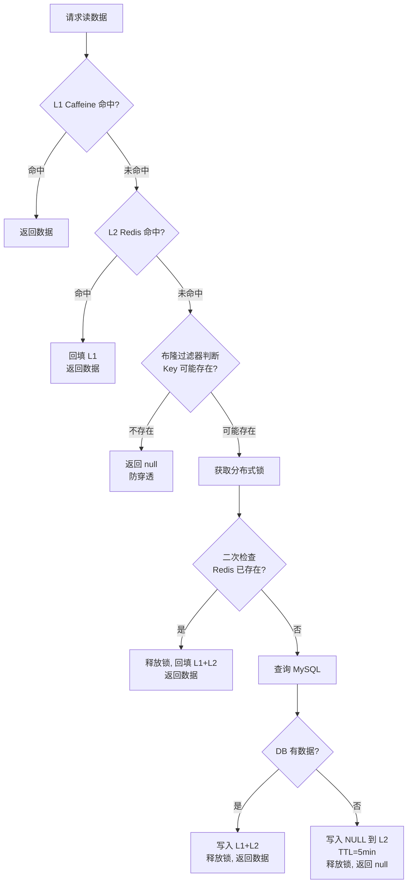
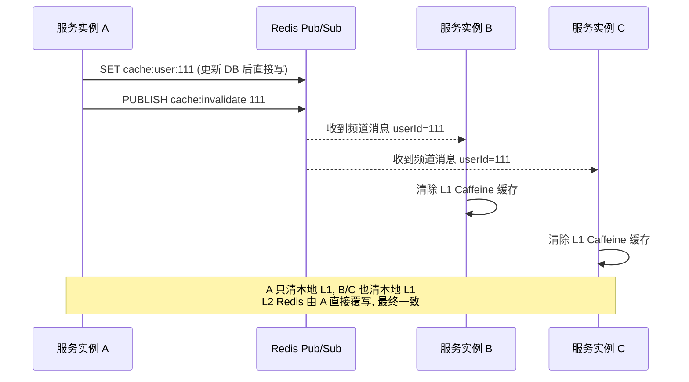
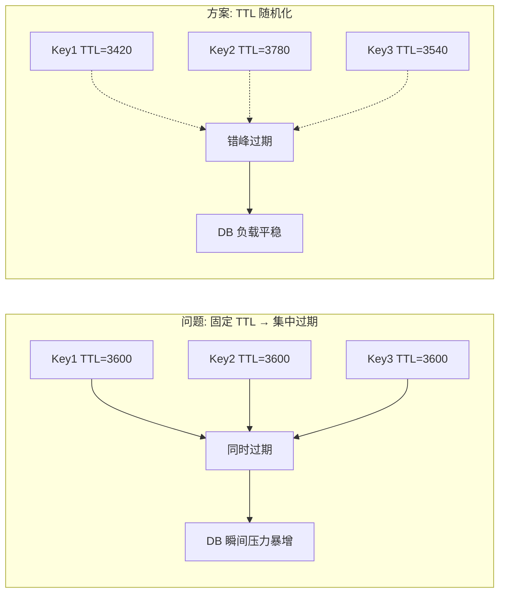

# 18 — 缓存策略完整规范

> 版本: v1.0 | 日期: 2026-10-30 | 作者: 架构组  
> 关联: 04-数据库设计.md, 08-中间件与第三方集成.md, 10-Docker部署与DevOps.md

---

## 一、缓存架构总览

### 1.1 缓存分层

```text
┌──────────────────────────────────────────────────────┐
│                    客户端 (Browser)                    │
│  LocalStorage / SessionStorage / IndexedDB            │
│  静态资源 (CDN + Service Worker)                       │
└────────────────┬─────────────────────────────────────┘
                 │ HTTP / WS
                 ▼
┌──────────────────────────────────────────────────────┐
│              API Gateway (Spring Cloud Gateway)        │
│  Caffeine 本地缓存 (限流计数 / 路由配置)                 │
└────────────────┬─────────────────────────────────────┘
                 │
                 ▼
┌──────────────────────────────────────────────────────┐
│              微服务内容 (每个 Spring Boot 实例)           │
│  Caffeine L1 进程内缓存 (高频读 / 极少变)                │
│  Lettuce Redis L2 分布式缓存 (跨实例共享)                │
└────────────────┬─────────────────────────────────────┘
                 │
                 ▼
┌──────────────────────────────────────────────────────┐
│              Redis Cluster (6 节点: 3 主 3 从)           │
│  DB0: 业务数据缓存                                     │
│  DB1: WS 节点路由 / 用户在线状态                         │
│  DB2: 分布式锁 / 幂等键                                 │
│  DB3: 会话 / Token 黑名单                               │
│  DB4: 限流计数器                                       │
└──────────────────────────────────────────────────────┘
                 │ (缓存未命中)
                 ▼
┌──────────────────────────────────────────────────────┐
│              MySQL 9 个数据库 (持久化层)                  │
└──────────────────────────────────────────────────────┘
```

### 1.2 Redis DB 分配

| DB | 用途 | 主要 Key 模式 | 过期策略 |
|----|------|--------------|---------|
| 0 | 业务数据缓存 | `cache:user:{id}` | TTL 1-24h |
| 1 | WS 路由 & 在线状态 | `ws:user:{userId}` | TTL 5min (心跳续期) |
| 2 | 分布式锁 & 幂等 | `lock:`, `mq:idempotent:` | TTL 10s-24h |
| 3 | Session & Token | `session:{userId}`, `token:blacklist:` | TTL 7d |
| 4 | 限流计数器 | `rate:{.userId}:{api}` | TTL 1min |

---

## 二、Redis 数据结构设计

### 2.1 用户信息缓存 (DB0)

```bash
# Hash: 用户基础信息 (缓存 2h)
HSET cache:user:111
  "userId"      "111"
  "username"    "zhangsan"
  "displayName" "张三"
  "avatar"      "http://minio:9000/im-avatar/111/photo.jpg"
  "deptId"      "10"
  "deptName"    "研发部"
  "status"      "ACTIVE"
  "phone"       "13800138001"
  "email"       "zhangsan@company.com"
  "roleCodes"   "[\"admin\",\"user\"]"
EXPIRE cache:user:111 7200

# 批量获取 (管道化)
HMGET cache:user:111 displayName avatar deptName status
```

### 2.2 用户好友列表 (DB0)

```bash
# Sorted Set: 好友列表 (按添加时间倒序)
ZADD cache:friend:111 1698765432000 112 113 114 115
# 分页查询
ZREVRANGE cache:friend:111 0 49 WITHSCORES
ZCARD cache:friend:111                  # 好友总数
ZSCORE cache:friend:111 112              # 检查是否为好友
EXPIRE cache:friend:111 86400            # 24h TTL
```

### 2.3 会话列表 (DB0)

```bash
# Sorted Set: 用户会话 (按最后活跃时间排序)
ZADD cache:session:list:111 1699500000000 1001 1002 1003
# 前 50 个会话
ZREVRANGE cache:session:list:111 0 49

# Hash: 单个会话摘要
HSET cache:session:1001
  "sessionId"    "1001"
  "type"        "P2P"
  "targetUserId" "112"
  "targetName"  "李四"
  "targetAvatar" "http://minio:9000/im-avatar/112/photo.jpg"
  "lastMsgId"   "50001"
  "lastMsgContent" "好的，明天见"
  "lastMsgTime" "1699500000000"
  "unreadCount" "3"
  "pinned"      "false"
EXPIRE cache:session:1001 86400
```

### 2.4 部门树 (DB0)

```bash
# String: 整个部门树序列化为 JSON (小型组织 < 1000 节点)
SET cache:dept:tree "{\"deptId\":1,\"name\":\"总公司\",\"children\":[...]}"
EXPIRE cache:dept:tree 3600                     # 1h, 部门变动少

# Hash: 用户ID → 部门ID
HSET cache:user:dept 111 10 112 10 113 20
# 查询用户部门
HGET cache:user:dept 111    → "10"
```

### 2.5 WS 节点路由 (DB1, 心跳续期)

```bash
# String: 用户当前连接的 WS 节点 (最核心)
SET ws:user:111 "node-A:8081" EX 300 NX     # 5min TTL
# 心跳续期
EXPIRE ws:user:111 300

# 反查: 某节点上有哪些用户 (用于节点下线时批量通知)
SADD ws:node:user:node-A:8081 111 112 113
EXPIRE ws:node:user:node-A:8081 300

# 用户在线状态 (presence)
HSET presence:user:111
  "status"    "ONLINE"          # ONLINE/AWAY/BUSY/OFFLINE
  "device"    "DESKTOP"         # DESKTOP/MOBILE/WEB
  "lastSeen"  "1699500000000"
  "node"      "node-A:8081"
```

### 2.6 分布式锁 (DB2)

```bash
# 简单锁 (Redisson 封装)
SET lock:user:111:operator "uuid-xxx" EX 10 NX
# 看门狗续期 (RedissonWatchDog, 每 10s 续期到 30s)

# 消息防重幂等键 (24h 过期)
SET mq:idempotent:a1b2c3d4 "1" EX 86400 NX

# 接口防重 (客户端 requestId 去重, 60s)
SET req:idempotent:req-uuid-xxx "1" EX 60 NX
```

### 2.7 Token 黑名单 (DB3)

```bash
# 登出/Token 失效时加入黑名单 (TTL = Token 剩余有效期)
SET token:blacklist:eyJhbGciOi... "logout" EX 7200
# 校验: 存在即失效
EXISTS token:blacklist:eyJhbGciOi...

# 用户所有 Token 版本号 (强制全员下线时递增)
SET token:version:111 "5"        # 每次全员登出 +1
# Token payload 携带版本号, 校验比对
```

### 2.8 限流计数器 (DB4)

```bash
# 滑动窗口限流: 用户维度 (60s 窗口)
ZADD rate:111:/im/message/send {timestamp} {uuid}
ZREMRANGEBYSCORE rate:111:/im/message/send 0 {now-60000}
ZCARD rate:111:/im/message/send              # 当前窗口请求数
EXPIRE rate:111:/im/message/send 60

# 令牌桶预留 (INCR + 原子操作填充)
# Lua 脚本实现原子限流
EVAL "local current = redis.call('incr', KEYS[1])\nif current == 1 then\n  redis.call('expire', KEYS[1], ARGV[1])\nend\nif current > tonumber(ARGV[2]) then\n  return 0\nend\nreturn 1" 1 rate:{userId}:{api} 60 100
```

### 2.9 消息缓存 (DB0)

```bash
# Sorted Set: 会话消息流 (按 serverSeq 排序, 缓存最近 200 条)
ZADD cache:msg:conv:1001 50001 "{\"messageId\":50001,\"senderId\":111,...}"
ZADD cache:msg:conv:1001 50002 "{\"messageId\":50002,\"senderId\":112,...}"

# 保持最多 200 条 (超出淘汰最旧)
ZREMRANGEBYRANK cache:msg:conv:1001 0 -201

# 查询: serverSeq > 48 的消息
ZRANGEBYSCORE cache:msg:conv:1001 49 +inf WITHSCORES

# Hash: 单条消息详情 (引用计数缓存)
HSET cache:msg:detail:50001 ... (同消息对象)
EXPIRE cache:msg:detail:50001 3600
```

---

## 三、缓存模式定义

### 3.1 Cache-Aside (旁路缓存) — 默认模式

```java
@Service
@RequiredArgsConstructor
public class UserQueryService {

    private final UserMapper userMapper;
    private final StringRedisTemplate redis;
    private final ObjectMapper objectMapper;

    private static final String USER_CACHE_KEY = "cache:user:";
    private static final Duration USER_CACHE_TTL = Duration.ofHours(2);

    public UserVO getById(Long userId) {
        String key = USER_CACHE_KEY + userId;

        // 1. 读缓存
        String json = redis.opsForValue().get(key);
        if (json != null) {
            if ("NULL".equals(json)) return null;  // 防穿透
            return objectMapper.readValue(json, UserVO.class);
        }

        // 2. 缓存未命中 → 查 DB
        UserEntity entity = userMapper.selectById(userId);
        if (entity == null) {
            // 防穿透: 写入空值 (短 TTL)
            redis.opsForValue().set(key, "NULL", Duration.ofMinutes(5));
            return null;
        }

        // 3. 写入缓存
        UserVO vo = UserConverter.toVO(entity);
        redis.opsForValue().set(key, objectMapper.writeValueAsString(vo), USER_CACHE_TTL);
        return vo;
    }

    // 写操作: 先更新 DB → 再删缓存 (非更新缓存)
    @Transactional
    public void updateUser(Long userId, UpdateUserCommand cmd) {
        UserEntity entity = userMapper.selectById(userId);
        UserConverter.applyCommand(entity, cmd);
        userMapper.updateById(entity);

        // 删除缓存 (下次 getById 重建)
        redis.delete(USER_CACHE_KEY + userId);

        // 发布缓存失效事件 (多实例同步)
        redis.convertAndSend("cache:invalidate", userId.toString());
    }
}
```

### 3.2 Read-Through (读穿) — 自定义 Repository

```java
/**
 * 缓存 Repository 装饰器: 自动填充缓存
 */
public class CachedMessageRepository implements MessageRepository {

    private final MessageRepository delegate;
    private final StringRedisTemplate redis;

    @Override
    public Optional<Message> findById(Long messageId) {
        String key = "cache:msg:detail:" + messageId;
        String json = redis.opsForValue().get(key);
        if (json != null) return deserialize(json);

        Optional<Message> msg = delegate.findById(messageId);
        msg.ifPresent(m -> redis.opsForValue().set(key, serialize(m), Duration.ofHours(1)));
        return msg;
    }

    @Override
    public void save(Message message) {
        delegate.save(message);
        redis.opsForValue().set("cache:msg:detail:" + message.getId(),
            serialize(message), Duration.ofHours(1));
    }
}
```

### 3.3 Write-Behind (异步写回) — 高频计数场景

```java
/**
 * 未读数计数: 先更新 Redis, 定时批量刷 DB
 */
@Service
public class UnreadCountService {

    private static final String UNREAD_KEY = "cache:unread:";

    public void increment(Long userId, Long sessionId, int delta) {
        redis.opsForHash().increment(UNREAD_KEY + sessionId, userId.toString(), delta);
        // 标记需要刷库 (延迟队列 30s 后批量刷)
        redis.opsForZSet().add("cache:unread:dirty", sessionId.toString(),
            System.currentTimeMillis() + 30_000);
    }

    public int getUnread(Long userId, Long sessionId) {
        Object val = redis.opsForHash().get(UNREAD_KEY + sessionId, userId.toString());
        return val == null ? 0 : Integer.parseInt(val.toString());
    }

    @Scheduled(fixedDelay = 30_000)
    public void flushToDatabase() {
        Set<ZSetOperations.TypedTuple<String>> dirtySet =
            redis.opsForZSet().rangeByScoreWithScores("cache:unread:dirty", 0, System.currentTimeMillis());
        if (dirtySet == null || dirtySet.isEmpty()) return;

        for (var tuple : dirtySet) {
            Long sessionId = Long.valueOf(tuple.getValue());
            Map<Object, Object> entries = redis.opsForHash().entries(UNREAD_KEY + sessionId);
            // 批量 UPDATE unread_count SET count = ? WHERE session_id = ? AND user_id = ?
            batchUpdate(sessionId, entries);
            redis.opsForZSet().remove("cache:unread:dirty", sessionId.toString());
        }
    }
}
```

### 3.4 Write-Through (同步双写) — 强一致场景

```java
/**
 * 配置变更: DB + 缓存同步更新 (配置数据可容忍短时不一致)
 */
@Service
public class SysConfigService {

    @Transactional
    public void updateConfig(String key, String value) {
        // 1. 写 DB
        configMapper.updateValue(key, value);

        // 2. 同步写 Redis (覆盖式)
        redis.opsForValue().set("cache:config:" + key, value, Duration.ofHours(24));

        // 3. 广播使其他实例缓存失效
        redis.convertAndSend("cache:invalidate:config", key);
    }
}
```

---

## 四、防穿透 / 防击穿 / 防雪崩

### 4.1 缓存穿透 (查询不存在的 Key)

```java
// 问题: 恶意查询不存在的 userId → 每次都打到 DB

// 方案: 布隆过滤器 + 空值缓存

@Component
public class UserBloomFilter {

    private final RBloomFilter<Long> bloomFilter;

    @PostConstruct
    public void init() {
        BloomFilterConfig config = new BloomFilterConfig(100_000_000, 0.001);
        this.bloomFilter = redisson.getBloomFilter("bf:user");
        bloomFilter.tryInit(config.getExpectedInsertions(), config.getFalseProbability());
    }

    public void addAllExistingUsers(List<Long> userIds) {
        userIds.forEach(bloomFilter::add);
    }

    public boolean mightContain(Long userId) {
        return bloomFilter.contains(userId);
    }
}

// Service 层使用:
public UserVO getByIdSafe(Long userId) {
    if (!bloomFilter.mightContain(userId)) {
        return null;           // 一定不存在, 直接返回
    }
    return getById(userId);   // 可能存在 → 走旁路缓存
}
```

### 4.2 缓存击穿 (热点 Key 过期瞬间)

```java
// 问题: 热门部门/群组信息 Key 过期 → 大量请求同时打 DB

// 方案: 互斥锁 + 逻辑过期

// 方案 A: 互斥锁
public DeptVO getDeptWithLock(Long deptId) {
    String key = "cache:dept:" + deptId;
    String json = redis.opsForValue().get(key);
    if (json != null) return deserialize(json);

    // 获取分布式锁重建缓存
    String lockKey = "lock:dept:" + deptId;
    boolean locked = Boolean.TRUE.equals(
        redis.opsForValue().setIfAbsent(lockKey, "1", Duration.ofSeconds(10)));
    if (locked) {
        try {
            // 二次检查 (其他线程已重建)
            json = redis.opsForValue().get(key);
            if (json != null) return deserialize(json);
            // 真正查 DB
            DeptVO dept = deptMapper.selectById(deptId);
            redis.opsForValue().set(key, serialize(dept), Duration.ofHours(1));
            return dept;
        } finally {
            redis.delete(lockKey);
        }
    } else {
        // 等待 50ms 后重试
        Thread.sleep(50);
        return getDeptWithLock(deptId);   // 递归重试
    }
}

// 方案 B: 逻辑过期 (不设 TTL, 数据带 expireTime)
@Data
public class CacheWithExpiry<T> {
    private T data;
    private LocalDateTime expireTime;

    public boolean isExpired() {
        return LocalDateTime.now().isAfter(expireTime);
    }
}

// 发现过期时异步重建, 当前线程返回旧数据
```

### 4.3 缓存雪崩 (大量 Key 同时过期)

```java
// 问题: 批量用户/会话缓存同时过期 → DB 被打爆

// 方案: TTL 随机化 + 多级缓存 + 熔断

// TTL 随机化 (基础 TTL ± 10%)
private Duration randomTtl(Duration base) {
    long seconds = base.getSeconds();
    long jitter = ThreadLocalRandom.current().nextLong(-seconds / 10, seconds / 10);
    return Duration.ofSeconds(seconds + jitter);
}

// 使用:
redis.opsForValue().set(key, json, randomTtl(Duration.ofHours(2)));
// 范围: 1.8h ~ 2.2h, 打散重建压力

// 多级缓存: Caffeine L1 (1min) + Redis L2 (2h)
@Cacheable(value = "userLocal", key = "#userId", cacheManager = "caffeineCacheManager")
public UserVO getWithLocalCache(Long userId) {
    // L1 miss → L2
    String json = redis.opsForValue().setIfAbsent(...);
    return deserialize(json);
}
```

### 4.4 缓存一致性策略矩阵

| 场景 | 一致性要求 | 推荐策略 | 实现方式 |
|------|-----------|---------|---------|
| 用户基础信息 | 最终一致 | Cache-Aside + 删除缓存 | 更新 DB → 删 Key → 发布失效事件 |
| 会话列表 | 最终一致 | Cache-Aside + 消息驱动 | 新消息 → MQ → 清对应会话缓存 |
| 部门/群组 | 强一致 | Write-Through | 事务中同步更新 DB + Redis |
| 未读数 | 最终一致 | Write-Behind | Redis INCR → 定时刷 DB |
| 配置/字典 | 强一致 | Write-Through + 广播 | 同步双写 + 失效广播 |
| WS 路由 | 强一致 | 心跳续期 + 主动清除 | 上下线时直接 SET/DEL |

---

## 五、Redis 客户端配置 (Lettuce)

### 5.1 application.yml

```yaml
spring:
  data:
    redis:
      cluster:
        nodes:
          - redis-node-1:6379
          - redis-node-2:6379
          - redis-node-3:6379
          - redis-node-4:6379
          - redis-node-5:6379
          - redis-node-6:6379
        max-redirects: 3
      lettuce:
        pool:
          max-active: 50
          max-idle: 20
          min-idle: 5
          max-wait: 200ms
        cluster:
          refresh:
            adaptive: true
            period: 30s      # 拓扑刷新
      timeout: 3000ms
      connect-timeout: 3000ms
```

### 5.2 RedisTemplate 配置

```java
@Configuration
public class RedisConfig {

    @Bean
    public RedisTemplate<String, String> redisTemplate(RedisConnectionFactory factory) {
        RedisTemplate<String, String> template = new RedisTemplate<>();
        template.setConnectionFactory(factory);

        StringRedisSerializer keySerializer = new StringRedisSerializer();
        GenericJackson2JsonRedisSerializer valueSerializer =
            new GenericJackson2JsonRedisSerializer();

        template.setKeySerializer(keySerializer);
        template.setHashKeySerializer(keySerializer);
        template.setValueSerializer(valueSerializer);
        template.setHashValueSerializer(valueSerializer);
        template.setDefaultSerializer(valueSerializer);

        template.setEnableTransactionSupport(false);   // 默认关闭事务
        template.afterPropertiesSet();
        return template;
    }

    @Bean
    public StringRedisTemplate stringRedisTemplate(RedisConnectionFactory factory) {
        return new StringRedisTemplate(factory);
    }

    @Bean
    public RedissonClient redissonClient(@Value("${spring.data.redis.cluster.nodes}") List<String> nodes) {
        Config config = new Config();
        ClusterServersConfig clusterConfig = config.useClusterServers();
        nodes.forEach(clusterConfig::addNodeAddress);
        clusterConfig.setMasterConnectionMinimumIdleSize(2);
        clusterConfig.setMasterConnectionPoolSize(16);
        clusterConfig.setSlaveConnectionMinimumIdleSize(2);
        clusterConfig.setSlaveConnectionPoolSize(16);
        return Redisson.create(config);
    }
}
```

---

## 六、Caffeine 本地缓存配置

### 6.1 双级缓存管理器

```java
@Configuration
public class CacheManagerConfig {

    // L1: 进程内缓存 (热点数据, TTL 1min)
    @Bean("caffeineCacheManager")
    public CacheManager caffeineCacheManager() {
        CaffeineCacheManager manager = new CaffeineCacheManager();
        manager.setCaffeine(Caffeine.newBuilder()
            .maximumSize(10_000)
            .expireAfterWrite(Duration.ofMinutes(1))
            .recordStats());
        return manager;
    }

    // L2: Redis 分布式缓存 (共享数据, TTL 2h)
    @Bean("redisCacheManager")
    public CacheManager redisCacheManager(RedisConnectionFactory factory) {
        RedisCacheConfiguration config = RedisCacheConfiguration.defaultCacheConfig()
            .entryTtl(Duration.ofHours(2))
            .serializeKeysWith(RedisSerializationContext.SerializationPair
                .fromSerializer(new StringRedisSerializer()))
            .serializeValuesWith(RedisSerializationContext.SerializationPair
                .fromSerializer(new GenericJackson2JsonRedisSerializer()))
            .disableCachingNullValues();

        return RedisCacheManager.builder(factory)
            .cacheDefaults(config)
            .withCacheConfiguration("user",
                config.entryTtl(Duration.ofHours(2)))
            .withCacheConfiguration("session",
                config.entryTtl(Duration.ofHours(24)))
            .withCacheConfiguration("dept",
                config.entryTtl(Duration.ofHours(1)))
            .withCacheConfiguration("config",
                config.entryTtl(Duration.ofHours(24)))
            .transactionAware()
            .build();
    }
}
```

### 6.2 本地缓存使用限制

| 限制 | 原因 |
|------|------|
| 仅缓存极少变动的数据 | 本地缓存无失效广播, 不一致风险高 |
| TTL ≤ 60s | 过期即更新, 控制不一致窗口 |
| maxSize ≤ 10000条目 | 防止 OOM |
| **禁止** 缓存 WS 路由、未读数、在线状态 | 强一致要求, 必须走 Redis |

---

## 七、缓存 Key 命名规范

### 7.1 命名格式

```text
{业务域}:{子域}:{标识符}[:{操作}]    TTL={值}s
```

### 7.2 Key 目录

| Key 模式 | 用途 | TTL | 更新时机 |
|----------|------|-----|---------|
| `cache:user:{userId}` | 用户信息 | 2h | 用户信息变更 |
| `cache:friend:{userId}` | 好友列表 | 24h | 好友变更事件 |
| `cache:session:list:{userId}` | 会话列表 (ZSet) | 24h | 会话变更事件 |
| `cache:session:{sessionId}` | 单会话摘要 | 24h | 新消息时更新 |
| `cache:msg:conv:{convId}` | 会话消息流 (ZSet) | 7d | 新消息追加 |
| `cache:msg:detail:{msgId}` | 单条消息详情 | 1h | 消息发送 |
| `cache:dept:tree` | 部门树 | 1h | 部门变更 |
| `cache:config:{key}` | 系统配置 | 24h | 配置更新 |
| `cache:unread:{sessionId}` | 未读数 (Hash) | 持久 | 实时更新 |

### 7.3 WS 路由 Key (DB1, 高频读写)

| Key 模式 | 用途 | TTL | 说明 |
|----------|------|-----|------|
| `ws:user:{userId}` | 用户当前节点 | 5min | 心跳续期 |
| `ws:node:user:{nodeId}` | 节点用户集合 | 5min | 节点下线时清理 |
| `presence:user:{userId}` | 用户状态 | 5min | 含设备/状态/最后活跃 |

### 7.4 锁 & 幂等 Key (DB2)

| Key 模式 | 用途 | TTL | 说明 |
|----------|------|-----|------|
| `lock:{resource}` | 分布式锁 | 10s | Redisson 看门狗续期 |
| `mq:idempotent:{msgId}` | MQ 消费幂等 | 24h | 消费前检查 |
| `req:idempotent:{reqId}` | 接口防重 | 60s | 客户端 requestId |

---

## 八、缓存监控与告警

### 8.1 关键 Metrics

```java
@Component
public class CacheMetrics {

    private final MeterRegistry meterRegistry;

    @Scheduled(fixedDelay = 30_000)
    public void reportHitRate() {
        // Redis INFO 命中统计
        Properties info = redis.execute(connection -> connection.serverCommands().info("stats"));
        long hits = Long.parseLong(info.getProperty("keyspace_hits"));
        long misses = Long.parseLong(info.getProperty("keyspace_misses"));
        double hitRate = hits + misses > 0 ? (double) hits / (hits + misses) : 0;

        meterRegistry.gauge("cache.redis.hit_rate", hitRate);
        meterRegistry.gauge("cache.redis.connected_slaves",
            Long.parseLong(info.getProperty("connected_slaves")));
        meterRegistry.gauge("cache.redis.used_memory",
            Long.parseLong(info.getProperty("used_memory")));
    }

    @Scheduled(fixedDelay = 60_000)
    public void reportKeyCount() {
        Long dbSize = redis.execute(connection -> connection.serverCommands().dbSize());
        meterRegistry.gauge("cache.redis.key_count", dbSize);
    }
}
```

### 8.2 告警阈值

| 指标 | 警告 | 严重 | 动作 |
|------|------|------|------|
| Redis 命中率 | < 85% | < 70% | 检查缓存策略 / 热点 Key |
| Redis 内存 | > 70% | > 85% | 清理过期 Key / 扩容 |
| Redis 连接数 | > 80% | > 95% | 扩容连接池 / 检查慢查询 |
| Key 数量 | > 500 万 | > 1000 万 | 检查内存泄漏 / 过期策略 |
| Caffeine 命中率 | < 80% | < 60% | 调整 maxSize / TTL |
| 缓存穿透率 | > 5% | > 15% | 启用布隆过滤器 |

---

## 九、Mermaid 图

### 9.1 缓存读写流程



### 9.2 缓存失效广播



### 9.3 缓存雪崩防护



---

## 十、变更记录

| 日期 | 变更 |
|------|------|
| 2026-10-30 | 初版: 5 级缓存分层、10+ Redis 数据结构、4 种缓存模式代码、穿透/击穿/雪崩防护、Caffeine L1 配置、Key 命名规范、监控告警阈值 |
