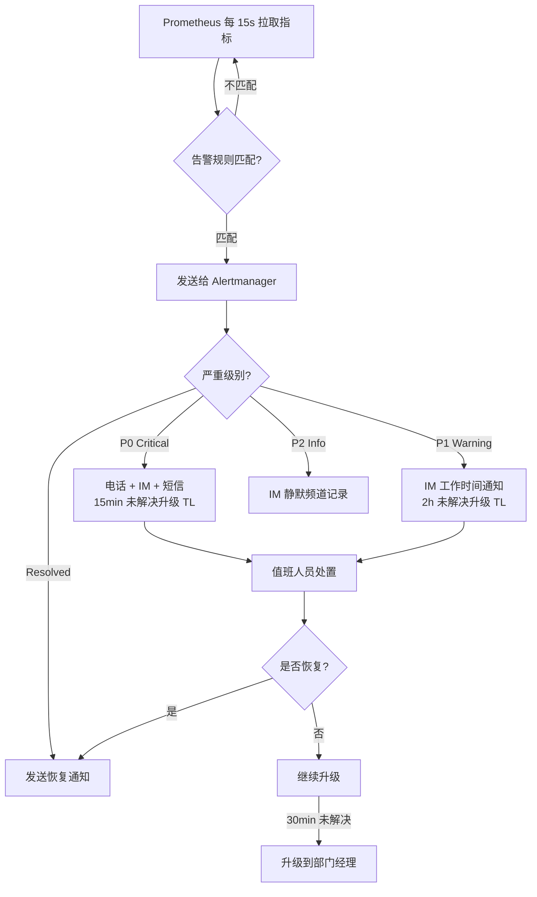
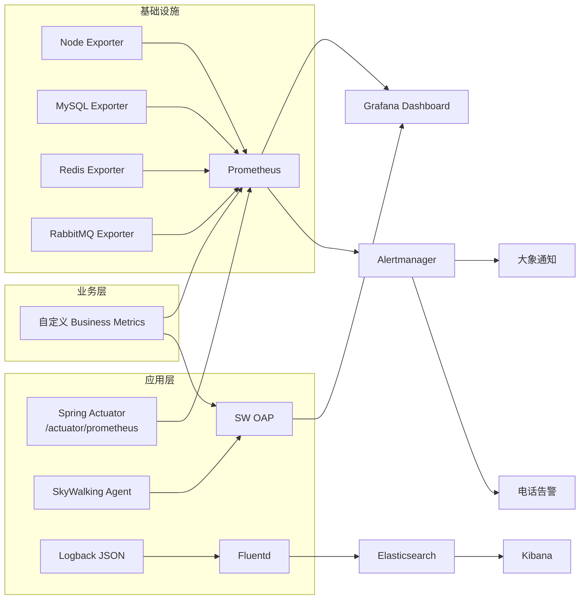

# 19 — 系统监控报警手册

> 版本: v1.0 | 日期: 2026-10-30 | 作者: 架构组  
> 关联: 01-系统上下文与部署架构.md, 10-Docker部署与DevOps.md

---

## 一、监控体系总览

### 1.1 三层监控模型

```text
┌─────────────────────────────────────────────────────────┐
│                   业务监控 (Business)                      │
│  消息发送成功率、登录成功率、在线用户数、通话接通率            │
├─────────────────────────────────────────────────────────┤
│                   应用监控 (Application)                   │
│  QPS、RT、JVM GC、线程池、HTTP 错误率、WS 连接数           │
├─────────────────────────────────────────────────────────┤
│                   基础设施监控 (Infrastructure)             │
│  CPU、内存、磁盘、网络、MySQL/Redis/RabbitMQ 中间件        │
└─────────────────────────────────────────────────────────┘
```

### 1.2 监控组件栈

| 组件 | 用途 | 端口 | 存储 |
|------|------|------|------|
| Prometheus | 指标采集 & 存储 | 9090 | 本地 SSD (15d retention) |
| Grafana | 可视化 Dashboard | 3000 | - |
| SkyWalking | 分布式链路追踪 | 11800 / 12800 | Elasticsearch |
| Alertmanager | 告警路由 & 通知 | 9093 | - |
| Node Exporter | 主机指标 | 9100 | - |
| MySQL Exporter | MySQL 指标 | 9104 | - |
| Redis Exporter | Redis 指标 | 9121 | - |
| RabbitMQ Exporter | MQ 指标 | 9419 | - |

---

## 二、Prometheus 配置

### 2.1 prometheus.yml

```yaml
global:
  scrape_interval: 15s
  evaluation_interval: 15s
  external_labels:
    cluster: 'im-prod'

# 告警规则
rule_files:
  - "rules/*.yml"

# 告警管理
alerting:
  alertmanagers:
    - static_configs:
        - targets: ['alertmanager:9093']

scrape_configs:
  # Spring Boot Actuator (所有 12 个微服务)
  - job_name: 'spring-boot'
    metrics_path: '/actuator/prometheus'
    consul_sd_configs:
      - server: 'consul:8500'
        services: ['im-message', 'im-session', 'im-real-time', 'im-group',
                   'im-call', 'im-todo', 'im-calendar', 'im-doc',
                   'im-file', 'platform-user', 'platform-admin', 'platform-ai',
                   'platform-search', 'im-gateway']
    relabel_configs:
      - source_labels: [__meta_consul_service]
        target_label: service
      - source_labels: [__meta_consul_node]
        target_label: instance

  # Node Exporter (每台物理机)
  - job_name: 'node'
    static_configs:
      - targets: ['node-exporter:9100']

  # MySQL Exporter
  - job_name: 'mysql'
    static_configs:
      - targets: ['mysql-exporter:9104']
        labels:
          instance: 'mysql-im'

  # Redis Exporter
  - job_name: 'redis'
    static_configs:
      - targets: ['redis-exporter:9121']

  # RabbitMQ Exporter
  - job_name: 'rabbitmq'
    static_configs:
      - targets: ['rabbitmq-exporter:9419']

  # SkyWalking OAP (自身监控)
  - job_name: 'skywalking'
    static_configs:
      - targets: ['skywalking-oap:1234']

  # Blackbox (HTTP/WS 存活探测)
  - job_name: 'blackbox-http'
    metrics_path: /probe
    params:
      module: [http_2xx]
    static_configs:
      - targets:
          - http://im-gateway:8080/im/auth/ping
          - http://im-gateway:8080/im/user/ping
    relabel_configs:
      - source_labels: [__address__]
        target_label: __param_target
      - target_label: __address__
        replacement: blackbox-exporter:9115

  - job_name: 'blackbox-ws'
    metrics_path: /probe
    params:
      module: [tcp_connect]
    static_configs:
      - targets:
          - im-real-time:8083
    relabel_configs:
      - source_labels: [__address__]
        target_label: __param_target
      - target_label: __address__
        replacement: blackbox-exporter:9115
```

### 2.2 告警规则 (rules/im-alerts.yml)

```yaml
groups:
  - name: im-service-down
    rules:
      # 微服务实例宕机
      - alert: ServiceInstanceDown
        expr: up{job="spring-boot"} == 0
        for: 30s
        labels:
          severity: critical
        annotations:
          summary: "微服务实例 {{ $labels.service }}/{{ $labels.instance }} 宕机"
          description: "{{ $labels.instance }} 已 30s 无法采集 metrics"

      # 所有实例都挂了
      - alert: ServiceAllDown
        expr: sum(up{job="spring-boot"}) by (service) == 0
        for: 1m
        labels:
          severity: critical
        annotations:
          summary: "服务 {{ $labels.service }} 全部实例宕机"

  - name: im-http-errors
    rules:
      # HTTP 5xx 错误率超阈值
      - alert: HighHttpErrorRate
        expr: |
          sum(rate(http_server_requests_seconds_count{status=~"5.."}[2m])) by (uri, service)
          /
          sum(rate(http_server_requests_seconds_count[2m])) by (uri, service) > 0.05
        for: 2m
 labels:
          severity: warning
        annotations:
          summary: "{{ $labels.service }} {{ $labels.uri }} 5xx 错误率 > 5% (当前 {{ $value | humanizePercentage }})"

      # HTTP RT 超过 SLA
      - alert: HighHttpResponseTime
        expr: |
          histogram_quantile(0.95, sum(rate(http_server_requests_seconds_bucket[5m])) by (le, service, uri)) > 1.0
        for: 3m
        labels:
          severity: warning
        annotations:
          summary: "{{ $labels.service }} P95 RT > 1s (当前 {{ $value }}s)"

  - name: im-jvm
    rules:
      # JVM 堆内存使用率高
      - alert: JvmHeapHigh
        expr: |
          sum(jvm_memory_used_bytes{area="heap"}) by (service, instance)
          /
          sum(jvm_memory_max_bytes{area="heap"}) by (service, instance) > 0.80
        for: 5m
        labels:
          severity: warning
        annotations:
          summary: "{{ $labels.service }}/{{ $labels.instance }} 堆内存 > 80%"

      # Full GC 频繁
      - alert: FrequentFullGC
        expr: |
          rate(jvm_gc_pause_seconds_count{gc="full"}[5m]) > 0.1
        for: 3m
        labels:
          severity: warning
        annotations:
          summary: "{{ $labels.service }} Full GC 频率 > 0.1/s"

      # 线程数超过阈值
      - alert: ThreadPoolHigh
        expr: |
          sum(jvm_threads_live_threads) by (service, instance) > 500
        for: 2m
        labels:
          severity: warning
        annotations:
          summary: "{{ $labels.service }} 线程数 > 500 (当前 {{ $value }})"

  - name: im-websocket
    rules:
      # WS 连接数异常
      - alert: WSConnectionDrop
        expr: |
          rate(im_ws_connections_total[5m]) < -5
        for: 1m
        labels:
          severity: warning
        annotations:
          summary: "WS 连接数在下降,可能有断连风暴"

      # WS 连接数超过阈值
      - alert: WSConnectionHigh
        expr: |
          im_ws_active_connections > 10000
        for: 5m
        labels:
          severity: warning
        annotations:
          summary: "WS 在线连接数超过 10K (当前 {{ $value }})"

  - name: im-business
    rules:
      # 消息发送失败率高
      - alert: HighMessageFailureRate
        expr: |
          rate(im_message_send_failed_total[5m])
          /
          rate(im_message_send_total[5m]) > 0.02
        for: 2m
        labels:
          severity: critical
        annotations:
          summary: "消息发送失败率 > 2% (当前 {{ $value | humanizePercentage }})"

      # 登录失败率高
      - alert: HighLoginFailureRate
        expr: |
          rate(im_login_failed_total[5m])
          /
          rate(im_login_total[5m]) > 0.10
        for: 3m
        labels:
          severity: warning
        annotations:
          summary: "登录失败率 > 10%, 可能存在攻击"

      # 通话接通率下降
      - alert: LowCallAnswerRate
        expr: |
          rate(im_call_answered_total[10m])
          /
          rate(im_call_invite_total[10m]) < 0.70
        for: 10m
        labels:
          severity: warning
        annotations:
          summary: "通话接通率 < 70%, LiveKit 可能异常"

  - name: im-middleware
    rules:
      # MySQL 慢查询
      - alert: MySQLSlowQueries
        expr: |
          rate(mysql_global_status_slow_queries[5m]) > 1
        for: 3m
        labels:
          severity: warning
        annotations:
          summary: "MySQL 慢查询速率 > 1/s ({{ $value }} slow queries/s)"

      # MySQL 连接数满
      - alert: MySQLConnectionFull
        expr: |
          mysql_global_status_threads_connected / mysql_global_variables_max_connections > 0.85
        for: 1m
        labels:
          severity: critical
        annotations:
          summary: "MySQL 连接数 > 85% ({{ $value | humanizePercentage }})"

      # Redis 内存使用
      - alert: RedisMemoryHigh
        expr: |
          redis_memory_used_bytes / redis_memory_max_bytes > 0.85
        for: 5m
        labels:
          severity: warning
        annotations:
          summary: "Redis 内存 > 85% ({{ $value | humanizePercentage }})"

      # Redis 主从延迟
      - alert: RedisReplicationLag
        expr: |
          redis_connected_slaves < 3
        for: 1m
        labels:
          severity: critical
        annotations:
          summary: "Redis 仅 {{ $value }} 个从节点在线, 可能发生主从切换"

      # RabbitMQ 队列积压
      - alert: RabbitMQQueueBacklog
        expr: |
          rabbitmq_queue_messages_ready{queue=~"im\\..*"} > 5000
        for: 3m
        labels:
          severity: warning
        annotations:
          summary: "RabbitMQ 队列 {{ $labels.queue }} 积压 > 5000 条"

      # RabbitMQ 节点内存告警
      - alert: RabbitMQMemoryHigh
        expr: |
          rabbitmq_node_mem_used / rabbitmq_node_mem_limit > 0.80
        for: 2m
        labels:
          severity: warning
        annotations:
          summary: "RabbitMQ {{ $labels.node }} 内存水位 > 80%, 即将流控"

  - name: im-disk-network
    rules:
      # 磁盘空间不足
      - alert: DiskSpaceLow
        expr: |
          (node_filesystem_avail_bytes{mountpoint="/"} / node_filesystem_size_bytes{mountpoint="/"}) < 0.15
        for: 1m
        labels:
          severity: critical
        annotations:
          summary: "主机 {{ $labels.instance }} 根分区剩余 < 15%"

      # 磁盘 inode 不足
      - alert: DiskInodeLow
        expr: |
          (node_filesystem_files_free{mountpoint="/"} / node_filesystem_files{mountpoint="/"}) < 0.10
        for: 1m
        labels:
          severity: critical
        annotations:
          summary: "主机 {{ $labels.instance }} inode 剩余 < 10%"
```

---

## 三、自定义业务 Metrics

### 3.1 微服务注册 Micrometer

```java
@Configuration
public class MetricsConfig {

    @Bean
    MeterRegistryCustomizer<MeterRegistry> metricsCommonTags() {
        return registry -> registry.config()
            .commonTags("application", "im-message")
            .commonTags("env", "prod");
    }
}

// 业务自定义计数器
@Component
@RequiredArgsConstructor
public class MessageMetrics {

    private final MeterRegistry registry;

    // 消息发送总数
    public void recordMessageSend(boolean success, String msgType) {
        registry.counter("im_message_send_total",
            "success", String.valueOf(success),
            "msg_type", msgType
        ).increment();
    }

    // 消息发送失败
    public void recordMessageSendFailed(String reason) {
        registry.counter("im_message_send_failed_total",
            "reason", reason  // NETWORK/TIMEOUT/PERMISSION/IDEMPOTENT
        ).increment();
    }

    // 消息发送耗时
    public Timer.Sample startTimer() {
        return Timer.start(registry);
    }

    public void recordMessageLatency(Timer.Sample sample, String msgType) {
        sample.stop(registry.timer("im_message_send_duration",
            "msg_type", msgType));
    }
}

// WS 连接指标
@Component
public class WSMetrics {

    private final MeterRegistry registry;

    // 当前活跃 WS 连接数 (Gauge)
    @PostConstruct
    public void init() {
        Gauge.builder("im_ws_active_connections",
            connectionManager,
            ConnectionManager::getActiveCount)
            .description("当前 WebSocket 活跃连接数")
            .register(registry);
    }

    // WS 连接变化速率 (Counter)
    public void recordConnectionChange(String action) {
        registry.counter("im_ws_connections_total",
            "action", action  // CONNECT/DISCONNECT/TIMEOUT/ERROR
        ).increment();
    }
}
```

### 3.2 SkyWalking OAP 配置

```yaml
# docker-compose 中 SkyWalking OAP
oap:
  image: apache/skywalking-oap-server:9.7.0
  environment:
    SW_STORAGE: elasticsearch
    SW_ES_USER: elastic
    SW_ES_PASSWORD: changeme
    SW_ES_CLUSTER_NODES: elasticsearch:9200
    SW_CORE_GRPC_PORT: 11800
    SW_CORE_REST_PORT: 12800
    SW_QUERY_MAX_QUERY_COMPLEXITY: 1000
    SW_STORAGE_ES_BULK_ACTIONS: 3000
    SW_STORAGE_ES_BULK_SIZE: 50
    SW_STORAGE_ES_FLUSH_INTERVAL: 5
```

### 3.3 SkyWalking Agent 配置 (每个微服务挂载)

```yaml
# docker-compose 中每个微服务的环境变量
environment:
  SW_AGENT_NAME: im-message
  SW_AGENT_COLLECTOR_BACKEND_SERVICES: skywalking-oap:11800
  SW_AGENT_SPAN_LIMIT: 3000
  SW_AGENT_SAMPLE: 100                      # 生产环境采样率 100%
  SW_AGENT_IGNORE_SUFFIX: .jpg,.js,.css,.png,.ico,.svg,.woff,.woff2
  SW_LOGGING_LEVEL: WARN
  SW_PLUGINS_ES_SQL_BODY_MAX_LENGTH: 4096
```

---

## 四、Grafana Dashboard 设计

### 4.1 Dashboard 清单

| Dashboard | 用途 | 刷新频率 | 关键面板 |
|-----------|------|---------|---------|
| IM-总览 | 全局健康总览 | 30s | 在线用户数、消息吞吐、P95 RT、错误率 |
| IM-消息服务 | im-message 深度 | 15s | 发送量、发送延迟、MQ 消费堆积 |
| IM-WS 实时 | im-real-time 深度 | 15s | WS 连接数、PUSH 延迟、断连率 |
| IM-登录认证 | platform-user | 15s | 登录量、失败率、JWT 签发频次 |
| IM-数据库 | MySQL 9 实例 | 30s | 连接数、慢查询、QPS/TPS、主从延迟 |
| IM-Redis | Redis 集群 | 30s | 内存、命中率、连接数、Key 数 |
| IM-RabbitMQ | MQ 集群 | 30s | 队列深度、消费速率、积压趋势 |
| IM-JVM | 所有 Java 服务 | 30s | 堆内存、GC、线程数、类加载 |
| IM-主机 | 物理机/容器 | 30s | CPU、内存、磁盘、网络 |
| IM-业务 | 核心业务指标 | 1min | 活跃用户数、消息送达率、通话接通率 |

### 4.2 IM-总览 Dashboard JSON 片段

```json
{
  "title": "IM 总览",
  "uid": "im-overview",
  "refresh": "30s",
  "panels": [
    {
      "title": "当前在线用户",
      "type": "stat",
      "targets": [{ "expr": "sum(im_ws_active_connections)" }],
      "thresholds": { "steps": [
        { "color": "red", "value": 0 },
        { "color": "yellow", "value": 5000 },
        { "color": "green", "value": 10000 }
      ]}
    },
    {
      "title": "消息发送 N/s",
      "type": "timeseries",
      "targets": [{ "expr": "sum(rate(im_message_send_total{success='true'}[1m]))" }]
    },
    {
      "title": "消息 P95 延迟",
      "type": "gauge",
      "targets": [{ "expr": "histogram_quantile(0.95, sum(rate(im_message_send_duration_bucket[5m])) by (le))" }],
      "thresholds": { "steps": [
        { "color": "green", "value": 0 },
        { "color": "yellow", "value": 0.5 },
        { "color": "red", "value": 1.0 }
      ]}
    },
    {
      "title": "HTTP 5xx 错误率",
      "type": "timeseries",
      "targets": [{ "expr": "sum(rate(http_server_requests_seconds_count{status=~'5..'}[1m])) / sum(rate(http_server_requests_seconds_count[1m]))" }]
    },
    {
      "title": "各服务实例数",
      "type": "bargauge",
      "targets": [{ "expr": "count(up{job='spring-boot'}) by (service)" }]
    }
  ]
}
```

### 4.3 IM-WS 实时 Dashboard

```json
{
  "title": "IM WS 实时",
  "uid": "im-ws",
  "refresh": "15s",
  "panels": [
    {
      "title": "当前活跃连接数",
      "type": "timeseries",
      "targets": [{ "expr": "im_ws_active_connections", "legendFormat": "{{instance}}" }]
    },
    {
      "title": "每秒新增/断开",
      "type": "timeseries",
      "targets": [
        { "expr": "sum(rate(im_ws_connections_total{action='CONNECT'}[1m]))", "legendFormat": "连接" },
        { "expr": "sum(rate(im_ws_connections_total{action='DISCONNECT'}[1m]))", "legendFormat": "断开" },
        { "expr": "sum(rate(im_ws_connections_total{action='TIMEOUT'}[1m]))", "legendFormat": "超时" }
      ]
    },
    {
      "title": "消息推送延迟 (P99)",
      "type": "stat",
      "targets": [{ "expr": "histogram_quantile(0.99, sum(rate(im_wsbucket[1m])) by (le))" }],
      "thresholds": { "steps": [
        { "color": "green", "value": 0 },
        { "color": "yellow", "value": 0.2 },
        { "color": "red", "value": 0.5 }
      ]}
    },
    {
      "title": "跨节点广播计数",
      "type": "timeseries",
      "targets": [{ "expr": "sum(rate(im_ws_publish_total[1m]))" }]
    }
  ]
}
```

---

## 五、告警通知路由

### 5.1 Alertmanager 配置

```yaml
global:
  resolve_timeout: 5m

route:
  receiver: 'default'
  group_by: ['alertname', 'service']
  group_wait: 10s
  group_interval: 30s
  repeat_interval: 4h

  routes:
    # P0: 立即电话通知
    - match:
        severity: critical
      receiver: 'critical-pager'
      group_wait: 0s
      repeat_interval: 15m

    # P1: 大象消息通知 (工作时间)
    - match:
        severity: warning
      receiver: 'dingtalk-warning'
      group_wait: 20s
      repeat_interval: 2h
      active_time_intervals:
        - workhours

receivers:
  - name: 'default'
    dingtalk_configs:
      - webhook_url: 'https://oapi.dingtalk.com/robot/send?access_token=xxx'
        title: '[IM 告警] {{ .GroupLabels.alertname }}'
        text: |
          {{ range .Alerts }}
          **级别**: {{ .Labels.severity }}
          **服务**: {{ .Labels.service }}
          **摘要**: {{ .Annotations.summary }}
          **时间**: {{ .StartsAt.Format "2006-01-02 15:04:05" }}
          {{ end }}

  - name: 'critical-pager'
    webhook_configs:
      - url: 'https://pager.company.com/webhook/im'
        send_resolved: true
    dingtalk_configs:
      - webhook_url: 'https://oapi.dingtalk.com/robot/send?access_token=critical'
        title: '🚨 [IM 严重告警] {{ .GroupLabels.alertname }}'

  - name: 'dingtalk-warning'
    dingtalk_configs:
      - webhook_url: 'https://oapi.dingtalk.com/robot/send?access_token=warning'
        title: '⚠️ [IM 警告] {{ .GroupLabels.alertname }}'
        text: |
          {{ range .Alerts }}
          - {{ .Annotations.summary }}
          {{ end }}

time_intervals:
  - name: workhours
    time_intervals:
      - times:
          - start_time: '09:00'
            end_time: '21:00'
        weekdays: ['monday:friday']
```

### 5.2 告警级别 & SLA

| 级别 | 触发条件 | 通知方式 | 响应时间 | 升级策略 |
|------|---------|---------|---------|---------|
| **P0 (严重)** | 服务全宕 / 消息全失败 / DB 全断 | 电话 + IM + 短信 | 5min | 15min 未解决升级 TL |
| **P1 (警告)** | 单实例宕 / 错误率升高 / RT 超标 | IM 通知 | 30min | 1h 未解决升级 TL |
| **P2 (提醒)** | 磁盘预警 / 内存预警 / 连接数预警 | IM (静默频道) | 2h | 次日处理 |
| **P3 (信息)** | 业务数据日报 / 趋势信息 | 仅日志记录 | 无 | 无 |

### 5.3 常见告警处置手册

| 告警名 | 可能原因 | 处置步骤 |
|--------|---------|---------|
| ServiceInstanceDown | OOM / 进程崩溃 / 容器驱逐 | 1. 查 Elasticsearch 日志 2. 触发自动重启 3. 保留 heap dump |
| HighHttpErrorRate | DB 慢 / 下游服务异常 / NPE | 1. SkyWalking 查 trace 2. 定位异常 URI 3. 查看 exception 日志 |
| HighMessageFailureRate | Redis 满 / WS 连接异常 | 1. 查 Redis 是否可写 2. 检查 RT 节点状态 |
| MySQLConnectionFull | 慢连接未释放 / 连接池满 | 1. kill 慢查询 2. 扩容 max_connections 3. 检查是否有连接泄漏 |
| RedisMemoryKeyEvict | 内存满开始驱逐 | 1. 评估被驱逐 Key 是否关键 2. 扩容内存 3. 检查过期策略 |
| WSConnectionDrop | 网络抖动 / 服务端重启 / 心跳超时 | 1. 检查 Nginx/网关层 2. 客户端指数退避重连 |
| RabbitMQQueueBacklog | 消费者挂了 / 消费速度跟不上 | 1. 检查消费者实例数 2. 扩容消费者 3. 启用背压控制 |

---

## 六、日志体系

### 6.1 日志收集架构

```text
[微服务 stdout JSON] → [Fluentd] → [Elasticsearch] → [Kibana]
                                                         ↓
                                                   SkyWalking UI
```

### 6.2 Logback 配置 (logback-spring.xml)

```xml
<included>
    <!-- 输出到 stdout (Fluentd 采集) -->
    <appender name="JSON_STDOUT" class="ch.qos.logback.core.ConsoleAppender">
        <encoder class="net.logstash.logstash.LogstashEncoder">
            <includeMdcKeyName>traceId</includeMdcKeyName>
            <includeMdcKeyName>userId</includeMdcKeyName>
            <includeMdcKeyName>service</includeMdcKeyName>
            <fieldNames>
                <timestamp>@timestamp</timestamp>
                <version>[ignore]</version>
                <message>message</message>
                <logger>[ignore]</logger>
                <thread>[ignore]</thread>
                <level>level</level>
                <levelValue>[ignore]</levelValue>
            </fieldNames>
            <customFields>{"app":"${APP_NAME:-unknown}"}</customFields>
        </encoder>
    </appender>

    <!-- ERROR 单独落盘 (保留 30d) -->
    <appender name="ERROR_FILE" class="ch.qos.logback.core.rolling.RollingFileAppender">
        <file>/var/log/im/error.log</file>
        <filter class="ch.qos.logback.classic.filter.ThresholdFilter">
            <level>ERROR</level>
        </filter>
        <rollingPolicy class="ch.qos.logback.core.rolling.SizeAndTimeBasedRollingPolicy">
            <fileNamePattern>/var/log/im/error.%d{yyyy-MM-dd}.%i.log.gz</fileNamePattern>
            <maxFileSize>100MB</maxFileSize>
            <maxHistory>30</maxHistory>
            <totalSizeCap>10GB</totalSizeCap>
        </rollingPolicy>
        <encoder class="net.logstash.logstash.LogstashEncoder"/>
    </appender>

    <root level="INFO">
        <appender-ref ref="JSON_STDOUT"/>
        <appender-ref ref="ERROR_FILE"/>
    </root>

    <!-- 业务关键日志 -->
    <logger name="com.ruoyi.im" level="DEBUG"/>
    <logger name="org.springframework.web" level="WARN"/>
    <logger name="com.alibaba.nacos" level="WARN"/>
</included>
```

### 6.3 Fluentd 配置

```xml
<source>
  @type tail
  path /var/log/containers/*im-*.log
  pos_file /var/log/fluentd-im.pos
  tag im.*
  <parse>
    @type json
    time_key @timestamp
    time_format %Y-%m-%dT%H:%M:%S.%L%z
  </parse>
</source>

<filter im.**>
  @type record_transformer
  <record>
    cluster im-prod
    env ${ENV}
  </record>
</filter>

<match im.**>
  @type elasticsearch
  host elasticsearch
  port 9200
  user elastic
  password changeme
  logstash_format true
  logstash_prefix im-
  flush_interval 5s
  reload_connections false
  reconnect_on_error true
  reload_on_failure true
</match>
```

---

## 七、健康检查端点

### 7.1 自定义 HealthIndicator

```java
@Component
public class RedisHealthIndicator implements HealthIndicator {

    private final StringRedisTemplate redis;

    @Override
    public Health health() {
        try {
            String pong = redis.execute(connection -> connection.ping());
            if ("PONG".equals(pong)) {
                return Health.up().withDetail("response", "PONG").build();
            }
            return Health.down().withDetail("response", pong).build();
        } catch (Exception e) {
            return Health.down(e).build();
        }
    }
}

@Component
public class RabbitMQHealthIndicator implements HealthIndicator {

    private final RabbitAdmin rabbitAdmin;

    @Override
    public Health health() {
        try {
            Properties props = rabbitAdmin.getQueueProperties("im.msg.send");
            if (props != null) {
                return Health.up().build();
            }
            return Health.down().withDetail("reason", "管理接口异常").build();
        } catch (Exception e) {
            return Health.down(e).build();
        }
    }
}
```

### 7.2 Kubernetes / Docker Compose 探针

```yaml
healthcheck:
  test: ["CMD", "curl", "-sf", "http://localhost:8081/actuator/health"]
  interval: 15s
  timeout: 5s
  retries: 3
  start_period: 60s        # Spring Boot 启动慢, 宽限期

readinessProbe:           # 就绪探测 (决定流量路由)
  httpGet:
    path: /actuator/health/readiness
    port: 8081
  periodSeconds: 10
  failureThreshold: 3

livenessProbe:            # 存活探测 (决定是否重启)
  httpGet:
    path: /actuator/health/liveness
    port: 8081
  periodSeconds: 15
  failureThreshold: 3
```

---

## 八、Mermaid 图

### 8.1 监控告警流程



### 8.2 三层监控信号流



---

## 九、性能基线 (Baseline)

### 9.1 SLA 基线

| 指标 | 目标值 | 告警阈值 | 测量方法 |
|------|--------|---------|---------|
| 消息发送端到端延迟 | P95 < 500ms | > 1000ms | im_message_send_duration |
| HTTP 接口响应 | P95 < 300ms | > 1000ms | http_server_requests_seconds |
| WS 消息推送延迟 | P95 < 200ms | > 500ms | im_ws_push_duration |
| 登录接口响应 | P95 < 500ms | > 1500ms | 埋点 timer |
| JVM Full GC | < 1次/天 | > 3次/天 | jvm_gc_pause_seconds |
| HTTP 5xx 错误率 | < 0.1% | > 1% | Prometheus 计算 |
| 整体可用性 | 99.95% | < 99.9% | Blackbox probe 成功率 |

### 9.2 容量规划

| 资源 | 单机 (10-500 人) | 中等规模 (500-5000 人) | 大规模 (5000+) |
|------|----------------|----------------------|---------------|
| im-message | 1 实例, 2C4G | 2 实例, 4C8G | 4 实例 + MQ 扩容 |
| im-real-time | 3 实例, 2C4G | 5 实例, 2C4G | 按 WS 连接数线性扩容 |
| MySQL | 单主, 4C8G | 一主两从, 8C16G | 分库分表 |
| Redis | 1 主 1 从 | 3 主 3 从集群 | 6 主 6 从 |
| RabbitMQ | 单节点镜像 | 3 节点集群 | 5 节点集群 |

---

## 十、变更记录

| 日期 | 变更 |
|------|------|
| 2026-10-30 | 初版: Prometheus 全配置 + 30+ 告警规则、自定义 Metrics 代码、Grafana Dashboard 10 套、Alertmanager 路由、日志体系 (Fluentd→ES→Kibana)、SkyWalking 配置、SLA 基线、容量规划 |
