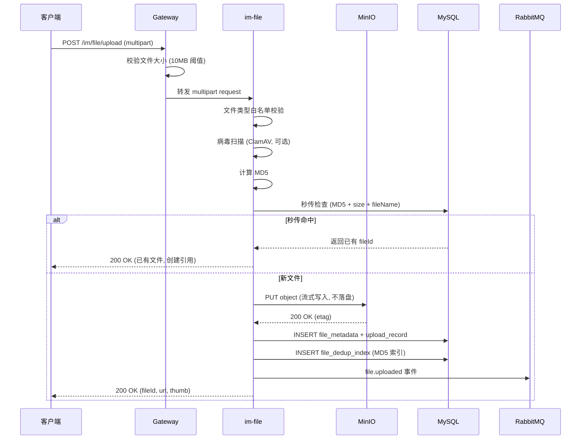
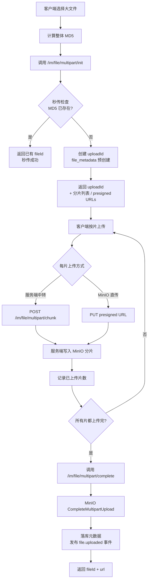
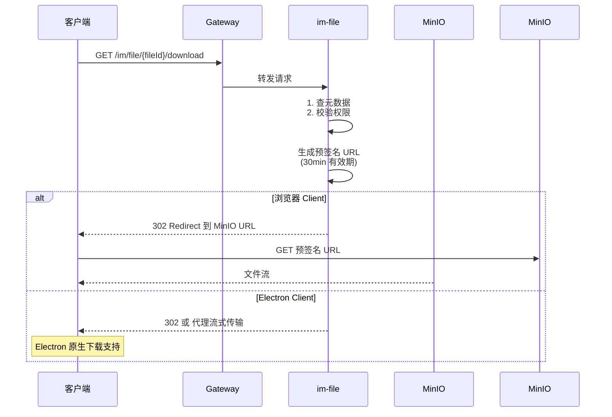
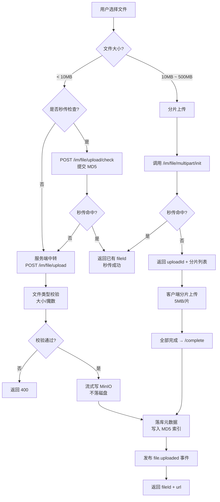

# 20 — 文件上传下载完整规范

> 版本: v1.0 | 日期: 2026-10-30 | 作者: 架构组  
> 关联: 06-RESTful-API设计.md, 08-中间件与第三方集成.md, 15-RabbitMQ事件总线完整规范.md

---

## 一、文件服务架构总览

### 1.1 存储分层

```text
┌─────────────────────────────────────────────────────┐
│              客户端 (Browser / Electron)              │
│  直传 MinIO: 预签名 PUT URL (大文件/图片)             │
│  服务端中转: 小文件 (< 10MB) / 需要后处理的文件         │
└────────────────┬────────────────────────────────────┘
                 │
                 ▼
┌─────────────────────────────────────────────────────┐
│                   API Gateway                        │
│  文件大小限制校验: 10MB 内直接透传                     │
│  大文件走 presigned URL 直传 (绕过应用服务器)           │
└────────────────┬────────────────────────────────────┘
                 │
                 ▼
┌─────────────────────────────────────────────────────┐
│                 im-file (8088)                       │
│  秒传校验 / 分片编排 / 元数据落库 / 事件发布            │
└────────────────┬────────────────────────────────────┘
                 │
                 ▼
┌─────────────────────────────────────────────────────┐
│               MinIO Cluster (S3 兼容)                 │
│  Bucket: im-chat-image   (聊天图片, 多副本)            │
│  Bucket: im-chat-file    (聊天文件, EC 纠删码)         │
│  Bucket: im-avatar       (用户头像, CDN 加速)          │
│  Bucket: im-voice        (语音, 低频访问)              │
│  Bucket: im-doc          (协作文档, 多版本)             │
└─────────────────────────────────────────────────────┘
                 │
                 ▼
┌─────────────────────────────────────────────────────┐
│            MySQL im_file 库                          │
│  文件元数据 / 分片记录 / 秒传索引 (MD5 → fileId)       │
└─────────────────────────────────────────────────────┘
```

### 1.2 Bucket 策略

| Bucket | 用途 | 单文件上限 | 访问策略 | 生命周期 |
|--------|------|-----------|---------|---------|
| im-chat-image | 聊天图片 | 20MB | 读私有, 写认证 | 永久 |
| im-chat-file | 聊天文件 (pdf/zip/doc) | 500MB | 读私有, 写认证 | 永久 |
| im-avatar | 用户头像 | 2MB | 公开读 | 永久 |
| im-voice | 语音消息 | 10MB | 读私有 | 永久 |
| im-temp | 分片上传临时区 | 5GB | 写认证 | 7d 自动清理 |

> **上传限制**: 单文件最大 100MB；分片上传最小 5MB 才触发分片；每用户每日上传总量 2GB；超过返回 413。

---

## 二、普通上传 (< 10MB)

### 2.1 流程时序



### 2.2 上传接口

```java
@RestController
@RequestMapping("/im/file")
@RequiredArgsConstructor
@Tag(name = "文件管理")
public class FileController {

    private final FileApplicationService fileService;

    /**
     * 普通上传 (< 10MB) — 服务端中转模式
     */
    @PostMapping("/upload")
    public Result<FileUploadVO> upload(
            @RequestParam("file") MultipartFile file,
            @RequestParam(value = "convId", required = false) Long convId,
            @CurrentUser Long userId) {
        String fileType = detectFileType(file.getContentType(), file.getOriginalFilename());
        UploadFileCommand cmd = new UploadFileCommand(file, fileType, convId, userId);
        return Result.success(fileService.upload(cmd));
    }

    /**
     * 秒传预检 (轻量接口, 不上传实际数据)
     */
    @PostMapping("/upload/check")
    public Result<FileCheckVO> checkExists(
            @Valid @RequestBody FileCheckRequest request,
            @CurrentUser Long userId) {
        return Result.success(fileService.checkDedup(request.getMd5(), request.getFileSize(), userId));
    }
}
```

### 2.3 秒传校验逻辑

```java
@Service
public class FileApplicationService {

    /**
     * 秒传: 客户端先上传前计算 MD5 → 后端查已有文件 → 命中则秒传成功
     */
    public FileCheckVO checkDedup(String md5, Long fileSize, Long userId) {
        // 1. 查找去重索引
        FileDedupIndexEntity dedup = dedupMapper.selectByMd5AndSize(md5, fileSize);

        if (dedup != null) {
            // 秒传命中: 已有该文件, 直接创建引用
            FileMetadataEntity existingMeta = fileMetaMapper.selectById(dedup.getFileId());
            // 创建一条新的 file_upload_record (关联已有 file)
            FileUploadRecordEntity record = new FileUploadRecordEntity();
            record.setFileId(dedup.getFileId());
            record.setUserId(userId);
            record.setUploadType("DEDUP");
            record.setCreateTime(LocalDateTime.now());
            uploadRecordMapper.insert(record);

            // 返回已有文件信息
            return FileCheckVO.builder()
                .exists(true)
                .fileId(dedup.getFileId())
                .url(generatePresignedUrl(existingMeta.getBucket(), existingMeta.getObjectKey()))
                .build();
        }

        return FileCheckVO.builder().exists(false).build();
    }
}
```

### 2.4 文件类型检测

```java
@Component
public class FileTypeDetector {

    private static final Map<String, String> MIME_TO_TYPE = Map.ofEntries(
        Map.entry("image/jpeg", "IMAGE"),
        Map.entry("image/png", "IMAGE"),
        Map.entry("image/gif", "IMAGE"),
        Map.entry("image/webp", "IMAGE"),
        Map.entry("application/pdf", "FILE"),
        Map.entry("application/zip", "FILE"),
        Map.entry("application/msword", "FILE"),
        Map.entry("application/vnd.openxmlformats-officedocument.wordprocessingml.document", "FILE"),
        Map.entry("application/vnd.ms-excel", "FILE"),
        Map.entry("application/vnd.openxmlformats-officedocument.spreadsheetml.sheet", "FILE"),
        Map.entry("audio/mpeg", "VOICE"),
        Map.entry("video/mp4", "VIDEO")
    );

    // 文件魔数白名单 (防止伪造扩展名)
    private static final Map<String, byte[]> MAGIC_NUMBERS = Map.ofEntries(
        Map.entry("image/jpeg", new byte[]{(byte) 0xFF, (byte) 0xD8, (byte) 0xFF}),
        Map.entry("image/png", new byte[]{(byte) 0x89, 0x50, 0x4E, 0x47}),
        Map.entry("image/gif", new byte[]{0x47, 0x49, 0x46, 0x38}),
        Map.entry("image/webp", new byte[]{0x52, 0x49, 0x46, 0x46}),  // "RIFF" 开头
        Map.entry("application/pdf", new byte[]{0x25, 0x50, 0x44, 0x46})  // "%PDF"
    );

    /**
     * 通过 MIME + 魔数双重校验, 拒绝伪造文件
     */
    public ValidationResult validate(MultipartFile file) {
        // 1. MIME 检查
        String mimeType = file.getContentType();
        if (!MIME_TO_TYPE.containsKey(mimeType)) {
            return ValidationResult.rejected("不支持的文件类型: " + mimeType);
        }

        // 2. 魔数校验
        try {
            byte[] header = file.getBytes();  // Spring 已写入临时目录
            if (header.length >= 4) {
                byte[] magic = MAGIC_NUMBERS.get(mimeType);
                if (magic != null && !Arrays.equals(Arrays.copyOf(header, magic.length), magic)) {
                    return ValidationResult.rejected("文件类型与内容不一致, 可能伪造扩展名");
                }
            }
        } catch (IOException e) {
            return ValidationResult.rejected("无法读取文件头: " + e.getMessage());
        }

        return ValidationResult.passed();
    }
}
```

---

## 三、分片上传 (10MB ~ 500MB)

### 3.1 分片上传流程



### 3.2 分片上传接口

```java
@PostMapping("/multipart/init")
public Result<MultipartInitVO> initMultipart(
        @Valid @RequestBody MultipartInitRequest request,
        @CurrentUser Long userId) {
    return Result.success(fileService.initMultipart(request, userId));
}

@PostMapping("/multipart/chunk")
public Result<MultipartChunkVO> uploadChunk(
        @RequestParam("uploadId") String uploadId,
        @RequestParam("chunkIndex") Integer chunkIndex,
        @RequestParam("file") MultipartFile chunk,
        @CurrentUser Long userId) {
    return Result.success(fileService.uploadChunk(uploadId, chunkIndex, chunk, userId));
}

@PostMapping("/multipart/complete")
public Result<FileUploadVO> completeMultipart(
        @Valid @RequestBody MultipartCompleteRequest request,
        @CurrentUser Long userId) {
    return Result.success(fileService.completeMultipart(request, userId));
}

@PostMapping("/multipart/abort")
public Result<Void> abortMultipart(
        @RequestParam("uploadId") String uploadId,
        @CurrentUser Long userId) {
    fileService.abortMultipart(uploadId, userId);
    return Result.success();
}
```

### 3.3 分片上传核心代码

```java
@Service
@RequiredArgsConstructor
public class MultipartFileService {

    private final MinioClient minioClient;
    private final FileMetadataMapper fileMetaMapper;
    private final FileMultipartRecordMapper multipartMapper;

    private static final int CHUNK_SIZE = 5 * 1024 * 1024;  // 5MB/片

    /**
     * 分片预签名 URL DTO (每片一个 PUT URL, 客户端直传 MinIO)
     */
    @Data
    @AllArgsConstructor
    public static class PartPresignedUrl {
        private Integer partNumber;   // 分片序号 (1-based)
        private String presignedUrl;   // 预签名 PUT URL (有效期 1h)
    }

    public MultipartInitVO initMultipart(MultipartInitRequest req, Long userId) {
        // 1. 秒传检查
        FileDedupIndexEntity dedup = dedupMapper.selectByMd5AndSize(req.getMd5(), req.getFileSize());
        if (dedup != null) {
            FileMetadataEntity meta = fileMetaMapper.selectById(dedup.getFileId());
            return MultipartInitVO.dedup(dedup.getFileId(), meta.getUrl());
        }

        // 2. 预创建文件元数据
        String fileId = IdWorker.getIdStr();
        String objectKey = buildObjectKey(fileId, req.getFileName());

        FileMetadataEntity meta = new FileMetadataEntity();
        meta.setFileId(fileId);
        meta.setFileName(req.getFileName());
        meta.setFileSize(req.getFileSize());
        meta.setFileType(req.getFileType());
        meta.setMimeType(req.getMimeType());
        meta.setMd5(req.getMd5());
        meta.setBucket(resolveBucket(req.getFileType()));
        meta.setObjectKey(objectKey);
        meta.setUploadStatus("UPLOADING");
        meta.setUserId(userId);
        meta.setCreateTime(LocalDateTime.now());
        fileMetaMapper.insert(meta);

        // 3. 创建 multipart upload (MinIO)
        String uploadId = minioClient.initMultipartUpload(
            InitMultipartUploadArgs.builder()
                .bucket(meta.getBucket())
                .object(objectKey)
                .build()
        );

        // 4. 记录到分片表
        int totalChunks = (int) Math.ceil((double) req.getFileSize() / CHUNK_SIZE);
        FileMultipartRecordEntity record = new FileMultipartRecordEntity();
        record.setUploadId(uploadId);
        record.setFileId(fileId);
        record.setUserId(userId);
        record.setTotalChunks(totalChunks);
        record.setChunkSize(CHUNK_SIZE);
        record.setUploadedChunks(Collections.emptyList());
        record.setCreateTime(LocalDateTime.now());
        multipartMapper.insert(record);

        // 5. 生成每片的 presigned URL (直传模式)
        List<PartPresignedUrl> presignedUrls = new ArrayList<>();
        for (int i = 1; i <= totalChunks; i++) {
            String url = minioClient.getPresignedObjectUrl(
                GetPresignedObjectUrlArgs.builder()
                    .method(Method.PUT)
                    .bucket(meta.getBucket())
                    .object(objectKey)
                    .expiry(3600)           // 1h 有效
                    .extraQueryParams(Map.of(
                        "uploadId", uploadId,
                        "partNumber", String.valueOf(i)
                    ))
                    .build()
            );
            presignedUrls.add(new PartPresignedUrl(i, url));
        }

        return MultipartInitVO.of(uploadId, totalChunks, presignedUrls);
    }

    public FileUploadVO completeMultipart(MultipartCompleteRequest req, Long userId) {
        FileMultipartRecordEntity record = multipartMapper.selectByUploadId(req.getUploadId());

        // 1. 校验所有片都已上传
        if (record.getUploadedChunks().size() != record.getTotalChunks()) {
            throw new BusinessException("分片未全部上传完成, 缺 " +
                (record.getTotalChunks() - record.getUploadedChunks().size()) + " 片");
        }

        // 2. MinIO 合并分片
        List<Part> parts = new ArrayList<>();
        for (int i = 0; i < record.getTotalChunks(); i++) {
            parts.add(new Part(i + 1, null));  // etag 可为空时 MinIO 可合并
        }
        ObjectWriteResponse response = minioClient.completeMultipartUpload(
            CompleteMultipartUploadArgs.builder()
                .bucket(record.getBucket())
                .object(record.getObjectKey())
                .uploadId(req.getUploadId())
                .parts(parts.toArray(new Part[0]))
                .build()
        );

        // 3. 更新元数据状态
        FileMetadataEntity meta = fileMetaMapper.selectById(record.getFileId());
        meta.setUploadStatus("COMPLETED");
        meta.setUploadedAt(LocalDateTime.now());
        if (req.getFileSize() != null) meta.setFileSize(req.getFileSize());
        fileMetaMapper.updateById(meta);

        // 4. 写入秒传索引 (下次使用)
        FileDedupIndexEntity dedup = new FileDedupIndexEntity();
        dedup.setFileId(record.getFileId());
        dedup.setMd5(req.getMd5());
        dedup.setFileSize(req.getFileSize());
        dedupMapper.insert(dedup);

        // 5. 生成访问 URL
        String url = generatePresignedUrl(meta.getBucket(), meta.getObjectKey());

        // 6. 发布事件
        eventPublisher.publish(new FileUploadedEvent(meta.getFileId(), userId, meta.getFileType()));

        return FileUploadVO.from(meta, url);
    }

    public void abortMultipart(String uploadId, Long userId) {
        FileMultipartRecordEntity record = multipartMapper.selectByUploadId(uploadId);
        // 中止 MinIO 上传
        minioClient.abortMultipartUpload(
            AbortMultipartUploadArgs.builder()
                .bucket(record.getBucket())
                .object(record.getObjectKey())
                .uploadId(uploadId)
                .build()
        );
        // 删除元数据和记录
        fileMetaMapper.deleteById(record.getFileId());
        multipartMapper.deleteById(record.getId());
    }
}
```

---

## 四、预签名 URL (直传 / 下载)

### 4.1 生成预签名 URL

```java
@Service
public class PresignedUrlService {

    private final MinioClient minioClient;
    private final FileMetadataMapper fileMetaMapper;

    /**
     * 下载用预签名 URL (有效期 30min)
     */
    public String generateDownloadUrl(String fileId, Long requesterId) {
        FileMetadataEntity meta = fileMetaMapper.selectById(fileId);
        validateAccessPermission(meta, requesterId);

        return minioClient.getPresignedObjectUrl(
            GetPresignedObjectUrlArgs.builder()
                .method(Method.GET)
                .bucket(meta.getBucket())
                .object(meta.getObjectKey())
                .expiry(30 * 60)
                .build()
        );
    }

    /**
     * 上传用预签名 PUT URL (有效期 1h), 绕过应用服务器直传 MinIO
     */
    public PresignedPutVO generateUploadUrl(String fileName, String contentType, Long userId) {
        String fileId = IdWorker.getIdStr();
        String objectKey = buildObjectKey(fileId, fileName);
        String bucket = resolveBucket(contentType);

        String putUrl = minioClient.getPresignedObjectUrl(
            GetPresignedObjectUrlArgs.builder()
                .method(Method.PUT)
                .bucket(bucket)
                .object(objectKey)
                .expiry(3600)
                .build()
        );

        // 异步落库元数据 (客户端上传完成后回调, 或 MQ 延迟确认)
        PresignedPutTask task = new PresignedPutTask(fileId, objectKey, bucket, userId);
        redis.opsForValue().set("presign:pending:" + fileId, task, Duration.ofHours(1));

        return PresignedPutVO.builder()
            .fileId(fileId)
            .uploadUrl(putUrl)
            .objectKey(objectKey)
            .bucket(bucket)
            .expireSeconds(3600)
            .callbackUrl("/im/file/upload/callback")
            .build();
    }

    /**
     * 鉴权: 只有会话参与者才能访问文件
     */
    private void validateAccessPermission(FileMetadataEntity meta, Long requesterId) {
        if (meta.getConvId() != null) {
            // 验证请求者是否在会话中
            boolean isMember = sessionMemberMapper.exists(meta.getConvId(), requesterId);
            if (!isMember) throw new ForbiddenException("您没有权限访问该文件");
        }
    }
}
```

### 4.2 客户端直传回调

```java
/**
 * 客户端上传完成后回调, 服务端校验并落库
 */
@PostMapping("/upload/callback")
public Result<FileUploadVO> uploadCallback(
        @RequestParam("fileId") String fileId,
        @RequestParam("etag") String etag,
        @CurrentUser Long userId) {
    return Result.success(fileService.confirmPresignedUpload(fileId, etag, userId));
}
```

---

## 五、图片处理

### 5.1 缩略图生成

```java
@Component
public class ImageThumbnailProcessor {

    private final MinioClient minioClient;
    private static final int THUMB_WIDTH = 256;
    private static final int THUMB_HEIGHT = 256;

    /**
     * 上传时同步生成缩略图 (小图 < 500KB 直接同步, 大图异步)
     */
    public String generateThumbnail(String bucket, String objectKey) {
        try {
            // 1. 下载原图到内存
            GetObjectResponse obj = minioClient.getObject(
                GetObjectArgs.builder().bucket(bucket).object(objectKey).build());

            // 2. 压缩 (使用 Thumbnailator / imgscalr)
            BufferedImage original = ImageIO.read(obj);
            BufferedImage thumbnail = Thumbnails.of(original)
                .size(THUMB_WIDTH, THUMB_HEIGHT)
                .keepAspectRatio(true)
                .outputQuality(0.85)
                .asBufferedImage();

            // 3. 上传到缩略图路径
            ByteArrayOutputStream baos = new ByteArrayOutputStream();
            ImageIO.write(thumbnail, "jpg", baos);
            String thumbKey = "thumb/" + objectKey;
            minioClient.putObject(
                PutObjectArgs.builder()
                    .bucket(bucket)
                    .object(thumbKey)
                    .stream(new ByteArrayInputStream(baos.toByteArray()),
                           baos.size(), -1)
                    .contentType("image/jpeg")
                    .build()
            );

            return thumbKey;
        } catch (Exception e) {
            log.warn("生成缩略图失败, file={}", objectKey, e);
            return null;
        }
    }

    /**
     * 异步生成缩略图 (通过 RabbitMQ im.file.thumbnail queue)
     */
    @RabbitListener(queues = "im.file.thumbnail")
    public void handleThumbnailRequest(ThumbnailRequest request) {
        String thumbKey = generateThumbnail(request.getBucket(), request.getObjectKey());
        if (thumbKey != null) {
            fileMetaMapper.updateThumbUrl(request.getFileId(),
                generatePresignedUrl(request.getBucket(), thumbKey));
        }
    }
}
```

---

## 六、语音/视频处理

### 6.1 语音转码 (AMR → MP3)

```java
/**
 * 语音消息: 客户端录制 AMR → 上传 → 服务端转 MP3 (异步)
 */
@Service
public class VoiceTranscodeService {

    @RabbitListener(queues = "im.file.voice.transcode")
    public void transcodeVoice(VoiceUploadEvent event) {
        // 1. 从 MinIO 下载 AMR
        // 2. 使用 FFmpeg 转 MP3
        // ffmpeg -i input.amr -ar 16000 -ac 1 output.mp3
        // 3. 上传转码后的 MP3
        // 4. 更新元数据 duration + transcodeKey
    }

    public Integer getAudioDuration(MultipartFile file) {
        // 读取 AMR 帧长计算时长, 或 ffprobe
        try {
            byte[] data = file.getBytes();
            if (data.length > 6 && data[0] == '#' && data[1] == '!') {
                // AMR 文件头: "#!AMR\n"
                int frameCount = (data.length - 6) / 32;  // 粗略估算
                return frameCount * 20 / 1000;           // 每帧 20ms
            }
        } catch (Exception e) {
            log.error("解析语音时长失败", e);
        }
        return 0;
    }
}
```

### 6.2 视频元数据

```java
/**
 * 视频消息: 提取时长/分辨率/首帧封面 (异步)
 */
@Service
public class VideoMetadataService {

    /**
     * ffprobe 提取视频信息
     */
    public VideoMetadata extractVideoMetadata(byte[] videoData) {
        // ffprobe -v quiet -print_format json -show_streams -show_format input.mp4
        return VideoMetadata.builder()
            .duration(185)      // 秒
            .width(1920)
            .height(1080)
            .frameRate(30)
            .codec("h264")
            .thumbnailKey("thumb/video/xxx/frame_0.jpg")
            .build();
    }
}
```

---

## 七、断点续传 (客户端配合)

### 7.1 客户端缓存策略

```text
上传状态存储于 IndexedDB:

Table: file_upload_upload
+----------+----------+---------+---------+-----------+-------------+
| uploadId | fileName | fileSize| fileType| totalChunks| uploadedChunks |
+----------+----------+---------+---------+-----------+-------------+
| xxx-aaa  | test.zip | 1048576 | FILE    | 5         | [0,1,2]     |
+----------+----------+---------+---------+-----------+-------------+

断点续传逻辑:
1. 读取 uploadedChunks 列表
2. 跳过已上传的分片
3. 仅上传缺失的分片
4. 全部完成后调用 complete 接口
```

### 7.2 服务端幂等性

```java
// 分片上传记录使用 uploadId + chunkIndex 作为唯一索引
@TableId(type =IdType.ASSIGN_ID)
public class FileChunkRecord {
    private String uploadId;
    private Integer chunkIndex;
    private String etag;
    private Long chunkSize;
    private LocalDateTime uploadedAt;

    @TableField(fill = FieldFill.INSERT)
    private Integer status;  // 1=已上传 2=已完成 (完成即合并)
}

// 已上传的分片查询 (用于返回断点位置)
public List<Integer> getUploadedChunks(String uploadId) {
    return chunkMapper.selectList(
        new LambdaQueryWrapper<FileChunkRecord>()
            .eq(FileChunkRecord::getUploadId, uploadId)
    ).stream().map(FileChunkRecord::getChunkIndex).sorted().collect(Collectors.toList());
}
```

---

## 八、文件安全策略

### 8.1 访问控制矩阵

| 角色 | 文件权限 | 说明 |
|------|---------|------|
| 文件上传者 | read / delete (自己的) / share | 可删除自己上传的 (24h 内) |
| 同会话成员 | read / download | 所有会话成员可读取 |
| 管理员 | manage_all | 无视会话限制只能查看, 不能下载 |
| 非会话成员 | none | 无权限 |

### 8.2 防盗链 & Referer

```java
// MinIO Bucket Policy: 校验 Referer 白名单
{
    "Version": "2012-10-17",
    "Statement": [
        {
            "Effect": "Allow",
            "Principal": {"AWS": "*"},
            "Action": ["s3:GetObject"],
            "Resource": ["arn:aws:s3:::im-chat-image/*"],
            "Condition": {
                "StringEquals": {
                    "aws:Referer": ["https://im.company.com", "https://localhost:5173"]
                }
            }
        }
    ]
}
```

### 8.3 病毒扫描 (ClamAV)

```java
@Component
public class VirusScanService {

    private final ClamAVClient clamAVClient;

    /**
     * 流式扫描, 不落地磁盘
     */
    public ScanResult scan(byte[] data) {
        try {
            byte[] reply = clamAVClient.scan(data);
            if (clamAVClient.isCleanReply(reply)) {
                return ScanResult.clean();
            }
            return ScanResult.infected("检测到病毒");
        } catch (Exception e) {
            log.error("ClamAV 扫描失败", e);
            // 扫描超时时放行或拒绝 (取决于安全策略)
            return ScanResult.scanFailed();
        }
    }
}
```

---

## 九、文件下载

### 9.1 下载流程



### 9.2 Electron 下载集成

```javascript
// Electron Main Process
ipcMain.handle('file:download', async (event, { fileId, fileName, url }) => {
    const win = BrowserWindow.getFocusedWindow();
    await win.webContents.downloadURL(url);
    // 或自定义下载路径
    // await download(win, url, { directory: 'C:/Downloads', filename: fileName });
});
```

---

## 十、Mermaid 总图

### 10.1 完整上传决策树



### 10.2 文件生命周期

```mermaid
stateDiagram-v2
    [*] --> INIT: 客户端选择文件
    INIT --> UPLOADING: 开始上传
    UPLOADING --> DEDUP: 秒传命中
    UPLOADING --> COMPLETED: 上传完成
    UPLOADING --> FAILED: 上传失败
    COMPLETED --> INDEXED: 元数据落库
    COMPLETED --> THUMBNAIL: 缩略图生成 (图片)
    THUMBNAIL --> INDEXED
    DEDUP --> INDEXED
    INDEXED --> STORED: MinIO 持久化
    STORED --> ACCESSED: 下载/查看
    ACCESSED --> ARCHIVED: 低频 (90d未访问)
    ARCHIVED --> STORED: 再次访问
    ARCHIVED --> DELETED: 用户删除/7d过期(temp)
    FAILED --> UPLOADING: 重试
    note right of STORED: 聊天文件: 永久保存\n临时文件: 7d 过期
```

---

## 十一、变更记录

| 日期 | 变更 |
|------|------|
| 2026-10-30 | 初版: 存储策略/Bucket 规划、普通上传+秒传、分片上传(init/chunk/complete/abort)、预签名 URL 直传下载、图片缩略图、语音转码、断点续传伪代码、安全策略 (访问控制+防盗链+ClamAV) |
