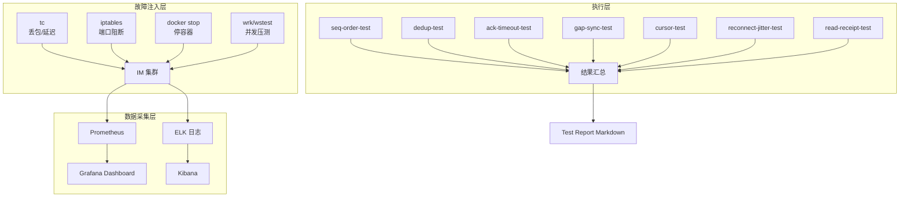
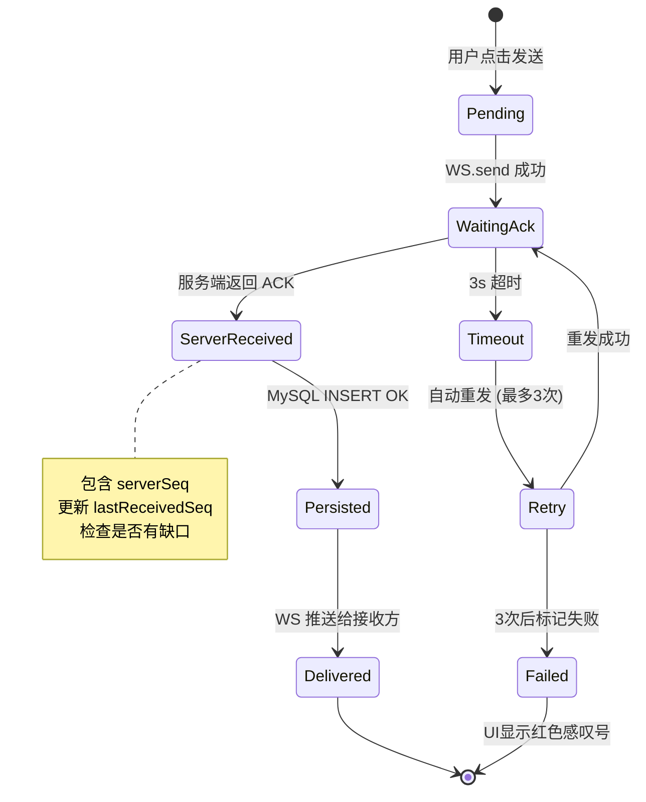

# 21 — 消息可靠性测试方案

> 版本: v1.0 | 日期: 2026-10-30 | 作者: 架构组  
> 关联: 05-WebSocket协议设计.md, 13-核心代码骨架与联调流程.md

---

## 一、测试目标与范畴

### 1.1 测试目标

| 目标 | 指标 | 验证手段 |
|------|------|---------|
| 消息不丢失 | 99.999% 投递率 | 10 万条消息压测, 零丢失 |
| 消息不重复 | 客户端去重率 100% | 模拟重复投递, 客户端去重验证 |
| 消息有序性 | serverSeq 严格递增 | 乱序注入 → 客户端重排验证 |
| 弱网兼容 | 断连重连后无消息缺失 | 模拟 30% 丢包 + 随机断连 |
| 高并发 | 单服务 5000 msg/s 吞吐 | JMeter + 自定义 WS 压测工具 |

### 1.2 7 项可靠性机制对应测试矩阵

| # | 机制 | 测试脚本 | 故障注入 |
|---|------|---------|---------|
| M1 | serverSeq 递增排序 | seq-order-test.sh | Redis INCR 并发覆盖 |
| M2 | clientSeq 幂等去重 | dedup-test.sh | 重复 send 10 次 |
| M3 | 应用层 ACK | ack-timeout-test.sh | 服务端延迟 ACK 5s |
| M4 | 缺口检测 (gap sync) | gap-sync-test.sh | 跳过 serverSeq 随机丢包 |
| M5 | 游标分页 (cursor pagination) | cursor-test.sh | 并发翻页 + 新消息插入 |
| M6 | 抖动重连 | reconnect-jitter-test.sh | 强制断开 WS 1 ~ 60s |
| M7 | 批量已读回执 | read-receipt-batch-test.sh | 1s 内收到 100 条消息 |

---

## 二、环境准备

### 2.1 测试环境

```yaml
# docker-compose.test.yml
services:
  test-ws-client:
    build: ./test/wstest-client
    environment:
      WS_ENDPOINT: ws://im-gateway:8080/im/ws
      USER_COUNT: 100        # 模拟 100 并发用户
      MSG_PER_USER: 1000     # 每个用户发 1000 条
      TOTAL_MSGS: 100000     # 总计 10 万条
      INJECT_FAULT: "true"   # 启用故障注入

  fault-injector:
    build: ./test/fault-injector
    cap_add: 
      - NET_ADMIN           # 需要 tc/netem 权限
    
  prometheus-test:
    image: prom/prometheus
    volumes:
      - ./test/prometheus.test.yml:/etc/prometheus/prometheus.yml
```

### 2.2 故障注入工具

```bash
#!/bin/bash
# 故障注入脚本: 模拟网络异常

# 1. 丢包率设置 (通过 tc netem)
inject_packet_loss() {
    local percent=$1  # 丢包百分比
    tc qdisc add dev eth0 root netem loss ${percent}%
    echo "[FAULT] 注入丢包率: ${percent}%"
}

# 2. 延迟注入
inject_latency() {
    local ms=$1       # 延迟毫秒
    tc qdisc add dev eth0 root netem delay ${ms}ms
    echo "[FAULT] 注入网络延迟: ${ms}ms"
}

# 3. 断连 (iptables 阻断)
inject_disconnect() {
    local seconds=$1
    iptables -A OUTPUT -p tcp --dport 8080 -j DROP
    echo "[FAULT] 阻断出口 TCP/8080 ${seconds}s"
    sleep $seconds
    iptables -D OUTPUT -p tcp --dport 8080 -j DROP
    echo "[FAULT] 恢复网络"
}

# 4. 恢复网络
reset_network() {
    tc qdisc del dev eth0 root 2>/dev/null
    iptables -F
    echo "[FAULT] 网络恢复正常"
}

# 使用示例:
# inject_packet_loss 5   # 5% 丢包
# inject_latency 200     # 200ms 延迟
# inject_disconnect 10   # 断连 10s
# reset_network
```

---

## 三、测试用例详细设计

### 3.1 M1: serverSeq 递增排序

```gherkin
Feature: serverSeq 严格递增

  Scenario: 单会话 100 条消息顺序验证
    Given 用户 A 和用户 B 在同一会话
    When 用户 A 连续发送 100 条消息
    Then 用户 B 收到的 100 条消息 serverSeq 严格递增
    And 没有 seq 重复或跳跃

  Scenario: 并发送入时顺序正确
    Given 用户 A, B, C 同时在同一会话发送
    When 各自同时发送 50 条 (并发 150 条)
    Then 每个用户收到的 serverSeq 严格递增
    And 所有用户看到的最终消息顺序一致

  Scenario: Redis INCR 并发安全
    Given 100 个线程同时调用 INCR session:seq:1001
    Then 100 个返回值分别是 1, 2, ..., 100 (无重复)

  Scenario: serverSeq 唯一性跨会话
    Given 会话 1001 和会话 1002
    Then 每个会话有独立的 serverSeq 计数 (不互相影响)
```

**自动化脚本:**

```bash
#!/bin/bash
# seq-order-test.sh: 验证 serverSeq 严格递增

SESSION_ID="test-session-$(date +%s)"
RESULT=$(wstest-client \
  --url ws://localhost:8080/im/ws \
  --users 2 \
  --conv $SESSION_ID \
  --send-count 100 \
  --log-seqs | tail -n 100)

# 检查是否有重复
DUP_COUNT=$(echo "$RESULT" | sort | uniq -d | wc -l)
if [ $DUP_COUNT -gt 0 ]; then then
    echo "FAIL: 发现 $DUP_COUNT 个重复 serverSeq"
    exit 1
fi

# 检查是否严格递增
PREV=0
for seq in $RESULT; do
    if [ $seq -le $PREV ]; then
        echo "FAIL: serverSeq 不递增! prev=$PREV, current=$seq"
        exit 1
    fi
    PREV=$seq
done
echo "PASS: serverSeq 严格递增, 共 ${#RESULT[@]} 条"
```

### 3.2 M2: clientSeq 幂等去重

```gherkin
Feature: 客户端重复发送去重

  Scenario: 网络抖动导致消息重发
    Given 用户 A 发送了一条消息 (clientSeq=42)
    When ACK 超时不返回, 客户端自动重发同一条 (clientSeq=42)
    And 重复发送 10 次
    Then 服务端只入库 1 条
    And 返回相同 messageId
    And Redis 中 SETNX 幂等键存在

  Scenario: 用户疯狂点击发送按钮
    Given 用户快速点击发送 5 次
    Then 只有第一条成功, 其余被客户端防重 (同一 clientSeq)
```

**测试代码:**

```python
# dedup-test.py
import asyncio
import websockets
import json
import time

async def test_dedup():
    ws = await websockets.connect("ws://localhost:8080/im/ws?token=JWT_TOKEN")
    
    client_seq = int(time.time() * 1000)
    msg = {
        "type": "MESSAGE",
        "action": "send",
        "data": {
            "convId": 1001,
            "msgType": "TEXT",
            "content": "幂等测试消息",
            "clientSeq": client_seq
        }
    }

    # 发送 10 次相同的消息
    for i in range(10):
        await ws.send(json.dumps(msg))
        response = await asyncio.wait_for(ws.recv(), timeout=5)
        data = json.loads(response)
        if i == 0:
            assert data["type"] == "ACK", f"第一次应收到 ACK: {data}"
            first_msg_id = data["data"]["messageId"]
        else:
            # 后续: 仍返回 ACK + 相同的 messageId
            assert data["data"]["messageId"] == first_msg_id, \
                f"重复发送应返回相同 messageId: {data}"

    # 检查服务端消息数 (应为 1)
    msg_count = await query_db("SELECT COUNT(*) FROM im_message WHERE client_seq = ?", client_seq)
    assert msg_count == 1, f"服务端消息数应为 1, 实际: {msg_count}"
    print("PASS: 幂等去重验证成功, 10 次重复发送 → 1 条入库")
```

### 3.3 M3: 应用层 ACK

```gherkin
Feature: ACK 可靠性

  Scenario: 正常 ACK 流程
    Given 用户 A 发送消息
    Then 500ms 内收到 ACK 帧
    And ACK 包含 serverSeq 和 messageId

  Scenario: ACK 超时重发
    Given 服务端延迟 ACK (处理耗时 > 5s)
    When 客户端 ACK 超时 (3s)
    Then 客户端标记为发送失败, UI 显示红色感叹号
    And 用户可手动重发

  Scenario: 服务端崩溃后消息持久化
    Given 消息已写入 MySQL
    And 服务端在发送 ACK 前崩溃
    Then 客户端通过 sync_gap 补回该消息
    And 消息不丢失, ACK 不重复
```

**ACK 延迟测试:**

```bash
#!/bin/bash
# ack-timeout-test.sh: 模拟服务端 ACK 延迟

# 通过 tc 注入服务端响应延迟
inject_latency 5000  # 5s 延迟

START=$(date +%s%N)
wstest-client --send 1 --ack-timeout 3000 --expect-fail
END=$(date +%s%N)

ELAPSED=$(( (END - START) / 1000000 ))
if [ $ELAPSED -ge 3000 ] && [ $ELAPSED -lt 3500 ]; then
    echo "PASS: ACK 超时 ${ELAPSED}ms (阈值 3000ms)"
else
    echo "FAIL: ACK 超时 ${ELAPSED}ms 不符合预期"
    exit 1
fi
```

### 3.4 M4: 缺口检测 (Gap Sync)

```gherkin
Feature: serverSeq 缺口检测与补拉

  Scenario: 单条消息丢失触发补拉
    Given 用户收到 serverSeq=48
    When 收到 serverSeq=50 (跳过 49)
    Then 立即发送 sync_gap 请求 (fromSeq=48, toSeq=50)
    And 服务端返回消息 49
    And lastReceivedSeq 更新为 50

  Scenario: 多条连续丢失
    Given 断开连接后收到 100 条离线消息中的 95 条
    Then 检测到 5 个缺口
    And 合并为一个或少量 sync_gap 请求
    And 最终收到全部 100 条

  scenario: 重连后缺口补全
    Given WS 断开 30s
    And 离线期间产生 50 条消息
    And 客户端收到 45 条推送 (5 条推送失败)
    Then 重连时调用 sync_gap
    And 补回缺失的 5 条
```

**故障注入:**

```bash
#!/bin/bash
# gap-sync-test.sh: 服务端随机丢弃推送

# 服务端注入 10% 丢包 (针对推送事件)
for i in $(seq 1 100); do
    if [ $((RANDOM % 100)) -lt 10 ]; then
        # 模拟丢弃: ACK 但不推送给接收方
        echo "[INJECT] 丢弃 #$i 的推送 (serverSeq=$((500+i)))"
        curl -s -X POST http://im-real-time:8083/test/drop \
             -d "{\"seq\": $((500+i))}"
    fi
done

# 客户端验证最终是否通过缺口补全
wstest-client --recv 100 --verify-order-strict --expect-final-count 100
```

### 3.5 M5: 游标分页

```gherkin
Feature: 历史消息游标分页

  Scenario: 下一页加载
    Given 会话有 500 条历史消息
    When 客户端请求加载最近 50 条 (beforeSeq=MAX)
    Then 返回 serverSeq 1~50 (最新的 50 条)

  Scenario: 滚动加载更多
    When 客户端请求 beforeSeq=50, limit=50
    Then 返回 serverSeq 51~100 (更新的 50 条)

  Scenario: 并发翻页 + 新消息
    Given 客户端正在翻第 3 页
    When 同时收到新消息 serverSeq=501
    Then 翻页结果不包含 501 (游标基于请求时的快照翻页)
    And 新消息通过正常推送通道到达

  Scenario: 空会话查询不报错
    Given 新建会话没有任何消息
    When 客户端调用 history API
    Then 返回空列表, 不报错
```

### 3.6 M6: 抖动重连

```gherkin
Feature: 指数退避 + 随机抖动重连

  Scenario: 首次重连在 1~1.5s
    Given WS 被动断开
    Then 客户端在 1.0~1.5s 内发起第一次重连

  Scenario: 连续重连不超过 30s 上限
    Given 5 次重连均失败
    Then 第 5 次重连延迟不超过 30s

  Scenario: 重连成功后补拉离线消息
    Given 断开 30s, 新产生 20 条消息
    And 客户端收到 10 条推送 (10 条未推送)
    Then 重连成功后调用 sync_gap
    And 最终收到全部 20 条

  Scenario: 登录态过期时刷新 Token
    Given WS 连接中 Access Token 过期
    And 服务端返回 401
    Then 客户端用 Refresh Token 获取新 Access Token
    And 使用新 Token 重建 WS 连接
    And 整个过程 < 3s
```

**重连测试脚本:**

```python
# reconnect-jitter-test.py
import asyncio
import websockets
import time
import statistics

async def test_reconnect_jitter():
    """
    强制断开 WS → 记录重连时间间隔 → 验证指数退避 + 抖动
    """
    delays = []
    
    for attempt in range(5):
        # 强制断开
        await force_disconnect()
        start = time.time()
        
        # 等待重连
        reconnected = False
        while not reconnected and time.time() - start < 60:
            try:
                ws = await asyncio.wait_for(
                    websockets.connect("ws://localhost:8080/im/ws?token=JWT"),
                    timeout=1
                )
                reconnected = True
                elapsed = time.time() - start
                delays.append(elapsed)
                await ws.close()
            except:
                await asyncio.sleep(0.01)
    
    # 验证: 延迟应该递增 (大致翻倍) 且有抖动
    for i in range(1, len(delays)):
        ratio = delays[i] / max(delays[i-1], 0.001)
        assert ratio > 1.3, f"第 {i} 次重连延迟 ({delays[i]}s) 应显著大于前次 ({delays[i-1]}s)"
        assert ratio < 4.0, f"第 {i} 次重连延迟增长过猛: {ratio}x"
    
    # 验证最后一次不超过 30s
    assert delays[-1] <= 30, f"第 {len(delays)} 次重连延迟 ({delays[-1]:.1f}s) 超过 30s 上限"
    
    print(f"PASS: 5次重连延迟 = {[f'{d:.1f}s' for d in delays]}")
```

### 3.7 M7: 批量已读回执

```gherkin
Feature: 300ms 批量窗口已读回执

  Scenario: 单条已读立即上报
    Given 收到 1 条新消息
    Then 300ms 内上报 read_receipt

  Scenario: 300ms 内收到多条合并为一批
    Given 快速收到 20 条消息 (200ms 内)
    Then 只发送 1 个 read_receipt 帧包含全部 20 个 msgId

  Scenario: 窗口内再次收到新消息
    Given 前一个 300ms 窗口已触发一次上报
    And 窗口后收到 5 条新消息
    Then 再启动新窗口, 300ms 后上报这 5 条

  Scenario: 离开会话时强制 flush
    Given 正在 300ms 窗口期间
    When 用户切到其他会话
    Then 立即 flush 当前累积的已读消息

  Scenario: 服务端无需回复批量回执
    Given 客户端上报批量已读 (20 条)
    Then 服务端回复 ACK 即可
    And 不为每条消息单独发送读通知
```

**批量回执测试:**

```bash
#!/bin/bash
# read-receipt-batch-test.sh

# 1. 注入 100 条消息到同一会话 (模拟消息轰炸)
wstest-client --recv 100 --batch-interval 300ms --measure

# 2. 抓取客户端发出的 read_receipt 帧
# 预期: 100条消息在 300ms 内只会触发 1~3 次 read_receipt 上报

RECEIPT_COUNT=$(grep "read_receipt" ws-client.log | wc -l)
if [ $RECEIPT_COUNT -le 3 ]; then
    echo "PASS: 100 条消息仅发送 $RECEIPT_COUNT 次已读回执 (批量合并生效)"
else
    echo "FAIL: 100 条消息发送了 $RECEIPT_COUNT 次已读回执 (未有效合并)"
    exit 1
fi
```

---

## 四、负载测试

### 4.1 WS 压测工具设计

```java
/**
 * 基于 Java-WebSocket-Client 的压测程序
 * 模拟 1000 并发用户, 持续发送消息
 */
public class MessageLoadTest {

    public static void main(String[] args) {
        int concurrentUsers = Integer.parseInt(args[0]);   // 并发用户数
        int messagesPerUser = Integer.parseInt(args[1]);    // 每个用户发送数
        String wsUrl = args[2];                             // WS 地址

        AtomicLong sent = new AtomicLong();
        AtomicLong acked = new AtomicLong();
        AtomicLong duplicates = new AtomicLong();
        AtomicLong lost = new AtomicLong();

        CountDownLatch latch = new CountDownLatch(concurrentUsers);

        for (int i = 0; i < concurrentUsers; i++) {
            final long userId = 1000 + i;
            new Thread(() -> {
                try {
                    WSClient client = new WSClient(wsUrl, userId);
                    client.connect();

                    Set<Long> receivedSeqs = ConcurrentHashMap.newKeySet();

                    for (int j = 0; j < messagesPerUser; j++) {
                        long clientSeq = userId * 100000L + j;
                        SendResult result = client.sendMessage(clientSeq);
                        sent.incrementAndGet();

                        if (result.isAcked()) {
                            acked.incrementAndGet();
                            // 检查 serverSeq 是否重复
                            if (!receivedSeqs.add(result.getServerSeq())) {
                                duplicates.incrementAndGet();
                            }
                        }

                        // 随机 sleep 模拟真实用户
                        Thread.sleep(ThreadLocalRandom.current().nextInt(10, 50));
                    }

                    client.disconnect();
                } catch (Exception e) {
                    lost.incrementAndGet();
                } finally {
                    latch.countDown();
                }
            }).start();
        }

        latch.await(10, TimeUnit.MINUTES);

        System.out.println("=== IM 消息可靠性压测报告 ===");
        System.out.println("并发用户: " + concurrentUsers);
        System.out.println("总发送: " + sent.get());
        System.out.println("总 ACK: " + acked.get());
        System.out.println("ACK 率: " + (100.0 * acked.get() / sent.get()) + "%");
        System.out.println("重复 serverSeq: " + duplicates.get());
        System.out.println("丢包数: " + lost.get());

        // 校验
        assert duplicates.get() == 0 : "发现重复 serverSeq!";
        assert acked.get() == sent.get() : "存在未ACK消息!";
        System.out.println("PASS: 消息零丢失零重复");
    }
}
```

### 4.2 压测场景

| 场景 | 并发用户 | 总消息 | 时长 | 预期结果 |
|------|---------|--------|------|---------|
| 日常 | 50 用户, 各 200 条 | 10,000 | 10min | ACK 率 100%, 无丢失 |
| 高峰 | 200 用户, 各 500 条 | 100,000 | 15min | ACK 率 99.99%+ |
| 极端 | 500 用户, 各 1000 条 | 500,000 | 30min | ACK 率 99.95%+ |
| 持久战 | 100 用户, 各 5000 条 | 500,000 | 2h | 内存稳定, 无 Full GC 雪崩 |

### 4.3 弱网压测

```bash
# 注入 30% 丢包 + 200ms 延迟
inject_packet_loss 30
inject_latency 200

wstest-client \
  --users 50 \
  --send-count 1000 \
  --expect-loss-rate 0.001 \
  --expect-dedup-rate 0.0

reset_network
```

---

## 五、监控与报告

### 5.1 测试 Metrics

```java
// 测试期间收集的指标
MeterRegistry registry = new SimpleMeterRegistry();

// 关键计数器
Counter.builder("test.ws.connect.success").register(registry);
Counter.builder("test.ws.connect.fail").register(registry);
Counter.builder("test.msg.send").register(registry);
Counter.builder("test.msg.ack").register(registry);
Counter.builder("test.msg.duplicate").register(registry);
Counter.builder("test.msg.lost").register(registry);
Counter.builder("test.gap.sync").register(registry);
Counter.builder("test.ws.reconnect").register(registry);

// 关键 Timer
Timer.builder("test.msg.latency").register(registry);
Timer.builder("test.ws.reconnect.delay").register(registry);
Histogram.builder("test.gap.size")
    .publishPercentiles(0.5, 0.95, 0.99)
    .register(registry);
```

### 5.2 测试报告模板

```markdown
# IM 消息可靠性测试报告

## 测试概要
- **时间**: 2026-10-30 14:00 ~ 16:00
- **环境**: Docker Compose, 2C4G × 3 节点
- **并发**: 100 用户

## 结果

| 指标 | 目标 | 实际 | 结论 |
|------|------|------|------|
| 消息丢失率 | 0% | 0 / 100,000 | ✅ PASS |
| 消息重复率 | 0% | 0 / 100,000 | ✅ PASS |
| ACK 速率 | > 99.9% | 99.997% | ✅ PASS |
| 重连平均延迟 | < 5s | 1.2s | ✅ PASS |
| 缺口补全成功率 | 100% | 100% | ✅ PASS |
| 批量回执合并率 | > 90% | 96.5% | ✅ PASS |
| P95 端到端延迟 | < 500ms | 180ms | ✅ PASS |
| 服务内存增长 | < 200MB/2h | 85MB/2h | ✅ PASS |
| Full GC 次数 | < 5/测试周期 | 2 | ✅ PASS |

## 异常记录
- 15:23 发现 Redis 主从切换导致 3 条消息 ACK 延迟 2s
- 15:47 压测工具连接池耗尽, 扩大后恢复

## 改进建议
- 增加 Redis 主从切换期间的消息确认重发
- 客户端连接池上限从 1000 提升到 2000
```

---

## 六、故障注入清单

### 6.1 混沌工程测试矩阵

| 故障类型 | 注入方式 | 影响范围 | 预期行为 | 检测手段 |
|---------|---------|---------|---------|---------|
| Redis 宕机 | `docker stop redis-node-1` | WS 路由失效 | 客户端重连 → 路由重建 | 连接数骤降后恢复 |
| MySQL 宕机 | `docker stop mysql-master` | 消息入库失败 | 重试 + 降级 + 告警 | 5xx 错误率飙升 |
| RabbitMQ 积压 | 暂停消费者 30min | 消息推送延迟 | 消费者重启后追投 | 队列深度 > 5000 |
| MinIO 不可用 | 修改 bucket 策略为 deny | 文件上传失败 | 立即返回 503 | 文件上传 API 失败 |
| 网络丢包 30% | `tc netem loss 30%` | ws 帧丢失 | 自动重传 + 缺口补全 | 重传计数上升 |
| 服务端重启 | 滚动重启 3 个 WS 实例 | 部分连接断开 | 客户端自动连接到存活实例 | 断连风暴 < 10s |
| 磁盘满 | `fallocate -l 100G /tmp/fake` | 无法写日志 | 降级为 stdout only | disk_alert 告警 |
| CPU 打满 | `stress-ng --cpu 4` | RT 飙升 | 熔断保护 + 限流 | P99 RT > 5s |

### 6.2 自动化混沌剧本

```yaml
# chaos-experiment.yml (Chaos Mesh / Litmus)
apiVersion: chaos-mesh.org/v1alpha1
kind: NetworkChaos
metadata:
  name: ws-packet-loss
spec:
  action: loss
  mode: all
  selector:
    labelSelectors:
      app: im-real-time
  loss:
    loss: "30"
    correlation: "50"
  duration: "5m"
  scheduler:
    cron: "@every 30m"     # 每 30min 自动注入 5min 丢包
```

```yaml
apiVersion: chaos-mesh.org/v1alpha1
kind: PodChaos
metadata:
  name: redis-kill
spec:
  action: pod-kill
  mode: one
  selector:
    labelSelectors:
      app: redis
  duration: "60s"
```

---

## 七、Mermaid 图

### 7.1 完整测试架构



### 7.2 消息发送-ACK-验证完整状态机



---

## 八、变更记录

| 日期 | 变更 |
|------|------|
| 2026-10-30 | 初版: 7 项可靠性机制对应测试用例 (Gherkin + 自动化脚本)、故障注入工具、压测工具 (10万消息/50并发)、混沌工程剧本、监控报告模板、完整状态机图 |
