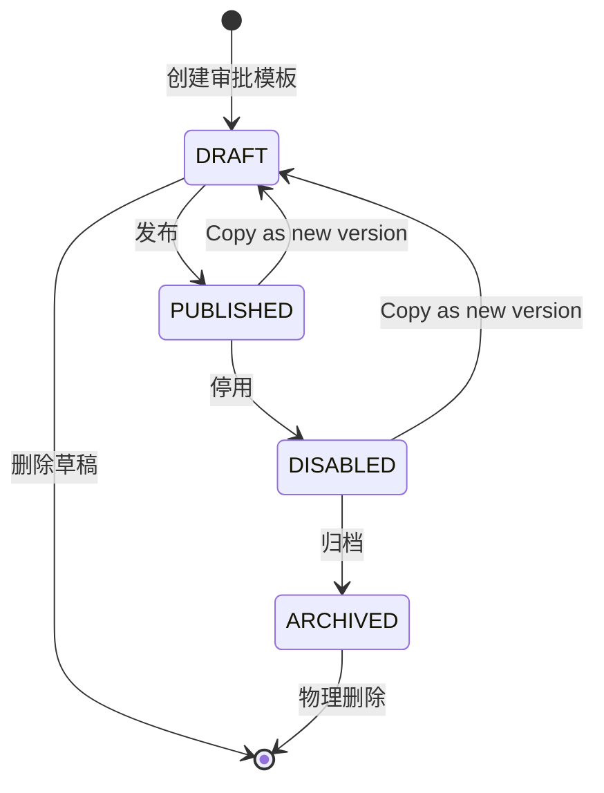

# 09 协同办公需求

> **定位**：通讯录、群组（用户侧）、DING 消息、消息收藏、日历、待办、审批、云盘/文档 —— 围绕 IM 外延的协同能力。
> **更新时间**：2026-10-27
> **基线对齐**：钉钉 Windows 客户端 8.2.0
> **管理后台需求**：见 `10-平台模块与管理后台需求.md`

---

## 一、通讯录（Contacts）

### 1.1 功能目标

- 快速查找成员、部门、群组
- 从通讯录直接发起会话
- 管理好友关系

### 1.2 页面布局

```
┌─────────────────────────────────────────────────────────────┐
│  搜索框（搜索成员/部门/群组）                                  │
├─────────────────────────────────────────────────────────────┤
│  Tab切换: [组织架构] [我的群组] [常用联系人] [外部联系人]        │
├──────────────────────┬──────────────────────────────────────┤
│  左侧树形区域         │  右侧详情区域                         │
│  ┌────────────────┐  │  ┌────────────────────────────────┐  │
│  │ 📁 总公司       │  │  │ 成员/群组详情                   │  │
│  │  📁 技术部      │  │  │ 头像 + 名称                     │  │
│  │   👤 张三       │  │  │ 部门/职位/在线状态              │  │
│  │   👤 李四       │  │  │ 手机/邮箱                       │  │
│  │  📁 产品部      │  │  │ [发消息] [语音通话] [视频通话]   │  │
│  └────────────────┘  │  └────────────────────────────────┘  │
└──────────────────────┴──────────────────────────────────────┘
```

### 1.3 需求清单

| 编号 | 需求 | 说明 | 状态 |
|------|------|------|------|
| CO-C-001 | 组织架构展示 | 按部门无限级树形展示，点击部门异步加载成员 | ✅ |
| CO-C-002 | 部门成员列表 | 查看部门下所有成员 | ✅ |
| CO-C-003 | 成员搜索 | 按姓名/手机号搜索成员 | ✅ |
| CO-C-004 | 成员详情查看 | 右侧详情面板：头像、部门、职位、在线状态、联系方式 | ✅ |
| CO-C-005 | 从通讯录发起会话 | 点击 `发消息` 直接进入单聊 | ✅ |
| CO-C-006 | 群组列表 | 查看已加入的所有群组 | ✅ |
| CO-C-007 | 常用联系人 | 按联系频率自动排序 | ✅ |
| CO-C-008 | 外部联系人 | 管理企业外联系人 | ✅ |
| CO-C-009 | 个人资料卡 | 点击头像展开个人卡片（UserProfileDialog） | ✅ |
| CO-C-010 | 好友管理 | 添加好友、删除好友、好友请求审批 | ✅ |

### 1.4 验收标准

- AC1：组织架构加载后显示完整的部门树结构
- AC2：搜索结果包含精确匹配 + 模糊匹配
- AC3：从详情面板点击 `发消息` 跳转到新会话
- AC4：常用联系人按最近联系时间排序

---

## 二、群组管理（用户侧）

### 2.1 功能目标

从用户视角管理群组（建群、群设置、退群），区别于 `10-平台模块` 中的管理员强制管控。

### 2.2 需求清单

| 编号 | 需求 | 说明 | 状态 |
|------|------|------|------|
| CO-G-001 | 创建群组 | 搜索成员（≥2人） → 设置群名称 → 创建 | ✅ |
| CO-G-002 | 群信息展示 | 群名、头像、群号、创建时间、群描述 | ✅ |
| CO-G-003 | 群成员管理 | 邀请/移除成员、搜索成员列表 | ✅ |
| CO-G-004 | 群主转让 | 群主权限转让给指定成员 | ✅ |
| CO-G-005 | 群禁言 | 群主/管理员设置全员或个人禁言 | ✅ |
| CO-G-006 | 群公告 | 发布、编辑、删除群公告 | ✅ |
| CO-G-007 | 退出/解散群 | 成员退出 or 群主解散 | ✅ |
| CO-G-008 | 群二维码 | 生成二维码扫码进群 | ✅ |
| CO-G-009 | 群文件面板 | ChatDetailDrawer 内独立 Tab 显示群文件 | ✅ |
| CO-G-010 | 个人备注 | 设置群内显示名称（自己可见） | ✅ |

### 2.3 群详情入口红线

> **C-005**：客户端群详情必须统一使用**右侧抽屉**（`ChatDetailDrawer`），禁止新增并行弹窗入口。

### 2.4 验收标准

- AC1：群组创建 ≤ 3 步
- AC2：群主可转让，转让需二次确认
- AC3：群公告修改后全员可见更新
- AC4：群文件面板可按类型（图片/视频/文档/其他）筛选

---

## 三、群文件

### 3.1 需求清单

| 编号 | 需求 | 说明 | 状态 |
|------|------|------|------|
| CO-F-001 | 群文件列表 | 展示群内所有上传文件，按上传时间排序 | ✅ |
| CO-F-002 | 文件分类浏览 | 按图片/视频/文档/其他分类查看 | ✅ |
| CO-F-003 | 文件上传下载 | 支持断点续传，进度可见 | ✅ |
| CO-F-004 | 文件搜索 | 按文件名搜索群文件 | ✅ |
| CO-F-005 | 文件删除 | 群主/管理员可删除任意文件 | ✅ |
| CO-F-006 | 批量操作 | 多选文件批量删除 | ✅ |

---

## 四、DING 消息

### 4.1 需求清单

| 编号 | 需求 | 说明 | 状态 |
|------|------|------|------|
| CO-D-001 | 发送 DING | 选择接收人（可多人）→ 填写内容 → 选择提醒方式 → 发送 | ✅ |
| CO-D-002 | DING 确认 | 接收方点击确认回执 | ✅ |
| CO-D-003 | DING 统计 | 发送方查看确认进度（已送达/已确认/未确认） | ✅ |
| CO-D-004 | DING 历史 | Tab: [收到的 DING] [我发送的 DING] | ✅ |
| CO-D-005 | DING 限制 | 每人每天最多发送 10 条 DING | ✅ |

### 4.2 发送规则

| 项 | 规范 |
|----|------|
| 对话框宽度 | 520px |
| 字段 | 接收人（可多人）、消息内容、提醒方式（**仅应用内**） |
| 每人每天限额 | 10 条 |
| 确认回执 | 接收方端内点击确认 |

> ⚠️ **决策（2026-10-27）**：内网无短信网关与电话线路，**短信 / 电话提醒方式本期不做**，仅保留"应用内"提醒。外部提醒能力预留 `NotifyProvider` 适配器（见 `18` 第五节）。

#### DING 超时升级机制 (补充)

> deadline 到期后: 若 ack_count < total_count，DING 状态变为 EXPIRED。
> EXPIRED DING 自动发送到群聊"@未确认人员的提醒"。
> 每 30 分钟升级一次提醒（最多 3 次），超过 3 次不再提醒。

### 4.3 验收标准

- AC1：DING 发送后接收方立即收到强提醒
- AC2：接收方确认后发送方实时更新确认统计
- AC3：超过 10 条/天提示"今日 DING 额度已用完"

---

## 五、消息收藏（Favorites）

### 5.1 页面布局

```
┌─────────────────────────────────────────────────────────────┐
│  我的收藏                                   [管理分类]        │
├──────────────────────┬──────────────────────────────────────┤
│  左侧分类列表         │  右侧收藏内容                         │
│  ┌────────────────┐  │  ┌────────────────────────────────┐  │
│  │ 📁 全部收藏     │  │  │ 张三 | 03-20 14:30              │  │
│  │ 📁 工作相关 (15)│  │  │ 这是最重要的项目需求...         │  │
│  │ 📁 学习资料 (8) │  │  │ [跳转到原消息]                  │  │
│  │ ➕ 新建分类     │  │  ├────────────────────────────────┤  │
│  └────────────────┘  │  │ 李四 | 03-19 10:00              │  │
│                      │  │ 会议纪要：1. 项目进度...        │  │
│                      │  │ [跳转到原消息]                  │  │
│                      │  └────────────────────────────────┘  │
└──────────────────────┴──────────────────────────────────────┘
```

### 5.2 需求清单

| 编号 | 需求 | 说明 | 状态 |
|------|------|------|------|
| CO-S-001 | 收藏消息 | 右键消息气泡 → 收藏（文本/图片/文件/链接） | ✅ |
| CO-S-002 | 收藏列表 | FavoritesPanel 分类查看（全部/工作/学习/自定义） | ✅ |
| CO-S-003 | 收藏跳转 | 点击收藏项跳转到原对话+原消息位置 | ✅ |
| CO-S-004 | 取消收藏 | 右键/详情中移除 | ✅ |
| CO-S-005 | 分类管理 | 创建/编辑/删除分类（前端 localStorage） | ✅ |
| CO-S-006 | 收藏搜索 | 按关键词搜索已收藏内容 | ✅ |

---

## 六、日历模块（Calendar）

### 6.1 需求清单

| 编号 | 需求 | 说明 | 状态 |
|------|------|------|------|
| PL-CA-001 | 日历视图切换 | 月/周视图切换 | ✅ |
| PL-CA-002 | 日程创建 | 新建日程：标题、时间、参与人、提醒、重复规则 | ✅ |
| PL-CA-003 | 日程编辑 | 修改日程信息 | ✅ |
| PL-CA-004 | 日程删除 | 删除已有日程 | ✅ |
| PL-CA-005 | 日程提醒 | 到点推送通知（桌面通知 + 站内） | ✅ |
| PL-CA-006 | 共享日历 | 查看同事的空忙状态 | ✅ |
| PL-CA-007 | 全天日程 | 支持跨天日程渲染 | ✅ |
| PL-CA-008 | 日程颜色 | 按类型区分颜色（工作/会议/个人/提醒） | ✅ |

### 6.2 验收标准

- AC1：日历月视图正确渲染当前月份天数 + 日程标记
- AC2：创建的日程在对应日期显示，点击可查看详情
- AC3：提醒时间到达时触发系统通知

---

## 七、待办模块（Todo）

### 7.1 需求清单

| 编号 | 需求 | 说明 | 状态 |
|------|------|------|------|
| PL-T-001 | 待办列表 | 统一管理个人待办，按状态/优先级排序 | ✅ |
| PL-T-002 | 消息转待办 | 右键消息 → 一键转为待办 | ✅ |
| PL-T-003 | 新建待办 | 标题、截止时间、优先级、描述 | ✅ |
| PL-T-004 | 待办提醒 | 到期前提醒通知 | ✅ |
| PL-T-005 | 批量操作 | 批量完成、批量删除 | ✅ |
| PL-T-006 | 待办分类 | 按工作/个人/学习/其他分类标签 | ✅ |

### 7.2 待办优先级

| 优先级 | 颜色 | 说明 |
|--------|------|------|
| HIGH | 红色 | 高优先级 |
| MEDIUM | 橙色 | 中优先级 |
| LOW | 蓝色 | 低优先级 |

#### 待办到期规则 (补充)

> 到期未完成: 标记为"逾期"（红色文字），自动推送提醒（WS EVENT todo_remind）。
> 连续逾期 3 天自动归档到"已完成"。用户可手动恢复。

---

## 八、审批模块（Approval）

### 8.1 需求清单

| 编号 | 需求 | 说明 | 状态 |
|------|------|------|------|
| PL-A-001 | 审批发起 | 选择模板 → 填写表单（动态 JSON） → 提交 | ✅ |
| PL-A-002 | 我的申请 | 查看已发起审批的状态（待审批/已通过/已拒绝/已撤销） | ✅ |
| PL-A-003 | 待我审批 | 查看待我处理的审批，可审批/驳回 | ✅ |
| PL-A-004 | 审批流程追踪 | 查看当前审批节点、历史审批记录 | ✅ |
| PL-A-005 | 审批通知 | 新审批到达时推送通知 | ✅ |
| PL-A-006 | 抄送审批 | 抄送我的审批可查看但不可审批 | ✅ |
| PL-A-007 | 审批模板管理 | 创建/编辑审批模板（表单设计器） | ✅ |

### 8.2 审批状态

| 状态 | 颜色 | 说明 |
|------|------|------|
| PENDING | 橙色 | 待审批 |
| APPROVED | 绿色 | 已通过 |
| REJECTED | 红色 | 已拒绝 |
| CANCELLED | 灰色 | 已撤销 |

#### 审批模板状态机 (补充)

| 状态 | 值 | 可操作性 |
|------|-----|----------|
| 草稿 | DRAFT | 可编辑、可删除 |
| 已发布 | PUBLISHED | 启动中，可停用 |
| 已停用 | DISABLED | 不可新建审批，已在审批中的继续运行 |
| 已归档 | ARCHIVED | 纯展示，不可编辑（模板历史保留） |

> 状态流转: DRAFT → PUBLISHED → DISABLED → ARCHIVED (单向)。DRAFT 可直接 → ARCHIVED。

#### 审批转交行为 (补充)

> 转交: 当前审批人将审批权责转给新审批人。原审批人中"已签名"意见保留，新审批人继承"待审批"位置。转交后不可撤回。

---

## 九、云盘/文档模块（CloudDrive）

### 9.1 需求清单

> ⚠️ **存储（决策定版）**：云盘文件实体一律存 **MinIO**，库内只存引用；群文件同样适用。详见 `08` §四。
>
> ⚠️ **在线编辑（决策定版）**：Office 文档在线编辑引入 **ONLYOFFICE Docs**（≥9.4），后端签发 JWT、前端嵌入编辑器，编辑后回写 MinIO。走 `OfficeProvider` 适配器，服务不可用时回退为"仅下载/预览"。详见 `08` §七 与 `18` 5.2 节。

| 编号 | 需求 | 说明 | 状态 |
|------|------|------|------|
| PL-C-001 | 文件列表 | 列表/图标视图切换，按修改时间排序 | ✅ |
| PL-C-002 | 文件上传 | 点击上传 + 拖拽上传，支持断点续传 | ✅ |
| PL-C-003 | 文件下载 | 点击下载原文件 | ✅ |
| PL-C-004 | 文件夹管理 | 创建/重命名/移动/删除文件夹 | ✅ |
| PL-C-005 | 文件搜索 | 按文件名搜索 | ✅ |
| PL-C-006 | 文件分享 | 生成分享链接（密码/有效期） | ✅ |
| PL-C-007 | 文件收藏 | 添加收藏夹快速访问 | ✅ |
| PL-C-008 | 回收站 | 删除的文件可在回收站恢复 | ✅ |
| PL-C-009 | 文档在线编辑 | 文本/Markdown **+ Office（docx/xlsx/pptx）**在线编辑 | ✅ |
| PL-C-010 | 文件预览 | 常见格式在线预览（PDF/图片/文本） | ✅ |
| PL-C-011 | 文件版本 | 查看文件历史版本，可回退 | ✅ |
| PL-C-012 | 文件权限 | 设置文件/文件夹分享权限 | ✅ |

### 9.2 快捷键

| 操作 | 快捷键 |
|------|--------|
| 上传 | Ctrl+U |
| 重命名 | F2 |
| 删除 | Delete |

### 9.3 验收标准

- AC1：文件上传进度条显示完整度
- AC2：文件夹层级可无限嵌套
- AC3：回收站内可恢复/彻底删除文件

---

## 十、微交互与协同体验准则

### 10.1 跨模块一致性

1. 所有列表项高度、padding、hover/active/selected 状态统一遵循 Design Tokens
2. 所有抽屉宽度统一 520px（群详情、审批详情等）
3. 所有空状态设计语言统一（64px 图标 + 14px 文案 + 16px 间距）

### 10.2 协同联动规则

| 场景 | 联动行为 |
|------|---------|
| 消息收到审批通知 | 点击跳转审批详情抽屉 |
| 消息一键转待办 | 右键 → 创建待办，回填消息内容 |
| 日历日程到点 | 推送桌面通知 + 站内红点 |
| 待办过期 | 推送提醒 + 列表标红 |
| 群文件上传完成 | 在群聊内发送群文件消息 |

---

## 十一、需求汇总表

| 模块 | 需求数 | 已完成 | 部分完成 | 待开发 |
|------|--------|--------|----------|--------|
| 通讯录 | 10 | 10 | 0 | 0 |
| 群组管理（用户侧） | 10 | 10 | 0 | 0 |
| 群文件 | 6 | 6 | 0 | 0 |
| DING 消息 | 5 | 5 | 0 | 0 |
| 消息收藏 | 6 | 6 | 0 | 0 |
| 日历 | 8 | 8 | 0 | 0 |
| 待办 | 6 | 6 | 0 | 0 |
| 审批 | 7 | 7 | 0 | 0 |
| 云盘/文档 | 12 | 12 | 0 | 0 |
| **合计** | **70** | **70** | **0** | **0** |

---

## 十二、变更记录

| 日期 | 变更内容 |
|------|---------|
| 2026-10-27 | 从历史素材（12-需求清单、13-需求明细、18-平台模块与管理后台需求）重建为新体系 09 文档；聚焦用户侧协同模块，与管理后台(10)分离 |
| 2026-10-27 | 同步 `18-功能范围与技术选型决策`：DING 提醒方式收敛为仅应用内（短信/电话不做，留 `NotifyProvider`）；云盘与群文件存储改 MinIO |
| 2026-10-27 | 云盘在线编辑扩展为**含 Office 文档**，引入 ONLYOFFICE Docs（≥9.4），走 `OfficeProvider` 适配器 |
| 2026-11-07 | P2 修复：F7 追加 doc 08 §17.7 对齐声明；新增 F16 `im_approval_template` Mermaid 状态流转图 |

---

## F8 — 群文件删除权限矩阵（补充 §三 群文件·CO-F-005）

| 操作人 | 可删除范围 | 前置条件 |
|--------|-----------|---------|
| 群主 | 群内任意文件 | 二次确认弹窗 |
| 群管理员 | 群内任意文件 | 二次确认弹窗 |
| 文件上传者本人 | **自己上传的文件**（含已发布状态） | 二次确认弹窗 |
| 普通成员 | 不可删除他人文件 | — |

文件删除前检查：文件正被共享/引用时弹出警告"该文件已被 N 人收藏/引用，确定删除？"

---

## F9 — AI 助手降级与边界（关联 AI 需求 PL-AI）

| 场景 | 前端行为 |
|------|---------|
| 未接入模型服务（/im/ai/status=false） | AI 入口置灰 + tooltip"未接入模型服务"，**不隐藏入口** |
| 模型列表为空（/im/ai/models 返回 []） | 入口置灰 + tooltip"尚未配置可用模型" |
| SSE 流式超时（60s 无响应） | 保留已输出内容，输入框下方显示"生成超时，点击重试"（可选保留部分或重生成） |
| 网络中断（SSE 断开） | 保留已输出内容，气泡标灰提示"⚠ 连接已断开，结果可能不完整"，输入框恢复可输入 |
| 上下文超过 maxTokens | 自动裁剪最早历史消息（保留最近 20 条 + 系统 Prompt），气泡底部标注"**已省略早期对话**" |
| Token 配额耗尽（默认 100 次/人/天） | 提示"今日 AI 额度已用完，请明日再试。可联系管理员调整。" |
| 用户手动中断（点击停止按钮） | 立即停止 SSE 流式，保留已输出内容 |

---

## F10 — 需追加的 API 端点（补充完善 06-RESTful-API设计.md）

以下端点已在业务需求中存在但尚未在 API 设计中补齐：

#### 邮件 MODULE (建议新服务 platform-mail 8093 或并入 im-message 8081)
| 方法 | 路径 | 说明 |
|------|------|------|
| GET | /im/mail/inbox | 收件箱列表（分页+筛选未读/已读/文件夹） |
| GET | /im/mail/{mailId} | 邮件详情 |
| POST | /im/mail/send | 发送邮件 |
| POST | /im/mail/reply | 回复 |
| POST | /im/mail/forward | 转发 |
| PUT | /im/mail/{mailId}/read | 标记已读/未读 |
| DELETE | /im/mail/{mailId} | 逻辑删除邮件 |
| GET | /im/mail/folders | 文件夹列表 |

#### 日历 FREEBUSY (collab-calendar 8086)
| 方法 | 路径 | 说明 |
|------|------|------|
| GET | /im/calendar/freebusy?userIds=...&startTime=...&endTime=... | 查询多用户空忙状态 |

#### 群禁言 (im-group 8083)
| 方法 | 路径 | 说明 |
|------|------|------|
| PUT | /im/group/{groupId}/mute { muted: true/false } | 全员禁言开关 |

#### AI 总结与推荐 (platform-ai 8091)
| 方法 | 路径 | 说明 |
|------|------|------|
| POST | /im/ai/summary | 总结指定上下文对话 |
| GET | /im/ai/recommend | 获取智能推荐动作列表 |

---

## F11 — 审批驳回与重新提交规则（补充 §八 审批）

- 审批被驳回后，发起人可修改表单**重新提交**
- 重新提交后**生成全新审批编号**（原审批记录保留，状态保持 REJECTED）
- 新审批记录关联原审批 ID（`parent_approval_id` 字段，DB 需追加）
- 审批追踪页面显示"基于 #原编号 重新提交"超链接

---

## F12 — 收藏分类存储策略（补充 §五 收藏·CO-S-005）

| 层级 | 存储位置 | 说明 |
|------|---------|------|
| 收藏数据（server-canonical） | 服务端 `im_message_favorite` 表 | 包含 userId、msgId、categoryId、createTime |
| 分类定义 | 服务端 `im_favorite_category` 表 | 包含 id、userId、name、sort |
| 分类排序缓存（client-only） | localStorage | 分类折叠状态、显示顺序等 UI 状态 |
| 分类标签可视化 | localStorage ≤ 200 条 | 仅 UI 偏好（折叠/展开），换设备不丢失关键数据 |

数据迁移策略：若暂不建分类服务器表，则降级方案为——**收藏 ID 列表存服务端，分类标签（≤5 个）存 localStorage**；换设备时收藏数据可读（按"全部"视图），分类配置需重建。

---

## F13 — 工作台快捷应用配置维度（补充 §一 工作台需求 PL-W）

- 快捷应用由**租户管理员统一配置**（per-tenant）
- 所有用户看到相同的应用入口列表（不可 per-user 自定义）
- 管理员配置入口：`管理后台 → 系统配置 → 工作台应用配置`
- REST API：`GET /im/workbench/quick-apps?tenantId={tid}`（ADMIN 可读写，普通用户只读）
- 应用类型：internal（内置模块）/ external（外部链接，在新标签页打开）

---

## F14 — H5/移动端边界（Out of Scope 明示）

本期产品矩阵明确边界：

| 平台 | 状态 | 说明 |
|------|------|------|
| Web 桌面浏览器 | ✅ 主力 | ruoyi-im-web 主站 |
| Windows / macOS / Linux 桌面端 | ✅ Electron 封装 | electron/ 主进程 + electron-builder |
| H5 移动端 Web | ❌ 不做 | 不在本期需求覆盖范围内 |
| 原生 Android App | ❌ 不做 | 不在本期需求覆盖范围内 |
| 原生 iOS App | ❌ 不做 | 不在本期需求覆盖范围内 |

若未来需要移动端，需**独立立项**，不在本需求文档覆盖范围内。

---

## F15 — 常用联系人排序算法（CO-C-007 补充）

| 维度 | 权重 | 说明 |
|------|------|------|
| 最近联系时间 | 0.5 | 归一化到 [0,1]，最近 24h=1.0，30 天=0.0 |
| 联系频次 | 0.3 | 近 30 天消息数归一化 |
| 主动发起 | 0.2 | 用户主动发起的会话权重 ×1.2，被动 ×0.8 |

**缓存策略**: Redis ZSET `im:contact:frequent:{userId}`，TTL 24h，实时更新。
**结果上限**: 最多返回 20 人。
**实时性**: 每次发送消息时更新 ZADD score。

---

## F1 — 审批模板生命周期状态（补充 §八 审批）

| 状态 | 值 | 是否可编辑 | 是否可发布 | 是否可停用 | 是否可物理删除 |
|------|-----|-----------|-----------|-----------|---------------|
| DRAFT（草稿） | 0 | ✅ | ✅ | ❌ | ✅ |
| PUBLISHED（已发布） | 1 | ❌（需新建版本） | ❌ | ✅ | ❌ |
| DISABLED（已停用） | 2 | ❌ | ❌ | ❌ | ✅ |
| ARCHIVED（已归档） | 3 | ❌ | ❌ | ❌ | ✅ |

- **发布**: DRAFT → PUBLISHED，生成新版本号（version+1），产生历史版本记录
- **停用**: PUBLISHED → DISABLED，**已提交的审批实例不受影响，继续走完剩余流程**
- **删除**: DRAFT/DISABLED → 逻辑删除（deleted=1），已 PUBLISHED 的必须先停用再删除
- **回退**: 已发布的模板不可回退为草稿，只能新建版本（COPY → DRAFT）

---

## F2 — 审批实例状态（修正 A2/E1/E2）

| 状态 | 值 | 颜色 Token | 说明 |
|------|-----|-----------|------|
| PENDING | 1 | `var(--dt-warning)` | 待审批（尚未被任何审批人处理） |
| IN_PROGRESS | 2 | `var(--dt-brand)` | 审批中（已有节点通过，流程继续） |
| APPROVED | 3 | `var(--dt-success)` | 已通过（所有节点通过） |
| REJECTED | 4 | `var(--dt-danger)` | 已驳回（任一节点驳回） |
| CANCELLED | 5 | `var(--dt-text-tertiary)` | 已撤回（发起人主动撤回） |

> 数据库 `im_approval.status` TINYINT 同步上述五值；CANCELLED 与"已撤回"统一为"已撤回"（发起人主动行为），不用"已撤销"。

---

## F3 — 审批转交规则（补充 §八 审批）

- **发起人**: 仅当前节点审批人可发起转交
- **转交对象**: 同企业内未被禁用的活跃用户（列表过滤已禁用/离职用户）
- **转交原因**: 必填，≤200 字
- **次数上限**: 同一审批单最多转交 **3 次**（避免无限循环转交）
- **历史保留**: 转交后原审批人意见保留显示在历史节点中，标注"已转交至XXX"
- **结果可见**: 被转交人拒绝/通过后，原审批人仍可在审批追踪中查看

---

## F4 — 消息转待办预填规则（补充 §七 待办·PL-T-002）

| 原消息类型 | 待办标题预填 | 待办描述预填 |
|-----------|-------------|-------------|
| TEXT | 消息文本（截断 60 字） | 完整消息文本 |
| IMAGE | `[图片消息]` | 可选：图片描述/文件名 |
| FILE | 文件名 | 文件类型 + 大小 |
| VOICE | `[语音消息]` | 语音时长 |
| DING | `DING: ${标题}`（截断 60 字） | 完整 DING 内容 |
| LINK | 链接标题/URL | 原 URL |
| SYSTEM | `系统通知: 标题`（截断 60 字） | 原系统通知内容 |

用户可在所有预填内容上编辑后保存。

---

## F5 — 待办提醒时间（补充 §七 待办·PL-T-004）

| 场景 | 提醒时间 |
|------|---------|
| 截止时间有具体时间点（如 14:00） | 截止前 **15 分钟**（用户可配置: 0/5/15/30/60 min） |
| 截止时间仅日期无时间（全天事件） | 当天 **09:00** |
| 未设截止时间 | 不提醒 |
| 逾期未完成 | 每日 **09:00** 追加提醒；持续 **7 天后**自动标记为 `OVERDUE` 并归档 |
| 逾期标记 | 列表项显示红色逾期徽章 + "逾期 N 天"文字 |

---

## F6 — 日历重复规则（补充 §六 日历·PL-CA-002）

采用 **RFC 5545 RRULE 标准子集**，格式：`FREQ=DAILY|WEEKLY|MONTHLY|YEARLY;INTERVAL=n;END-TYPE=END-VALUE`

| 参数 | 取值 | 示例 |
|------|------|------|
| FREQ | DAILY / WEEKLY / MONTHLY / YEARLY | `FREQ=WEEKLY` |
| INTERVAL | 正整数，默认 1 | `INTERVAL=2`（每 2 周） |
| BYDAY | MO,TU,WE,TH,FR,SA,SU（WEEKLY 时可选） | `BYDAY=MO,WE,FR` |
| UNTIL | 截止日期 YYYYMMDD | `UNTIL=20261231` |
| COUNT | 重复次数（与 UNTIL 二选一） | `COUNT=10` |

对重复事件支持 **"编辑本次"** 和 **"编辑系列"** 两种模式；删除同理支持 **"删除本次/本系列/所有未来"** 三选一确认。

---

## F7 — DING 等级与 UI 行为（补充 §四 DING 消息）

| 等级 | 颜色 Token | 通知声 | 是否突破免打扰 | UI 角标 |
|------|-----------|--------|-------------|---------|
| NORMAL | `var(--dt-brand)` (#277EFB) | 标准提示音 | 否 | 蓝色 🔔 |
| IMPORTANT | `var(--dt-warning)` (#FF7D00) | 加强提示音（长声） | 否 | 橙色 🔔! |
| URGENT | `var(--dt-danger)` (#F53F3F) | 持续提示音 + 窗口闪烁 | **是** | 红色 🔔!!! |

- 三级 DING 共享 **10 条/天** 限额（可管理后台按用户级别调整）
- URGENT DING 发送后 **每 2 分钟** 提醒一次（NORMAL/IMPORTANT 每 5 分钟）
- URGENT DING 可突破免打扰设置，但仅限同企业内被授权人使用
- **对齐**: 应用内提醒频率：每 5 分钟一次，最多 3 次（与 doc 08 §17.7 对齐）

---

## F16 — P0/P1 架构补齐（回应 26-辅助功能审查-待办审批工作台.md）

> **来源**：`26-辅助功能审查-待办审批工作台.md`（2026-11-07）指出 PL-T/PL-A/PL-W 三大辅助模块在 DB / API / WS 层存在 4 项 P0 + 6 项 P1 缺口。
> 本节逐项补齐到需求文档层，确保后续架构设计（doc 04/05/06）有明确需求锚点。

### P0 ── 阻断实现，必须立即修复

#### P0-1｜审批模板表 `im_approval_template` 定义（补 PL-A-001/007）

F1 已定义模板生命周期状态与流转，但缺字段级表结构。完整定义如下：

```sql
CREATE TABLE im_approval_template (
    id              BIGINT       NOT NULL AUTO_INCREMENT,
    tenant_id       BIGINT       NOT NULL,
    name            VARCHAR(128) NOT NULL COMMENT '模板名称（如"请假申请"、"费用报销"）',
    category        VARCHAR(64)  NOT NULL DEFAULT '通用' COMMENT '模板分类',
    form_schema     TEXT         NOT NULL COMMENT '动态表单 JSON Schema（字段类型/必填/选项）',
    node_def        TEXT         NOT NULL COMMENT '审批节点定义 JSON 数组（含 node_order / approve_mode / node_type）',
    description     VARCHAR(500) NULL,
    status          TINYINT      NOT NULL DEFAULT 0 COMMENT '0=DRAFT 1=PUBLISHED 2=DISABLED 3=ARCHIVED（见 F1）',
    version         INT          NOT NULL DEFAULT 1 COMMENT '当前版本号',
    creator_id      BIGINT       NOT NULL,
    create_time     DATETIME     NOT NULL DEFAULT CURRENT_TIMESTAMP,
    update_time     DATETIME     NOT NULL DEFAULT CURRENT_TIMESTAMP ON UPDATE CURRENT_TIMESTAMP,
    deleted         TINYINT      NOT NULL DEFAULT 0,
    PRIMARY KEY (id),
    KEY idx_tenant_status (tenant_id, status, deleted)
) COMMENT '审批模板表';
```

配套模板管理 API（已在 F10§F追加端点 未列出的，此处明确补齐）：

| 方法 | 路径 | 说明 |
|------|------|------|
| POST | /im/approval/template | 创建模板（初始 DRAFT） |
| PUT | /im/approval/template/{id} | 编辑草稿模板（DRAFT 状态允许修改） |
| GET | /im/approval/template/{id} | 获取模板详情（含 form_schema / node_def） |
| GET | /im/approval/template/list | 模板列表（可按 status/category 筛选，ADMIN 可读写） |
| PUT | /im/approval/template/{id}/publish | DRAFT → PUBLISHED（生成新版本号） |
| PUT | /im/approval/template/{id}/disable | PUBLISHED → DISABLED |
| DELETE | /im/approval/template/{id} | 逻辑删除（DRAFT/DISABLED 可删，PUBLISHED 需先 disable） |

#### P0-2｜工作台后端定义（补 PL-W-001/002/003）

F13 已定义快捷应用配置维度（per-tenant、`GET /im/workbench/quick-apps`）。补齐数据库与服务归属：

**服务归属**：新增 `workbench` 子模块（挂载于 `platform-user` 8085 下，端口复用），数据库独立 schema `im_workbench`。

```sql
-- 工作台应用池（per-tenant 统一配置）
CREATE TABLE im_workbench_app (
    id              BIGINT       NOT NULL AUTO_INCREMENT,
    tenant_id       BIGINT       NOT NULL,
    name            VARCHAR(64)  NOT NULL,
    icon_url        VARCHAR(256) NULL,
    app_type        TINYINT      NOT NULL DEFAULT 0 COMMENT '0=internal 1=external',
    target_url      VARCHAR(512) NULL COMMENT 'internal=前端路由, external=外部链接',
    sort_order      INT          NOT NULL DEFAULT 0,
    status          TINYINT      NOT NULL DEFAULT 1 COMMENT '0=禁用 1=启用',
    create_time     DATETIME     NOT NULL DEFAULT CURRENT_TIMESTAMP,
    PRIMARY KEY (id),
    KEY idx_tenant_sort (tenant_id, status, sort_order)
) COMMENT '工作台应用配置';

-- 用户常用应用统计（per-user，用于"智能排序"与最近使用）
CREATE TABLE im_workbench_user_app (
    user_id         BIGINT      NOT NULL,
    app_id          BIGINT      NOT NULL,
    use_count       INT         NOT NULL DEFAULT 0,
    last_used       DATETIME    NULL,
    PRIMARY KEY (user_id, app_id)
) COMMENT '用户工作台使用频率';
```

API 清单（Gateway 路由：`GET/POST/DELETE /im/workbench/** → platform-user 8085`）：

| 方法 | 路径 | 说明 |
|------|------|------|
| GET | /im/workbench/apps | 当前租户可用应用列表（按 sort_order 排序） |
| POST | /im/workbench/apps | ADMIN：新增应用 |
| PUT | /im/workbench/apps/{appId} | ADMIN：编辑应用 |
| DELETE | /im/workbench/apps/{appId} | ADMIN：删除应用 |
| POST | /im/workbench/apps/track | 用户点击应用时上报 use_count+1 |
| GET | /im/workbench/search?keyword=`**` | 工作台应用搜索 |

#### P0-3｜考勤打卡架构定义（补 PL-W-004）

完整业务功能，涉及地理位置/Wi-Fi/记录/统计。

**服务归属**：新增 `attendance` 子模块（挂载于 `platform-user` 8085 或独立 8097），数据库独立 schema `im_attendance`。

```sql
CREATE TABLE im_attendance_config (
    id              BIGINT        NOT NULL AUTO_INCREMENT,
    tenant_id       BIGINT        NOT NULL,
    work_start_time TIME          NOT NULL DEFAULT '09:00:00',
    work_end_time   TIME          NOT NULL DEFAULT '18:00:00',
    location_lat    DECIMAL(10,7) NULL COMMENT '打卡地点纬度',
    location_lng    DECIMAL(10,7) NULL COMMENT '打卡地点经度',
    location_radius INT           NOT NULL DEFAULT 200 COMMENT '有效打卡半径（米）',
    wifi_ssid       VARCHAR(64)   NULL COMMENT '允许打卡的 Wi-Fi SSID',
    PRIMARY KEY (id),
    UNIQUE KEY uk_tenant (tenant_id)
) COMMENT '考勤规则配置';

CREATE TABLE im_attendance_record (
    id              BIGINT        NOT NULL AUTO_INCREMENT,
    user_id         BIGINT        NOT NULL,
    tenant_id       BIGINT        NOT NULL,
    clock_date      DATE          NOT NULL,
    clock_in_time   DATETIME      NULL,
    clock_in_type   TINYINT       NULL COMMENT '1=GPS定位 2=Wi-Fi',
    clock_in_lat    DECIMAL(10,7) NULL,
    clock_in_lng    DECIMAL(10,7) NULL,
    clock_out_time  DATETIME      NULL,
    status          TINYINT       NOT NULL DEFAULT 0 COMMENT '0=正常 1=迟到 2=早退 3=缺卡',
    PRIMARY KEY (id),
    UNIQUE KEY uk_user_date (user_id, clock_date)
) COMMENT '打卡记录';
```

API 清单：

| 方法 | 路径 | 说明 |
|------|------|------|
| POST | /im/attendance/clock-in | 上班打卡（携带 GPS/Wi-Fi 信息，服务端判定是否在范围内） |
| POST | /im/attendance/clock-out | 下班打卡 |
| GET | /im/attendance/today | 获取今日打卡状态（是否已打卡/迟到/早退） |
| GET | /im/attendance/month?year=`**`&month=`**` | 月度打卡汇总（正常/迟到/早退/缺卡天数统计） |
| GET | /im/attendance/config | ADMIN：查看考勤配置 |
| PUT | /im/attendance/config | ADMIN：修改考勤配置 |

#### P0-4｜审批通知 WS 帧 `EVENT:approval`（补 PL-A-005）

在 WS 协议（doc 05）中追加以下事件定义：

| EVENT | 方向 | payload | 触发场景 |
|-------|------|---------|---------|
| `approval` | server → client | `{ approvalId, type: "NEW"/"RESULT"/"TRANSFER"/"REMIND", title, initiatorName, approverName?, status? }` | 审批关键节点实时推送 |

**各类 payload 明细**：

| type | 触发条件 | 接收人 | 客户端行为 |
|------|---------|--------|-----------|
| `NEW` | 审批发起时 | 所有节点审批人 | 审批入口红角标 + 浏览器桌面通知 + 声音提示 |
| `RESULT` | 任一节点通过/驳回 | 发起人 | 审批列表状态实时刷新，详情抽屉停留在最新节点 |
| `TRANSFER` | 审批人转交后 | 被转交人 | 待审批列表新增一条 + 红角标 |
| `REMIND` | 审批超时前半小时间隔 | 当前节点审批人 | 与 NEW 行为一致（二级提醒） |

### P1 ── 功能不完整，应在 1-2 周内补齐

#### P1-5｜待办批量操作 API（补 PL-T-005）

参照 `POST /im/session/batch/*` 模式补齐：

| 方法 | 路径 | 请求体 | 说明 |
|------|------|--------|------|
| POST | /im/todo/batch/finish | `{ ids: [todoId...] }` | 批量将待办状态改为 DONE |
| DELETE | /im/todo/batch | `{ ids: [todoId...] }` | 批量删除待办 |
| POST | /im/todo/batch/priority | `{ ids: [...], priority: 0\|1\|2 }` | 批量修改优先级 |

**返回格式**：`{ successCount: N, failCount: 0 }` 或整体失败 `400 Bad Request`。

**前端交互约束**（呼应 doc 13 §6.5 交互路径3）：
- 长按 Ctrl/Cmd 或悬停勾选进入"多选模式"
- 顶部浮现横向操作栏：[完成] [删除] [改优先级▾] [取消]
- 删除需二次确认（含待办标题列表预览）

#### P1-6｜待办提醒表 `im_todo_reminder`（补 PL-T-004）

F5 已定义提醒时间规则，但缺数据库表与 cron 设计：

```sql
CREATE TABLE im_todo_reminder (
    id              BIGINT      NOT NULL AUTO_INCREMENT,
    todo_id         BIGINT      NOT NULL,
    user_id         BIGINT      NOT NULL,
    remind_time     DATETIME    NOT NULL COMMENT '计划推送时间',
    reminded        TINYINT     NOT NULL DEFAULT 0 COMMENT '0=未推送 1=已推送',
    auto_created    TINYINT     NOT NULL DEFAULT 0 COMMENT '0=用户设置 1=系统逾期自动提醒',
    channel         TINYINT     NOT NULL DEFAULT 0 COMMENT '0=站内+WS 1=站内+WS+桌面通知',
    create_time     DATETIME    NOT NULL DEFAULT CURRENT_TIMESTAMP,
    PRIMARY KEY (id),
    KEY idx_remind_scan (remind_time, reminded)
) COMMENT '待办提醒记录';
```

**定时任务设计**：
- cron 每 1 分钟扫描 `WHERE remind_time <= NOW() AND reminded = 0`
- 命中后：推送 WS `EVENT: todo_remind { todoId, title, remindTime }` + 浏览器 Notification API
- 推送成功标记 `reminded=1`

**前端 UI 呼应**（补 doc 13 §6.4 缺失部分）：
- 待办卡片右下角显示提醒图标（🔔）+ 提醒时间文字
- 逾期项自动显示红色"逾期 N 天"徽章
- Toast 提醒格式："⏰ 待办提醒：{title} 将于 15 分钟后到期"

#### P1-7｜抄送审批字段与 API（补 PL-A-006）

**DB 方案**：使用独立子表避免 `im_approval` 主表膨胀：

```sql
CREATE TABLE im_approval_cc (
    id              BIGINT      NOT NULL AUTO_INCREMENT,
    approval_id     BIGINT      NOT NULL,
    user_id         BIGINT      NOT NULL,
    read_time       DATETIME    NULL COMMENT '首次查看时间（用于"是否已读"判定）',
    create_time     DATETIME    NOT NULL DEFAULT CURRENT_TIMESTAMP,
    PRIMARY KEY (id),
    UNIQUE KEY uk_approval_user (approval_id, user_id),
    KEY idx_user_read (user_id, read_time)
) COMMENT '审批抄送记录';
```

**API 扩展**：

| 方法 | 路径 | 说明 |
|------|------|------|
| GET | /im/approval/list?type=cc | 抄送我的审批列表（按 cc.create_time 倒序，含 read_time 用于区分 已读/未读） |
| PUT | /im/approval/{approvalId}/cc-read | 标记抄送已读（填充 read_time） |

**审批详情抽屉中**：抄送人节点显示灰色 ✓（未读）/ 绿色 ✓（已读）二态。

#### P1-8｜`im_approval_node.node_order` 字段（补 PL-A-004）

```sql
ALTER TABLE im_approval_node ADD COLUMN node_order INT NOT NULL DEFAULT 0 COMMENT '节点执行顺序（升序，最小值为0）' AFTER approval_id;
```

> **约束**：插入审批节点时按 `node_order ASC` 排序执行，避免依赖 PK 自增导致顺序不可控。

#### P1-9｜消息转待办 API 契约（补 PL-T-002）

F4 定义了预填规则，此处明确 API 端的复用策略：

**决策**：复用现有 `POST /im/todo`，不新增独立端点。通过 request body 中 `sourceType` 与 `sourceRef` 字段区分。

**请求体扩展**（已有字段基础上新增可选字段）：

```json
{
  "title": "...",          // 必填
  "description": "...",    // 可选
  "priority": 0,           // 可选, 默认 0
  "dueTime": null,         // 可选
  "category": 0,           // 可选, 默认 0（工作）
  "sourceType": "MSG_TRANSFER",  // 新增, 标识来源
  "sourceRef": "sessionId_msgId" // 新增, 唯一关联原始消息
}
```

**前端逻辑**：
1. 右击消息气泡 → 菜单追加"📋 转待办"
2. 根据 F4 预填规则构建 request body
3. 弹出待办编辑弹窗（用户可修改预填内容）
4. 确认后调用 `POST /im/todo`
5. 成功后 Toast："已转为待办" + 跳转链接

#### P1-10｜待办分类体系统一（补 PL-T-006）

**现状矛盾**：
- doc 09 §7.1 PL-T-006 定义："按**工作/个人/学习/其他**分类标签"（业务分类）
- doc 13 §6.2 定义默认导航："全部 / 今天 / 最近7天 / 已完成 / 已过期"（时间筛选视图）

**统一方案：两者并存**

| 维度 | 分类类型 | 存储 | UI 表达 |
|------|---------|------|---------|
| **时间视图**（一级导航） | 系统自动计算 | 不存储，基于 `due_time` 动态判定 | Tab: 全部 \| 今天 \| 最近7天 \| 已完成 \| 已过期 |
| **业务标签**（二级标记） | 用户自定义 | `im_todo_item.category TINYINT`（0=工作 1=个人 2=学习 3=其他） | 卡片右下角色标 + 筛选 chips |

**`im_todo_item` 表追加字段**：

```sql
ALTER TABLE im_todo_item ADD COLUMN category TINYINT NOT NULL DEFAULT 0 COMMENT '业务分类: 0=工作 1=个人 2=学习 3=其他';
```

**颜色映射**（使用 Design Token）：

| category 值 | 显示文字 | 文字颜色 Token | 背景颜色 Token |
|-------------|---------|---------------|---------------|
| 0 | 工作 | `var(--dt-brand)` | `var(--dt-bg-card)` + 品牌蓝边框 |
| 1 | 个人 | `var(--dt-text-secondary)` | `var(--dt-bg-card)` + 灰色边框 |
| 2 | 学习 | `var(--dt-success, #00B42A)` | `var(--dt-bg-card)` + 绿色边框 |
| 3 | 其他 | `var(--dt-text-tertiary)` | `var(--dt-bg-card)` + 浅灰边框 |

**前端交互**：
- 新建/编辑待办弹窗中，新增"业务分类"下拉选择（4 选项）
- 列表顶部 chips 条显示：工作 \| 个人 \| 学习 \| 其他（点击筛选，支持多选）
- 列表中每张待办卡片右下角显示对应分类色标小方块

---

## F17 — 审批模板状态流转图（Mermaid）



> **说明**：此图对应 §八 审批·P0-1 中 `im_approval_template.status` 字段状态机与 F1 模板生命周期定义。
